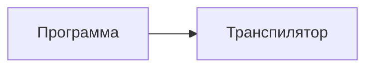

# Интерактивный слой курса

Курс — не только текст: в ключевых уроках модулей 00–03 есть кликабельные
симуляторы, схемы потоков (Mermaid), готовые иллюстрации и анимации. Всё работает **офлайн**,
без внешних CDN-зависимостей для виджетов и без сборки.

## Как это устроено

```text
assets/
├── js/
│   ├── qc-core.js            # общая библиотека: комплексная арифметика, гейты,
│   │                          # вектор состояния, сфера Блоха, отрисовка canvas
│   ├── mermaid-init.js       # запуск схем Mermaid в теме сайта
│   ├── widget-shared.js      # status, reduced-motion и высота дочернего iframe
│   ├── widget-embed.js       # приём высоты на родительской странице
│   └── widget-*.js           # логика конкретных виджетов
├── interactive/              # сами виджеты (HTML-страницы, встраиваются через iframe)
├── styles/interactive.css    # оформление виджетов, схем и иллюстраций
└── figures/                  # статические иллюстрации и анимации (PNG, GIF)
tools/
├── js/qc-core.test.js        # тесты библиотеки: node tools/js/qc-core.test.js
└── make_figures.py           # генератор иллюстраций: python tools/make_figures.py
```

Встраивание в урок выглядит так. Относительный путь зависит от глубины файла:
из `curriculum/<модуль>/<урок>.md` — это `../../assets/...`, из корня
репозитория — `assets/...`:

```html
<iframe class="qc-embed" src="../../assets/interactive/bloch-sphere.html"
        title="Сфера Блоха" height="560" loading="lazy"></iframe>
```

Схема в уроке — обычный блок кода с тегом `mermaid`:

````text

````

## Виджеты

| Виджет | Файл | Что показывает | Где полезен |
|---|---|---|---|
| Сфера Блоха | `assets/interactive/bloch-sphere.html` | состояние одного кубита, действие гейтов X/Y/Z/H/S/T и поворотов Раби, фаза и вероятности измерения | модули 00, 01 |
| Два кубита | `assets/interactive/two-qubit.html` | две сферы Блоха, entangled-состояния, корреляции при измерении | модуль 01 |
| Конструктор схем | `assets/interactive/circuit-playground.html` | сборка схемы кликами, вектор состояния, вероятности и гистограмма измерений | модули 01, 02, 03 |
| Цикл коррекции ошибок | `assets/interactive/qec-cycle.html` | 3-кубитный код: внедрение X-ошибки, измерение синдромов, поиск и исправление | модуль 03 |
| Амплитуды и Гровер | `assets/interactive/grover-amplitude.html` | рост вероятности нахождения отмеченного элемента, интерференция | модули 01, 03 |

Каждый виджет устроен одинаково: панель кнопок, canvas с графикой, текстовый
вывод состояния, сворачиваемый блок «Как читать» и техническая сноска.

> **О порядке разрядов.** Все виджеты следуют [CONVENTIONS.md](CONVENTIONS.md), как Qiskit: кет `|q(n−1)…q0⟩`, `q0` — правый, младший бит; индекс амплитуды равен `Σ bit[q] · 2^q`. Для двух кубитов порядок — `|00⟩, |01⟩, |10⟩, |11⟩`. В QEC исторические имена «кубит 1, 2, 3» соответствуют `q2, q1, q0`; оба имени показаны рядом.

### Доступность и высота iframe

Все пять HTML подключают `widget-shared.js` перед собственным скриптом.
Постоянный `role="status"` сообщает краткий результат действия и счётчики
измерений; подробные численные состояния остаются обычным текстом. Кадры
анимации не переписывают status. При `prefers-reduced-motion: reduce`
«Анимация» Блоха выполняет полный поворот одним действием, «Авто» Гровера —
одну итерацию без таймера. Включение настройки останавливает текущую анимацию.

Для автоматической высоты родительская страница должна подключить
`assets/js/widget-embed.js` через `extra_javascript` в конфигурации сайта.
Дочерний `ResizeObserver` измеряет `.qc-widget`, а не высоту viewport,
и отправляет `{type: 'qc-widget:resize', height: number}`.
При запуске родитель сначала регистрирует получатель, затем отправляет всем
известным подходящим iframe `{type: 'qc-widget:resize-request'}`; запрос
повторяется при загрузке iframe, включая добавленные позднее. Дочерний виджет
проверяет `event.source === parent` и origin (свой HTTP(S) origin либо `null`
только в файловом режиме), после чего повторно сообщает высоту, даже если
она не изменилась. Так поздняя загрузка родительского скрипта не теряет
первый размер и не требует действия пользователя. Получатель принимает
только высоты 100–20000 CSS px от `contentWindow` существующего
`iframe.qc-embed`. На HTTP(S) обязательны одинаковые origin сообщения,
родителя и URL iframe. Origin `null` разрешён только родителю `file://`
для iframe с URL `file://`; дочерний файл использует targetOrigin `*`,
поскольку файловые origin непрозрачны. Работа не требует сети. Без получателя
или JavaScript остаётся исходная фиксированная высота и обычная прокрутка.

## Как встроен в уроки

Раздел `## 🎛 Интерактив` размещается между контентной частью урока и
`## ✅ Проверь себя` (эмодзи в заголовках — по [STYLEGUIDE.md](STYLEGUIDE.md))
и состоит из трёх частей:

1. короткое объяснение, что показывает виджет;
2. сам виджет;
3. блок «Задание» с 2–4 конкретными действиями ученика и ожидаемым результатом.

Задания сформулированы так, чтобы их нельзя было «просмотреть глазами»:
нужно нажать кнопки и получить определённую амплитуду, синдром или вероятность.

Честная карта: раздел есть не в каждом уроке, а в 10 уроках модулей 00–03
(00: уроки 02–03; 01: уроки 01–04; 02: урок 01; 03: уроки 01, 03–04 —
см. таблицу виджетов выше). В остальных уроках интерактивная нагрузка —
таблицы, Mermaid-схемы и иллюстрации; эта же карта продублирована в
[README](README.md) и [PROGRESS](PROGRESS.md).

## Иллюстрации и анимации

`assets/figures/` содержит шесть статических схем и три анимации:

| Файл | Что изображено |
|---|---|
| `bloch-sphere.png` | сфера Блоха с осями, точкой состояния и параметризацией $(\theta, \varphi)$ |
| `phase-circle.png` | окружность фаз с отметками S и T и объяснением ненаблюдаемости глобальной фазы |
| `surface-code-lattice.png` | решётка 3×3 surface code: кубиты данных и плакеты X/Z |
| `coupling-maps.png` | три типа карт связности: линейная цепочка, решётка, heavy-hex (подписано «схематично») |
| `qec-cycle.png` | блок-схема цикла коррекции: измерение синдромов → декодирование → коррекция |
| `grover-iterations.png` | рост вероятности нахождения отмеченного элемента и распределение амплитуд |
| `gif/bloch-rotation.gif` | вращение вектора состояния по сфере |
| `gif/qec-cycle.gif` | цикл коррекции: ошибка → синдромы → исправление |
| `gif/grover-iterations.gif` | рост амплитуд Гровера по итерациям |

Все они перегенерируются одной командой:

```bash
python tools/make_figures.py
```

Иллюстрации со схематичными данными подписаны словом «схематично» — числа,
которые нельзя выдавать за измеренные. Числа, взятые из точной модели
(вероятности Гровера при N = 4, синдромы 3-кубитного кода), проверены
симуляцией и на рисунках подписаны как точные.

## Схемы и формулы на сайте

В `mkdocs.yml` включены расширения `pymdownx.superfences` (с кастомным
fence `mermaid`) и `pymdownx.arithmatex`; подключены `mermaid-init.js`
(перерисовка схем в теме сайта) и MathJax для формул. Схемы пишутся в
уроках обычным блоком кода:

````text

````

## Как добавить свой виджет

1. Создайте `assets/js/widget-<имя>.js`, используя API `window.QC`
   (см. `assets/js/qc-core.js`): `QC.sv.apply1`, `QC.sv.apply2`, `QC.bloch`,
   `QC.draw.sphere`, `QC.draw.bars`, `QC.dom.canvas` и другие.
2. Создайте `assets/interactive/<имя>.html`: подключите
   `../styles/interactive.css`, `../js/qc-core.js`, `../js/widget-shared.js`
   и `../js/widget-<имя>.js`; добавьте постоянный `#widget-status` с `role="status"`.
3. Проверьте синтаксис: `node --check assets/js/widget-<имя>.js`.
4. Вставьте в нужный урок раздел `## 🎛 Интерактив` с **маркером** виджета и ссылкой:

   ```markdown
   <!--qc-embed: <имя>.html | Заголовок виджета | 640-->

   **Интерактив:** [виджет «Заголовок виджета»](https://drdimooon.github.io/qc-design-course/<путь-к-уроку>/#интерактив) · [файл виджета](../../assets/interactive/<имя>.html)
   ```

   Почему так: GitHub не исполняет `<iframe>` и показывает его как код, поэтому в
   исходнике лежит ссылка (её видно и в репозитории), а настоящий `<iframe>`
   подставляет сборщик сайта — `tools/build_site.py` раскрывает маркер
   `<!--qc-embed: … -->` в тег с корректным относительным путём. На сайте
   виджет встраивается как обычно, в репозитории остаётся чистая ссылка.

## Проверка слоя

```bash
node tools/js/qc-core.test.js     # проверки математики библиотеки
node tools/js/qc-playground.test.js
node --check assets/js/widget-*.js
python tools/make_figures.py      # перегенерация иллюстраций
python tools/build_site.py        # сборка сайта в ./site
python tools/test_widgets_browser.py  # отдельная зависимость: Python Playwright + Chromium
```

Браузерные unittest-тесты поднимают временный HTTP-сервер только на
`127.0.0.1` со свободным портом. Они не сохраняют отчёты или скриншоты.
Отсутствие Playwright/Chromium считается ошибкой запуска, а не успешным skip.

Сборка сайта идёт через `tools/build_site.py`: контент лежит в корне
репозитория, а MkDocs требует, чтобы каталог с документами был подчинён
каталогу конфига, поэтому скрипт собирает временную сцену и запускает в ней
`mkdocs build`. Локальный предпросмотр — `python tools/build_site.py --serve`.

Ограничения, о которых стоит знать: транскрипты YouTube недоступны из-за
проверок ботов, поэтому таймкоды в уроках опираются на маркеры глав;
встраиваемые виджеты не работают в режиме «печать в PDF» как интерактив —
для печати предусмотрены статические иллюстрации из `assets/figures/`.
