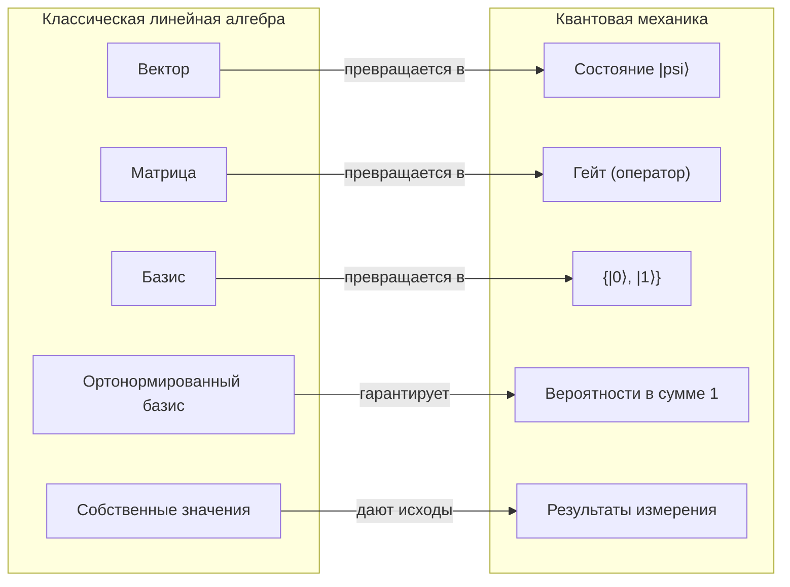

# Линейная алгебра для квантовых вычислений (Linear Algebra for Quantum Computing)

Линейная алгебра — не «подготовка» к квантовым вычислениям, а их собственный язык. Состояние квантовой системы — это вектор, операция — матрица, измерение — проекция. В этом уроке мы соберём минимальный, но полноценный набор инструментов: комплексные числа, векторы и скобки Дирака, унитарные матрицы и тензорное произведение.

## Комплексные числа (complex numbers)

Комплексное число записывается как $z = a + bi$, где $i^2 = -1$. Полезны две формы:

- **алгебраическая**: $z = a + bi$;
- **полярная**: $z = r(\cos\theta + i\sin\theta) = r e^{i\theta}$, где $r = |z| = \sqrt{a^2 + b^2}$ — модуль, а $\theta$ — фаза (phase).

Сопряжённое число: $\bar{z} = a - bi$. Ключевое тождество:

$$|z|^2 = \bar{z}z = a^2 + b^2$$

Именно $\bar{z}z$, а не $z^2$, появится в правиле Борна для вероятностей — модуль комплексного числа всегда неотрицателен.

```python
# Python: комплексные числа встроены в язык
z = 3 + 4j
print(abs(z))       # 5.0 — модуль |z|
print(z.conjugate())  # (3-4j)
```

## Векторы, скобки Дирака и внутреннее произведение

В квантовой механике вектор-столбец обозначают «кет»-скобкой: $|\psi\rangle$. Сопряжённо-транспонированный вектор-строка — «бра»: $\langle\psi|$. Состояние кубита (qubit) — вектор из двух комплексных чисел:

$$|0\rangle = \begin{pmatrix} 1 \\ 0 \end{pmatrix}, \qquad |1\rangle = \begin{pmatrix} 0 \\ 1 \end{pmatrix}$$

Произвольное состояние — суперпозиция (superposition) базисных:

$$|\psi\rangle = \alpha|0\rangle + \beta|1\rangle = \begin{pmatrix} \alpha \\ \beta \end{pmatrix}$$

Внутреннее произведение (inner product) даёт число:

$$\langle a | b \rangle = \begin{pmatrix} \bar{a_1} & \bar{a_2} \end{pmatrix} \begin{pmatrix} b_1 \\ b_2 \end{pmatrix} = \bar{a_1}b_1 + \bar{a_2}b_2$$

Базис $|0\rangle, |1\rangle$ ортонормирован: $\langle 0|0\rangle = \langle 1|1\rangle = 1$, $\langle 0|1\rangle = 0$. Состояние должно быть нормировано: $\langle\psi|\psi\rangle = |\alpha|^2 + |\beta|^2 = 1$.

Внешнее произведение (outer product) даёт оператор — проектор на состояние $|0\rangle$:

$$|0\rangle\langle 0| = \begin{pmatrix} 1 & 0 \\ 0 & 0 \end{pmatrix}$$

## Матрицы как операции над состояниями



Как читать схему: слева собраны термины классической линейной алгебры, справа — их квантовые аналоги, а над стрелкой сказано, что именно происходит при переходе. Каждая строка опирается на формулы урока: нормированный вектор-столбец, унитарная матрица, ортонормированный базис и правило Борна.

- Проверь себя: почему состояние можно считать вектором, но нельзя считать произвольным вектором из $\mathbb{C}^2$ — какое условие накладывает постулат нормировки?
- Проверь себя: какое свойство унитарной матрицы отвечает за две последние строки схемы — сохранение нормы или обратимость, и почему именно оно?

Каждый квантовый гейт — матрица $U$, действующая на вектор состояния: $|\psi'\rangle = U|\psi\rangle$. Пример — гейт Адамара (Hadamard):

$$H = \frac{1}{\sqrt{2}}\begin{pmatrix} 1 & 1 \\ 1 & -1 \end{pmatrix}, \qquad H|0\rangle = \frac{|0\rangle + |1\rangle}{\sqrt{2}}$$

Состояние $\frac{|0\rangle + |1\rangle}{\sqrt{2}}$ обозначают $|+\rangle$ — «равновзвешенная суперпозиция».

## Унитарные матрицы (unitary matrices)

Матрица унитарна (unitary), если $U^\dagger U = I$, где $U^\dagger$ — эрмитово сопряжение (сопряжение + транспонирование). Следствия:

1. **Сохранение нормы**: $|U\psi|^2 = |\psi|^2$. Квантовая эволюция не «теряет» вероятность — это прямое следствие постулата нормировки.
2. **Обратимость**: $U^{-1} = U^\dagger$. Любой квантовый гейт обратим — в отличие от классических логических вентилей типа AND, стирающих информацию.

Проверим на примере: $H^\dagger = H$ (Адамар эрмитов и вещественен), и $HH = I$. То есть два гейта H подряд возвращают кубит в исходное состояние — запомните это, пригодится в алгоритмах.

<details class="admonition analogy" markdown="1">
<summary class="admonition-title">Аналогия: колода, которую можно размешать и «размешать назад»</summary>

Унитарная эволюция — перемешивание колоды, которое можно строго отменить: ни одна карта не сгорает и не дублируется, а, зная приём тасовщика, вы всегда пройдёте те же шаги в обратном порядке ($U^\dagger$). Классический вентиль AND — это сжигание карт: по результату «0» уже не восстановить, какие были аргументы. Квантовая схема поэтому состоит только из обратимых ходов; единственное необратимое событие — измерение, и оно появится в следующем уроке.
Предел аналогии: тасование должно быть обратимым — «тасование с потерями» (запись на плёнку) это уже другое явление, в квантовой механике его зовут измерением.

</details>

```python
import numpy as np

H = np.array([[1, 1], [1, -1]]) / np.sqrt(2)
print(np.allclose(H @ H, np.eye(2)))          # True — унитарность
ket0 = np.array([1, 0])
print(H @ ket0)   # [0.7071, 0.7071] — состояние |+>
```

## Тензорное произведение (tensor product)

Как описать два кубита вместе? Не сложением, а тензорным произведением (в коде — `np.kron`, «кронекерово произведение»):

$$|a\rangle \otimes |b\rangle = |ab\rangle, \qquad |0\rangle \otimes |0\rangle = \begin{pmatrix} 1 \\ 0 \\ 0 \\ 0 \end{pmatrix}$$

Правило для элементов: $A_{ik} B_{jl} = (A \otimes B)_{ij,kl}$. Размерности перемножаются: матрица $2\times 2$ на кубите + матрица $2\times 2$ на втором кубите дают $4\times 4$ на паре. Для $n$ кубитов вектор состояния имеет размер $2^n$ — вот почему классическая симуляция квантовых систем так дорога.

О соглашении на запись: в этом курсе базисные состояния записываются как $|q_1 q_2 \ldots q_n\rangle$, где первый кубит стоит слева (старший). В Qiskit нумерация обратная: `q0` — младший бит, вектор состояния упорядочен как $|q_{n-1}\ldots q_0\rangle$. Поэтому один и тот же оператор записывается по-разному: `np.kron(np.eye(2), X)` в записи курса действует на второй (правый) кубит, а в Qiskit — на `q0`; чтобы менять `q1` в Qiskit, нужен `np.kron(X, np.eye(2))`. Держите это в голове при чтении кода.

**И отдельно про виджеты.** Интерактивные виджеты на сайте используют третий порядок: в них самый левый разряд — это `q0` (то есть «старший» с точки зрения виджета), в то время как Qiskit печатает состояние с `q1` слева. Поэтому индексы амплитуд из виджета и из `print(Statevector(...))` нельзя сравнивать напрямую — это один и тот же вектор, записанный в обратном порядке. В виджете «Цикл коррекции ошибок» действует соглашение курса: «кубит 1» = первый (левый) разряд.

<details class="admonition analogy" markdown="1">
<summary class="admonition-title">Аналогия: не два «куска», а этаж со всеми квартирами</summary>

Классический бит «бронирует» одну ячейку: 0 или 1. А $n$ кубитов — это один вектор, в котором у каждой из $2^n$ ячеек (базисных состояний) есть своя амплитуда: будто вы описываете не «где человек сейчас», а комплексную амплитуду появления во всех $2^n$ квартирах одновременно. Тензорное произведение — конструктор, который «достраивает этаж»: $2\times 2 \to 4$, а дальше экспоненциально. Именно этот рост делает дорогой классическую симуляцию; выигрыш появляется там, где у задачи есть структура, которую видят унитарные преобразования (см. [обзор алгоритмов](../01-quantum-basics/04-algorithms-overview.md)).
Предел аналогии: аналогия объясняет только размерность пространства: как выбираются амплитуды — этого она не говорит, а именно в этом и состоит вычислительная сила.

</details>

Гейт на втором кубите при «нетронутом» первом записывается как $I \otimes X$.

```python
import numpy as np

ket0 = np.array([1, 0])
X = np.array([[0, 1], [1, 0]])
X_on_second = np.kron(np.eye(2), X)  # действует X на второй кубит (в записи курса)
print(X_on_second @ np.kron(ket0, ket0))  # |01>
```

## Почему это язык квантовых вычислений

Сведём соответствие:

| Объект квантовых вычислений | Объект линейной алгебры |
|---|---|
| Состояние $n$ кубитов | Вектор в $\mathbb{C}^{2^n}$ единичной нормы |
| Гейт (операция) | Унитарная матрица $2^n \times 2^n$ |
| Измерение (measurement) | Проекция на базисный вектор, правило Борна: $p = \lvert\langle b \vert \psi\rangle\rvert^2$ |
| Составная система | Тензорное произведение векторов |
| Двухкубитный гейт | Унитарная матрица $4\times 4$, например CNOT |

Каждое дальнейшее понятие курса — сфера Блоха, запутанность, алгоритмы — записывается в этих терминах. Если формулы из этого урока читаются свободно, вы готовы к [основам квантовой механики](02-quantum-mechanics-basics.md).

## 📚 Узнать подробнее

<details markdown="1"><summary>Видеолекции</summary>

- **MIT 8.04 Lecture 10: Clicker Bonanza and Dirac Notation, MIT OpenCourseWare** [01:07:31-01:09:40] - блок урока «Векторы, скобки Дирака и внутреннее произведение»: Аллан Адамс вводит дираковскую запись (бра- и кет-скобки) как основной язык векторных пространств, на котором построен весь курс квантовой механики. [смотреть](https://www.youtube.com/watch?v=VSqpYPgxcps)
- **Single Systems | Understanding Quantum Information & Computation | Lesson 01, Qiskit, Джон Уотрус** - блок урока «Унитарные матрицы (unitary matrices)»: та же точка зрения строго для программистов — состояния как векторы, унитарное преобразование как «изменение» системы без потерь. [смотреть](https://www.youtube.com/watch?v=3-c4xJa7Flk)
- **Quantum Computing for Computer Scientists, Microsoft Research, Эндрю Хелвер** - блок урока «Матрицы как операции над состояниями»: квантовые вычисления целиком через матрицы и векторы — гейт как умножение унитарной матрицы на вектор состояния. [смотреть](https://youtu.be/F_Riqjdh2oM)
- **Multiple Systems | Understanding Quantum Information & Computation | Lesson 02, Qiskit, Джон Уотрус** - блок урока «Тензорное произведение (tensor product)»: как из подсистем собираются составные состояния — формализация того, что здесь записано через $|ab\rangle$ и $I \otimes X$. [смотреть](https://www.youtube.com/watch?v=DfZZS8Spe7U)

</details>

<details markdown="1"><summary>Статьи и блоги</summary>

- **Quantum Computing for the Very Curious, Энди Мэтусчак и Майкл Нильсен (Quantum Country)** - блок урока «Комплексные числа (complex numbers)»: интерактивное эссе с нулевым порогом входа: амплитуды как комплексные числа, правило квадрата модуля $\bar{z}z$ и суперпозиция — с системой запоминания на интервальных повторениях. [читать](https://quantum.country/qcvc)

</details>

<details markdown="1"><summary>Книги</summary>

- **Томас Вонг, «Introduction to Classical and Quantum Computing» (Rooted Grove, 2022; ISBN 979-8-9855931-0-5)** - главы о комплексных числах, векторных пространствах и первом знакомстве с кубитами — самый мягкий вход в математику этого урока; полный PDF распространяется автором бесплатно. [читать](https://www.thomaswong.net/introduction-to-classical-and-quantum-computing-1e4p.pdf)
- **М. Нильсен, И. Чуанг, «Quantum Computation and Quantum Information» (10th Anniversary Edition, Cambridge University Press)** - глава 2, раздел 2.1 «Linear algebra»: строгая формализация языка урока — внутренние произведения (2.1.4) и тензорные произведения (2.1.7) с задачами. [читать](https://www.cambridge.org/us/universitypress/subjects/physics/quantum-physics-quantum-information-and-quantum-computation/quantum-computation-and-quantum-information-10th-anniversary-edition)

</details>

<details markdown="1"><summary>Русскоязычные ресурсы</summary>

- **Лекция 4. В.И. Яшин. Один квантовый бит, МЦМУ МИАН** - блок урока «Векторы, скобки Дирака и внутреннее произведение»: вводный курс «Квантовые вычисления» — состояние кубита как вектор с комплексными амплитудами, нормировка и первые гейты. [смотреть](https://www.youtube.com/watch?v=y73_2w7Q33g) [проверено]
- **Лекция 1. В.И. Яшин. Базовые элементы квантовых схем, МЦМУ МИАН** - блок урока «Тензорное произведение (tensor product)»: однокубитные и многокубитные вентили, запись действий на подсистемах через тензорные произведения. [смотреть](https://www.youtube.com/watch?v=487uPVrePgg) [проверено]
- **Лекция 3. В.И. Яшин. Обратимые вычисления, МЦМУ МИАН** - блок урока «Унитарные матрицы (unitary matrices)»: принцип Ландауэра и сведение булевых схем к обратимым — физический источник требований унитарности и обратимости гейтов. [смотреть](https://www.youtube.com/watch?v=IASpjwiNXB8) [проверено]
- **Лекция 6. В.И. Яшин. Универсальность в квантовых схемах, МЦМУ МИАН** - блок урока «Унитарные матрицы (unitary matrices)»: какие наборы гейтов универсальны — почему из простых матриц собирается любая унитарная эволюция. [смотреть](https://www.youtube.com/watch?v=y0qOs_JO5O4) [проверено]
- **А. Китаев, А. Шень, М. Вялый, «Классические и квантовые вычисления» (МЦНМО, 1999)** - блок урока «Почему это язык квантовых вычислений»: классический русскоязычный вводник — квантовый формализм (состояния, измерение, схемы) с задачами; полный текст свободно распространяется. [читать](https://old.mccme.ru/free-books/qcomp/qbook.pdf) [проверено]

</details>

## ✅ Проверь себя

Для проверки понадобится матрица

$$M = \begin{pmatrix} 1 & 1 \\ 0 & 1 \end{pmatrix}$$

1. Для $z = 1 + i$ найдите $|z|$, $\bar{z}$ и фазу $\theta$ в полярной форме.
2. Почему матрица $M$ не может быть квантовым гейтом? Проверьте вычислением $M^\dagger M \neq I$.
3. Вычислите $H|1\rangle$ и выразите результат через $|+\rangle$ и $|-\rangle$.
4. Каков размер вектора состояния для 3 кубитов и как получить $|010\rangle$ из $|0\rangle, |1\rangle, |0\rangle$?
5. Докажите, что $\langle 0|+\rangle = \frac{1}{\sqrt{2}}$, где $|+\rangle = \frac{|0\rangle + |1\rangle}{\sqrt{2}}$. Какой вероятности это соответствует при измерении в базисе $\{|0\rangle, |1\rangle\}$?

[тест модуля 00](../../tests/00-quiz.md)

## ➡️ Что дальше

Следующий урок: [Основы квантовой механики: постулаты, суперпозиция, измерение](02-quantum-mechanics-basics.md).
