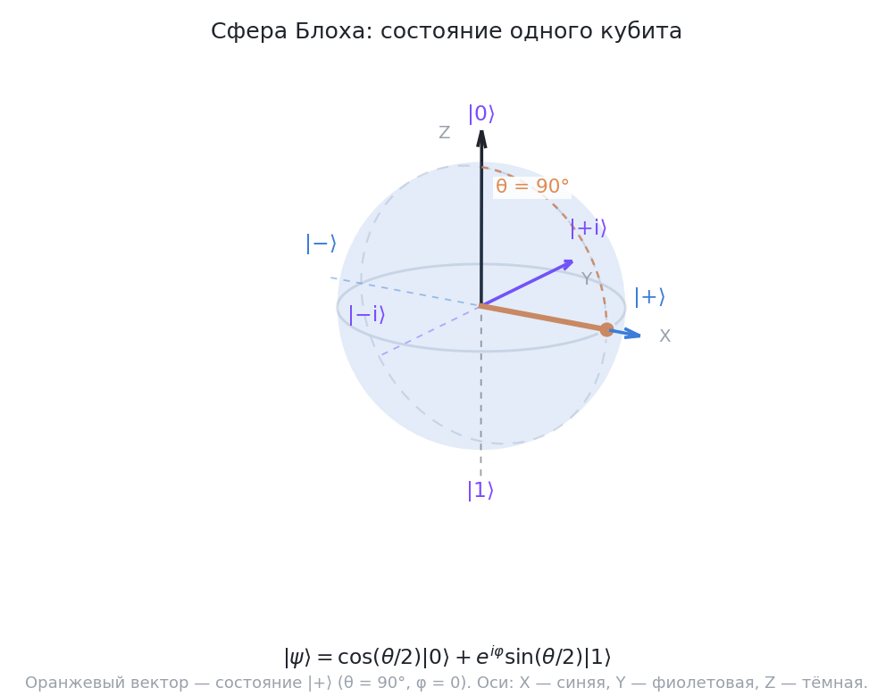

# Основы квантовой механики: постулаты, суперпозиция, измерение

Квантовым вычислениям не нужна «вся квантовая механика» — нужен её вычислительный каркас, который описывается пятью постулатами (postulates). Формулировка здесь подчёркнуто алгебраическая: состояние — вектор, эволюция — унитарная матрица (см. [урок 01](01-linear-algebra.md)).

## Постулат 1: состояние

Состояние замкнутой квантовой системы — вектор $|\psi\rangle$ в комплексном гильбертовом пространстве (Hilbert space) единичной нормы. Для кубита:

$$|\psi\rangle = \alpha|0\rangle + \beta|1\rangle, \qquad |\alpha|^2 + |\beta|^2 = 1$$

Термин «суперпозиция» (superposition) не означает, что кубит «на самом деле» в одном из состояний, а мы не знаем в каком. Суперпозиция — это новое, целостное состояние; это проверяется экспериментально через интерференцию (см. ниже).


*Сфера Блоха: северный полюс — $|0\rangle$, южный — $|1\rangle$, оранжевый вектор — состояние $|+\rangle$ с $\theta = 90^\circ$ и $\varphi = 0$. Вывод: суперпозиция — это не «неизвестно, 0 или 1», а конкретная точка сферы, задающая амплитуды; чем выше точка над экватором, тем вероятнее исход 0.*

## Постулат 2: измерение и правило Борна

Измерение в вычислительном базисе (computational basis) $\{|0\rangle, |1\rangle\}$ даёт классический исход с вероятностями по правилу Борна (Born rule):

$$p(0) = |\alpha|^2 = |\langle 0|\psi\rangle|^2, \qquad p(1) = |\beta|^2$$

Важно различать **амплитуду** (amplitude), комплексное число $\alpha$, и **вероятность** (probability), неотрицательное вещественное $|\alpha|^2$. Амплитуды могут быть отрицательными и комплексными — и именно знаки/фазы амплитуд создают интерференцию, которой у вероятностей не бывает.

## Постулат 3: коллапс состояния

После измерения состояние проектируется на соответствующий базисный вектор: если выпал результат $0$, то состояние становится $|0\rangle$. Повторное измерение в том же базисе даст тот же ответ с вероятностью 1.

Практическое следствие: измерение разрушает суперпозицию (в данном базисе), поэтому в схемах измерение ставят в конце, а промежуточные преобразования делают унитарными операциями.

### Обобщённое измерение (POVM) — короткая справка

Постулаты выше описывают «идеальное» измерение: прибор с двумя исходами, повторное измерение даёт тот же ответ. Обобщённое измерение (POVM, positive operator-valued measure) допускает приборы с произвольным числом исходов и с «нечёткими» эффектами: каждый исход $y$ сопровождается оператором $M_y \succeq 0$, $\sum_y M_y = I$, а вероятность исхода равна $p(y) = \mathrm{Tr}(\rho M_y)$. Проекционное измерение в вычислительном базисе — частный случай ($M_0 = |0\rangle\langle 0|$, $M_1 = |1\rangle\langle 1|$). Зачем это знать: в квантовой теории информации так формулируют задачи различения состояний и строят оптимальные измерительные приборы. В нашем курсе это остаётся справочным слоем: матрицы плотности, каналы и смешанные состояния разбираются в [уроке о шуме](../02-programming/04-noise-simulation.md), а сами POVM мы дальше не разбираем — держите эту формулировку в голове как «язык, на котором говорят в статьях».

## Постулат 4: унитарная эволюция

Замкнутая система эволюционирует унитарно: $|\psi(t)\rangle = U|\psi(0)\rangle$, где $U^\dagger U = I$. Отсюда два фундаментальных свойства квантовых вычислений:

- сохранение нормы (вероятности всех исходов всегда в сумме дают 1);
- обратимость (uncomputation возможен; классическое «стирание» бита — нет).

## Постулат 5: составные системы

Состояние составной системы — тензорное произведение (tensor product) состояний подсистем: $|\psi_{AB}\rangle = |\psi_A\rangle \otimes |\psi_B\rangle$. Но не всякое состояние двух кубитов факторизуется — существуют запутанные состояния (entangled states); подробно о них — в модуле 01.

## Интерференция: главная «фишка» квантовых вычислений

Рассмотрим кубит в состоянии $|\psi\rangle = \frac{|0\rangle - |1\rangle}{\sqrt{2}}$ (обозначим $|-\rangle$). Применим гейт Адамара:

$$H|-\rangle = \frac{1}{\sqrt{2}}\left(H|0\rangle - H|1\rangle\right) = \frac{1}{2}\left(|0\rangle + |1\rangle - |0\rangle + |1\rangle\right) = |1\rangle$$

Амплитуды состояния $|0\rangle$ **сократились**: $\frac{1}{2} - \frac{1}{2} = 0$ — деструктивная интерференция (destructive interference). А для $|+\rangle$ амплитуды сложатся: конструктивная интерференция даст $|0\rangle$.

В этом и состоит стратегия квантовых алгоритмов: устроить унитарную эволюцию так, чтобы неверные ответы гасились интерференцией, а верные — усиливались. Классический рандомизированный алгоритм так не умеет: у вероятностей нет знаков.

```python
from qiskit import QuantumCircuit
from qiskit.quantum_info import Statevector

qc = QuantumCircuit(1)
qc.h(0)          # |0> -> |+>
qc.h(0)          # |+> -> |0>  (это H† = H, т.е. обратимость, а не интерференция)
print(Statevector(qc))  # Statevector([1.+0.j, 0.+0.j], dims=(2,))
```

Ещё один эффект — **вырожденность представления**: состояния $|\psi\rangle$ и $e^{i\theta}|\psi\rangle$ физически неотличимы (глобальная фаза, global phase). Подробный разбор — в следующем уроке.

## Уточнение терминологии: суперпозиция vs смесь

Не путайте чистую суперпозицию $|+\rangle$ и классическую случайную смесь «с вероятностью 50/50 в $|0\rangle$ или $|1\rangle$». Смесь описывается матрицей плотности (density matrix), она не даёт интерференции и ведёт себя иначе под гейтами. Пока работаем с чистыми состояниями, но различие запомните — это частая причина ошибок в интуиции.

<details class="admonition analogy" markdown="1">
<summary class="admonition-title">Аналогия: монета в воздухе и монета под стаканом</summary>

Подброшенная монета в полёте — это не «какая-то сторона, которую мы пока не знаем»: у летящей монеты стороны просто нет, и «порции вероятности» умеют усиливать и гасить друг друга — это суперпозиция. Монета под стаканом, которую вам не показали, — смесь: сторона давно стала фактом, он лишь скрыт от вас. Из «монеты под стаканом» интерференцию не получить — а суперпозиция умеет обнулять и усиливать варианты; формальный язык для смесей (матрицы плотности) мы введём в [уроке о шуме модуля 02](../02-programming/04-noise-simulation.md).
Предел аналогии: она про один кубит и про различие «чистое состояние vs смесь» — на больше чем двух кубитах картина со смесями уже не сводится к «подброшенной монете», и говорить о ней нужно на языке матриц плотности.

</details>

## Сводная таблица

| Понятие | Формула | Ключевое свойство |
|---|---|---|
| Состояние | $\|\psi\rangle = \alpha\|0\rangle + \beta\|1\rangle$ | $\|\alpha\|^2 + \|\beta\|^2 = 1$ |
| Вероятность исхода | $p(b) = \|\alpha_b\|^2$ | неотрицательна, вещественна |
| Эволюция | $\|\psi'\rangle = U\|\psi\rangle$ | $U^\dagger U = I$, обратима |
| Измерение | коллапс в $\|b\rangle$ | разрушает суперпозицию |
| Интерференция | $\alpha + \beta \to 0$ или $\to$ усиление | требует «знаков» у амплитуд |

## 📚 Узнать подробнее

<details markdown="1"><summary>Видеолекции</summary>

- **MIT 8.04 Lecture 1: Introduction to Superposition, MIT OpenCourseWare** [01:12:35-01:14:35] - блок урока «Постулат 1: состояние»: Аллан Адамс на «жёстком/мягком» эксперименте показывает, что электрон в суперпозиции «ни жёсткий, ни мягкий, ни то и другое, ни ни одно из них» — суперпозиция это новое целостное состояние. [смотреть](https://www.youtube.com/watch?v=lZ3bPUKo5zc)
- **MIT 8.04 Lecture 3: The Wave Function, MIT OpenCourseWare** [00:18:38-00:20:30] - блок урока «Постулат 2: измерение и правило Борна»: формулируется второй постулат: вероятность обнаружить объект при измерении равна норме амплитуды $\psi(x)$ в квадрате, а нормировка обязывает сумму вероятностей быть 1. [смотреть](https://www.youtube.com/watch?v=Ei8CFin00PY)
- **MIT 8.04 Lecture 3: The Wave Function, MIT OpenCourseWare** [00:50:10-00:52:45] - блок урока «Интерференция: главная «фишка» квантовых вычислений»: «складываются волновые функции, а не вероятности» — перекрёстные члены дают интерференцию; и замечание к уроку: умножение на фазу $e^{ia}$ не меняет ничего, так как её норма равна 1. [смотреть](https://www.youtube.com/watch?v=Ei8CFin00PY)
- **MIT 8.04 Lecture 6: Time Evolution and the Schrödinger Equation, MIT OpenCourseWare** [00:28:42-00:29:48] - блок урока «Постулат 3: коллапс состояния»: коллапс при измерении задает новое начальное условие, после которого снова работает детерминированная эволюция по Шредингеру — «два режима» одной теории. [смотреть](https://www.youtube.com/watch?v=TWpyhsPAK14)
- **Ph/CS 219A Lecture 1: Introduction, Caltech, Джон Прескилл** - блок урока «Постулат 4: унитарная эволюция»: вводная лекция аспирантского курса того же каркаса: состояния, задаваемые амплитудами; эволюция унитарными вентилями; вероятность по квадратам модулей. [смотреть](https://youtu.be/w08pSFsAZvE)
- **But what is quantum computing? (Grover's Algorithm), 3Blue1Brown, Грант Сандерсон** - блок урока «Интерференция: главная «фишка» квантовых вычислений»: визуальное объяснение того, как усиление и гашение амплитуд превращают суперпозицию в алгоритмическое преимущество. [смотреть](https://youtu.be/RQWpF2Gb-gU)

</details>

<details markdown="1"><summary>Статьи и блоги</summary>

- **Quant Computing Promises New Insights, Not Just Supermachines, Скотт Ааронсон (Shtetl-Optimized)** - блок урока «Интерференция: главная «фишка» квантовых вычислений»: смерть мифа о том, что квантовый компьютер «испытывает все ответы параллельно»: сам по себе «параллелизм» не даёт выигрыша — решает интерференция амплитуд. [читать](https://scottaaronson.blog/?p=871)
- **What Is Quantum Computing?, IBM Think (Джош Шнайдер, Иэн Смолли)** - блок урока «Постулат 1: состояние»: обзор с точки зрения индустрии: четыре ключевых принципа — суперпозиция, запутанность, интерференция, декогеренция; пояснение, что измерение коллапсирует состояние в бинарный исход. [читать](https://www.ibm.com/think/topics/quantum-computing)

</details>

<details markdown="1"><summary>Книги</summary>

- **Джон Прескилл, лекции Physics 219 «Quantum Computation» (Caltech), глава 2** - глава целиком про амплитуды, правило Борна и унитарность — аспирантурно, но строго и с задачами; PDF выложен автором свободно. [читать](https://preskill.caltech.edu/ph219/chap2_15.pdf)
- **М. Нильсен, И. Чуанг, «Quantum Computation and Quantum Information» (10th Anniversary Edition, Cambridge University Press)** - глава 2, раздел 2.2 «The postulates»: формальная версия всех постулатов урока — пространство состояний (2.2.1), эволюция (2.2.2), измерение (2.2.3) и составные системы (2.2.8). [читать](https://www.cambridge.org/us/universitypress/subjects/physics/quantum-physics-quantum-information-and-quantum-computation/quantum-computation-and-quantum-information-10th-anniversary-edition)

</details>

<details markdown="1"><summary>Русскоязычные ресурсы</summary>

- **Лекция 9. В.И. Яшин. Квантовые вычисления, МЦМУ МИАН** - блок урока «Постулат 5: составные системы»: запутанные состояния и измерения в квантовых схемах — развитие постулата о тензорном произведении состояний подсистем. [смотреть](https://www.youtube.com/watch?v=tbs6sz1kwnU) [проверено]
- **Лекция 1. А.С. Трушечкин. Квантовые вычисления, МЦМУ МИАН** - блок урока «Постулат 2: измерение и правило Борна»: вводная лекция курса — состояния, амплитуды и вероятности исходов измерения. [смотреть](https://www.youtube.com/watch?v=S_KBPd8EBVo) [проверено]
- **Stanislav Straupe, Introduction to quantum computing, Центр квантовых технологий МГУ им. М.В. Ломоносова** - блок урока «Постулат 1: состояние»: вводная лекция курса МГУ — кубит как вектор состояния, суперпозиция и измерение на физических примерах. [смотреть](https://www.youtube.com/watch?v=z4kUkmckxf8) [проверено]
- **КА 1.3.1 Однокубитные операции, квантовые гейты (вентили) для одного кубита, КФУ** - блок урока «Постулат 4: унитарная эволюция»: однокубитные вентили как унитарные матрицы — переход от состояния к операции. [смотреть](https://www.youtube.com/watch?v=sGAXEeKfcSs) [проверено]

</details>

## 🎛 Интерактив

Сфера Блоха показывает, как один кубит живёт на поверхности сферы: точка — это состояние, её высота над экватором — вероятности измерения, а азимут — фаза. В этом уроке виджет нужен, чтобы увидеть постулаты 1–4 в движении: суперпозицию, переворот кубита и унитарную эволюцию, посчитанную в числах.

<!--qc-embed: bloch-sphere.html | Сфера Блоха | 600-->

**Интерактив:** [виджет «Сфера Блоха»](https://drdimooon.github.io/qc-design-course/curriculum/00-fundamentals/02-quantum-mechanics-basics/#интерактив) · [файл виджета](../../assets/interactive/bloch-sphere.html)

**Задание.**

- Нажмите «Сброс |0⟩»: точка встанет на северный полюс, $\theta = 0.0^\circ$, $P(0) = 1.000$, $P(1) = 0.000$, а фаза будет «не определена» — амплитуды $|1\rangle$ у состояния ещё нет.
- Нажмите H: точка переедет на экватор, $\theta = 90.0^\circ$, $P(0) = P(1) = 0.500$ (сумма = 1.000), а вектор состояния будет смотреть вдоль оси +X (в блоке состояния: x = 1.000, y = 0.000, z = 0.000).
- Нажмите «Сброс |0⟩», затем X: точка окажется на южном полюсе, $\theta = 180.0^\circ$, $P(1) = 1.000$, $P(0) = 0.000$ — кубит перевернулся, состояние стало $|1\rangle$.
- Нажмите «Сброс |0⟩», затем RX 90°: получится $\theta = 90.0^\circ$ и $P(0) = P(1) = 0.500$, но фаза окажется равной $270.0^\circ$ — это просто другая точка экватора, а не изменившаяся вероятность.

Как это связано с уроком: каждая кнопка — это унитарная операция из постулата 4, а строка вероятностей внизу виджета — правило Борна из постулата 2. Сравните H и X: обе меняют высоту точки, то есть вероятности, а вот гейт, поворачивающий только азимут (RZ, S, T), вероятностей не трогает — это и есть разница между относительной и глобальной фазой, к которой мы придём в следующем уроке.

## ✅ Проверь себя

1. Нормализуйте состояние $\frac{1}{2}|0\rangle + \frac{\sqrt{3}}{2}i|1\rangle$ — нормировано ли оно? Вычислите вероятности исходов.
2. Почему нельзя «прочитать» амплитуды $\alpha, \beta$ одним измерением копии состояния? Сколько копий нужно, чтобы оценить $|\alpha|^2$ с заданной точностью?
3. Что произойдёт с состоянием $|-\rangle$ после последовательности H, H?
4. Поясните, почему унитарность эволюции гарантирует сохранение суммы вероятностей.
5. Чем суперпозиция отличается от классической смеси 50/50? Приведите наблюдаемый эффект, который есть у суперпозиции, но не у смеси.

[тест модуля 00](../../tests/00-quiz.md)

## ➡️ Что дальше

Следующий урок: [Комплексные сигналы и кубиты: фаза, частота и гейты](03-complex-signals-qubits.md).
