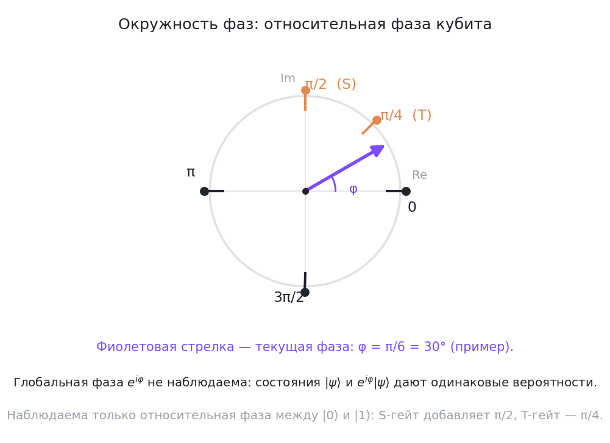
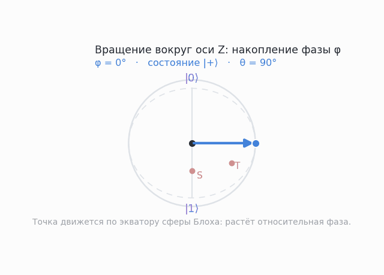

# Комплексные сигналы и кубиты: фаза, частота и подготовка к гейтам

Амплитуды комплексные — но пока мы не почувствовали, зачем. Этот урок связывает знакомые из электротехники и обработки сигналов (signal processing) понятия — фазу (phase) и частоту (frequency) — с фазовыми гейтами (phase gates) квантовых вычислений.

## Синусоида как носитель фазы

Осциллирующий сигнал (например, микроволновый импульс, которым управляют кубиты на сверхпроводниках) записывается как:

$$s(t) = A\cos(\omega t + \varphi) = \Re\left(Ae^{i(\omega t + \varphi)}\right)$$

Здесь $A$ — амплитуда, $\omega$ — угловая частота (rad/s), $\varphi$ — начальная фаза. Инженеры почти всегда работают с комплексной записью $Ae^{i\varphi}$: умножение на $e^{i\varphi}$ = «повернуть фазу», и алгебраически проще тригонометрических тождеств.

**Сдвиг фазы двух сигналов** меняет результат их сложения: при разности фаз $0$ волны усиливают друг друга, при $\pi$ — гасят. Знакомо? Это ровно та интерференция амплитуд из [предыдущего урока](02-quantum-mechanics-basics.md). Комплексная амплитуда $Ae^{i\varphi}$ — буквально «амплитуда и фаза в одном числе».

## Фаза квантового состояния: глобальная vs относительная

У состояния кубита $\alpha|0\rangle + \beta|1\rangle$ два комплексных коэффициента — четыре вещественных числа минус нормировка и минус физически невидимая симметрия. Рассмотрим два вида фазы:

**Глобальная фаза (global phase).** Состояния $|\psi\rangle$ и $e^{i\gamma}|\psi\rangle$ неотличимы: все вероятности $|e^{i\gamma}\alpha|^2 = |\alpha|^2$ совпадают, любое измерение даёт одинаковые вероятности исходов. Глобальную фазу игнорируют.

**Относительная фаза (relative phase).** Состояния $|+\rangle = \frac{|0\rangle+|1\rangle}{\sqrt{2}}$ и $|-\rangle = \frac{|0\rangle-|1\rangle}{\sqrt{2}}$ отличаются знаком у $\beta$ (фазовый сдвиг $\pi$) — и это РАЗНЫЕ, различимые состояния: $H|+\rangle = |0\rangle$, но $H|-\rangle = |1\rangle$.

Правило: **фаза между базисными амплитудами физична, общий множитель $e^{i\gamma}$ — нет.**

| Состояние | Относительная фаза | Отличимо от $\|+\rangle$? |
|---|---|---|
| $\|+\rangle = \frac{\|0\rangle + \|1\rangle}{\sqrt2}$ | $0$ | — (эталон) |
| $\|-\rangle = \frac{\|0\rangle - \|1\rangle}{\sqrt2}$ | $\pi$ | да (измерение после H) |
| $e^{i\pi/4}\|+\rangle$ | $0$ | нет (только глобальная фаза) |


*Окружность фаз: отметки $0$, $\pi/4$ (T), $\pi/2$ (S), $\pi$ и $3\pi/2$ — это положения относительной фазы, а фиолетовая стрелка показывает текущую фазу (на рисунке $\varphi = \pi/6 = 30^\circ$ как пример). Вывод: фаза — это угол на комплексной окружности, и наблюдаема только разность фаз между амплитудами, а не сам общий множитель $e^{i\varphi}$.*

Именно поэтому для визуализации кубита нужна сфера Блоха (Bloch sphere) с двумя углами $\theta, \varphi$, а не три:

$$|\psi\rangle = \cos\frac{\theta}{2}|0\rangle + e^{i\varphi}\sin\frac{\theta}{2}|1\rangle$$

Подробно о сфере — в модуле 01, а здесь важно: $\varphi$ — относительная фаза, это азимут (долгота) на сфере, а $\theta$ — полярный угол, «высота» точки над экватором.


*Анимация: вектор состояния обходит экватор сферы Блоха за полный оборот — $\theta = 90^\circ$ остаётся постоянным, а накопленная фаза $\varphi$ растёт от $0^\circ$ до $360^\circ$, последовательно проходя состояния $|+\rangle$, $|+i\rangle$, $|-\rangle$ и $|-i\rangle$. Вывод: фазовый гейт — это поворот вокруг оси Z, который меняет только азимут и совсем не меняет высоту точки, то есть вероятности.*

## Частота: от синусоиды к квантовой эволюции

В квантовой механике эволюция состояния во времени даётся уравнением Шрёдингера (Schrödinger equation); для стационарного состояния с энергией $E$ решение — фазовый множитель:

$$|\psi(t)\rangle = e^{-iEt/\hbar}|\psi(0)\rangle$$

Состояние «крутится» по фазе с частотой $E/\hbar$ — квантовый аналог $\omega$ синусоиды. Если два базисных состояния $|0\rangle$ и $|1\rangle$ имеют разные энергии $E_0, E_1$, их фазы расходятся с частотой разности энергий: разность фаз накапливается как $\omega t + \varphi$ в сигнале.

<details class="admonition analogy" markdown="1">
<summary class="admonition-title">Аналогия: два динамика в комнате и наушники с шумоподавлением</summary>

Включите два динамика с одним тоном: в одних точках комнаты звук громкий, в других почти исчезает. Мощности не «сложились» по-разному — складываются волны с фазой: где-то гребень на гребень (усиление), где-то гребень на впадину (обнуление). Наушники с шумоподавлением — тот же эффект на службе: инвертированный по фазе сигнал гасит внешний шум. Амплитуды $|+\rangle$ и $|-\rangle$ устроены так же: у $|-\rangle$ вторая амплитуда «переворачивается» знаком — и это уже другое физическое состояние, хотя вероятности одинаковые.
Предел аналогии: аналогия объясняет только само явление сдвига фазы; она ничего не говорит ни о том, как фаза измеряется, ни о том, что такое «нормировка» и «базис». Это всё разбирается формулами выше и ниже.

</details>

Отсюда мост к гейтам: **управляемое накопление относительной фазы = фазовый гейт**. RZ-гейт (rotation about Z) за время $t$ добавляет разность фаз:

$$R_Z(\lambda) = [[e^{-i\lambda/2}, 0], [0, e^{i\lambda/2}]]$$

Сравните: $R_Z(\pi)$ переводит $|+\rangle \to |-\rangle$, а $R_Z(2\pi)$ даёт глобальную фазу $-1$, то есть физически ничего не меняет. Гейты S и T из следующего модуля — это RZ на $\pi/2$ и $\pi/4$ с точностью до глобальной фазы.

```python
import numpy as np

lam = np.pi / 2
RZ = np.array([[np.exp(-1j*lam/2), 0], [0, np.exp(1j*lam/2)]])
plus = np.array([1, 1]) / np.sqrt(2)
after = RZ @ plus
# вероятности не изменились, но относительная фаза стала pi/2
print(after)  # [0.5-0.5j 0.5+0.5j] — повернулись на сфере Блоха
```

## «Сигналы и унитарности»: физическая реализация

Почему это не просто математика: все реальные квантовые компьютеры управляются классическими сигналами.

- **Сверхпроводящие кубиты** (IBM): микроволновые импульсы с заданной амплитудой, частотой и фазой; импульс с правильными параметрами реализует rotation-гейт RX/RY/RZ.
- **Ионные ловушки** (IonQ): лазерные импульсы, аналогичная роль фазы.
- **Фотоника**: фазовые сдвигатели (phase shifters) в интерферометрах — буквально RZ на фотонном кубите.

Сигнал с фазой $\varphi$ = поворот фазы кубита; погрешность фазы сигнала = ошибке гейта. Понимание фазы — это понимание того, что «настраивается» в железе.

## Что запомнить

1. Комплексная амплитуда $Ae^{i\varphi}$ = амплитуда + фаза; общий множитель $e^{i\gamma}$ невидим, а разность фаз между амплитудами — физична и различима.
2. Частота/энергия — это «скорость накопления фазы» во времени.
3. RZ, S, T — дискретные порции накопления фазы; на железе их реализуют сигналы.

## 📚 Узнать подробнее

<details markdown="1"><summary>Видеолекции</summary>

- **MIT 8.04 Lecture 7: More on Energy Eigenstates, MIT OpenCourseWare** [00:15:41-00:17:20] - блок урока «Частота: от синусоиды к квантовой эволюции»: стационарное состояние набирает фазу $e^{-iE_n t/\hbar}$; вводится $\omega_n = E_n/\hbar$ — квантовый аналог угловой частоты $\omega$ из сигнала. [смотреть](https://www.youtube.com/watch?v=Uk5DUtHY7LM)
- **MIT 8.04 Lecture 7: More on Energy Eigenstates, MIT OpenCourseWare** [00:45:44-00:46:55] - блок урока «Фаза квантового состояния: глобальная vs относительная»: Аллан Адамс прямо формулирует правило урока: общая фаза $\psi$ не имеет значения; относительная фаза между слагаемыми суперпозиции — имеет. [смотреть](https://www.youtube.com/watch?v=Uk5DUtHY7LM)
- **1. Qubits and Quantum States, Quantum Circuits, Measurements - Part 1 (Qiskit Global Summer School 2020), Qiskit** - блок урока «Фаза квантового состояния: глобальная vs относительная»: вводная лекция школы Qiskit: кубит как вектор состояния, относительные фазы и наглядная запись состояния через углы сферы Блоха $(\theta, \varphi)$. [смотреть](https://youtu.be/NZD9APb7ZtY)
- **QDW Beginner Track Day 1: Superconducting qubits 101 - making your first qubit, Златко Минев (UCLA Quantum Computing Student Association)** - блок урока «Сигналы и унитарности: физическая реализация»: от физики джозефсоновских переходов до параметров управления кубитом — что именно «настраивается» микроволновыми сигналами на железе. [смотреть](https://youtu.be/rUjePWndpiY)

</details>

<details markdown="1"><summary>Статьи и блоги</summary>

- **Explained: Quantum engineering, MIT News (Дэниел Акерман)** - блок урока «Сигналы и унитарности: физическая реализация»: серия «Explained»: биты против кубитов, суперпозиция, декогеренция и выбор между сверхпроводниками и ионными ловушками. [читать](https://news.mit.edu/2020/explained-quantum-engineering-1210)
- **What is a QPU (Quantum Processing Unit)?, IBM Think (Джош Шнайдер, Иэн Смолли)** - блок урока «Сигналы и унитарности: физическая реализация»: как IBM-железо из сверхпроводящих кубитов доходит до бинарного результата — и где в этом играют роль суперпозиция и измерение. [читать](https://www.ibm.com/think/topics/qpu)

</details>

<details markdown="1"><summary>Книги</summary>

- **Олег Эзрати, «Understanding Quantum Technologies» (издание 2025, 8-я ред.)** - открытый учебник-справочник «на 360 градусов» (≈1500 стр.): разделы по платформам железа, криогенике и управляющей электронике показывают, как фаза СВЧ-сигнала доходит до кубита и становится RZ; PDF выложен автором свободно. [читать](https://www.oezratty.net/wordpress/2025/understanding-quantum-technologies-2025/)

</details>

<details markdown="1"><summary>Русскоязычные ресурсы</summary>

- **Квантовая информатика. Лекция 1, КФУ** - блок урока «Фаза квантового состояния: глобальная vs относительная»: вводная лекция курса КФУ — состояния кубита, комплексные амплитуды и их физический смысл. [смотреть](https://www.youtube.com/watch?v=SJuE5wHppgI) [проверено]
- **Вентили Тоффоли и Фредкина, квантовые биты и их состояния, сфера Блоха (Quantum Tech)** - блок урока «Фаза квантового состояния: глобальная vs относительная»: состояния кубита через углы сферы Блоха $(\theta, \varphi)$ — наглядная геометрия относительной фазы. [смотреть](https://www.youtube.com/watch?v=8qrE2j6x8uU) [проверено]
- **КА 1.3.1 Однокубитные операции, квантовые гейты (вентили) для одного кубита, КФУ** - блок урока «Частота: от синусоиды к квантовой эволюции»: однокубитные вентили как повороты на сфере Блоха — фазовые гейты как накопление относительной фазы. [смотреть](https://www.youtube.com/watch?v=sGAXEeKfcSs) [проверено]

</details>

## 🎛 Интерактив

Виджет сферы Блоха показывает, как фазовые гейты поворачивают состояние вокруг оси Z: точка едет по экватору, а стрелка фазы на отдельной окружности сдвигается на 45° (T) или 90° (S). В этом уроке виджет нужен, чтобы увидеть главный вывод про фазу: после фазового гейта вероятности не меняются, меняется только азимут.

<!--qc-embed: bloch-sphere.html | Сфера Блоха | 600-->

**Интерактив:** [виджет «Сфера Блоха»](https://drdimooon.github.io/qc-design-course/curriculum/00-fundamentals/03-complex-signals-qubits/#интерактив) · [файл виджета](../../assets/interactive/bloch-sphere.html)

**Задание.**

- Нажмите «Сброс |0⟩», затем H: точка встанет на экватор, $\theta = 90.0^\circ$, $\varphi = 0.0^\circ$, $P(0) = P(1) = 0.500$.
- Нажмите T: фаза станет $\varphi = 45.0^\circ$, а вероятности останутся прежними — $P(0) = 0.500$, $P(1) = 0.500$; точка сдвинется по экватору, но её высота не изменится.
- Нажмите «Сброс |0⟩», затем H, затем S: фаза станет $\varphi = 90.0^\circ$, а вероятности останутся $P(0) = 0.500$, $P(1) = 0.500$ — S сам по себе добавляет ровно 90° к нулю фазы.
- Нажмите «Сброс |0⟩», затем H, затем T, затем S: фаза станет $\varphi = 135.0^\circ$ (повороты вокруг одной оси складываются: 45° от T плюс 90° от S), а вероятности по-прежнему $0.500$ и $0.500$.

Как это связано с уроком: S и T — это $R_Z$ на $\pi/2$ и $\pi/4$: они вращают точку на 90° и 45° вокруг оси Z, и вероятности в Z-базисе при этом не меняются. Но важно не путать два утверждения: **глобальная** фаза (общий множитель $e^{i\gamma}$) не наблюдаема ни в каком измерении, а **относительная** фаза между амплитудами $\lvert0\rangle$ и $\lvert1\rangle$ не видна только в текущем Z-базисе — она обнаруживается после смены базиса. Проверьте в виджете: «Сброс → H → H» вернёт $P(0)=1$, а «Сброс → H → S → H» даст $P(0)=P(1)=0.500$ — вероятности последнего измерения различаются, значит фаза от S вовсе не «невидима». Обратите внимание и на случай «Сброс |0⟩» → T: точка не сдвинется, а фаза будет «не определена», потому что одна ненулевая амплитуда ещё не суперпозиция — относительная фаза появляется только вместе с второй ненулевой амплитудой.

## ✅ Проверь себя

1. Чем отличаются состояния $\frac{|0\rangle + i|1\rangle}{\sqrt2}$ и $|+\rangle$? Различимы ли они и как это проверить?
2. Почему RZ($2\pi$) считается «тождественной операцией», хотя её матрица равна $-I$?
3. Сигнал $s(t) = \cos(\omega t)$ и $s'(t) = -\cos(\omega t)$: какова разность фаз? Проведите аналогию с парой $|+\rangle/|-\rangle$.
4. Как эволюционирует относительная фаза за время $t = \pi/\omega$?
5. Зачем в спецификации импульса для сверхпроводящего кубита нужны все три параметра: амплитуда, частота, фаза?

[тест модуля 00](../../tests/00-quiz.md)

## ➡️ Что дальше

Следующий урок (практика): [Настройка окружения и первый кубит в Qiskit](lab-00-env-setup.md). Затем — [модуль 01: Квантовые основы](../01-quantum-basics/README.md) и сфера Блоха.
