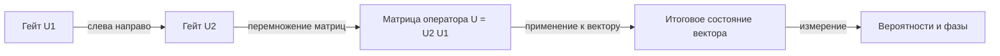

# Вентили и схемы (Gates and Circuits)

## Вентиль = унитарная матрица = вращение сферы Блоха

Квантовый вентиль (quantum gate) — унитарная матрица $U$ ($U^\dagger U = I$), действующая на вектор состояния: $|\psi'\rangle = U|\psi\rangle$. Из унитарности следуют два свойства (см. [модуль 00](../00-fundamentals/01-linear-algebra.md)):

- сохранение нормы — вероятности всегда в сумме дают 1;
- обратимость — у каждого вентиля есть обратный $U^\dagger$; «стирающих» вентилей в КМ-эволюции нет.

Каждый однокубитный вентиль — поворот сферы Блоха вокруг некоторой оси на некоторый угол.

## Таблица основных вентилей: матрица и действие

| Вентиль | Действие на сфере Блоха | Примечание |
|---|---|---|
| X | вращение на $\pi$ вокруг оси $x$ ($\|0\rangle \leftrightarrow \|1\rangle$) | квантовый NOT |
| Y | вращение на $\pi$ вокруг оси $y$ | $\|0\rangle \to i\|1\rangle$ |
| Z | вращение на $\pi$ вокруг оси $z$ | фазовый флип: $\|+\rangle \to \|-\rangle$ |
| H | вращение на $\pi$ вокруг оси, лежащей между $x$ и $z$ | $\|0\rangle \to \|+\rangle$, $\|1\rangle \to \|-\rangle$ |
| S | фаза $\pi/2$ (поворот по долготе) | $S = T^2$; $SS = Z$ |
| T | фаза $\pi/4$ | «$\pi/8$-вентиль» (в записи $T = e^{-i\pi Z/8}$); нужен для универсальности |
| $R_X(\theta)$ | вращение на $\theta$ вокруг $x$ | из всех этих гейтов собираются сложные операции |
| $R_Y(\theta)$ | вращение на $\theta$ вокруг $y$ | меняет полярный угол $\theta$ («широту» точки) на сфере |
| $R_Z(\lambda)$ | вращение на $\lambda$ вокруг $z$ | меняет только относительную фазу $\varphi$ |

Матрицы тех же вентилей (вынесены отдельным блоком: в таблице они не читались, а в GitHub-просмотре матрица внутри ячейки вообще не отрисовывалась):

$$
X = [[0, 1], [1, 0]], \qquad
Y = [[0, -i], [i, 0]], \qquad
Z = [[1, 0], [0, -1]]
$$

$$
H = \frac{1}{\sqrt2}\,[[1, 1], [1, -1]], \qquad
S = [[1, 0], [0, i]], \qquad
T = [[1, 0], [0, e^{i\pi/4}]]
$$

$$
R_X(\theta) = [[\cos\frac\theta2, -i\sin\frac\theta2], [-i\sin\frac\theta2, \cos\frac\theta2]], \quad
R_Y(\theta) = [[\cos\frac\theta2, -\sin\frac\theta2], [\sin\frac\theta2, \cos\frac\theta2]], \quad
R_Z(\lambda) = [[e^{-i\lambda/2}, 0], [0, e^{i\lambda/2}]]
$$

Связи между гейтами полезно знать: $H = \frac{X+Z}{\sqrt2}$; $HZH = X$; $S^\dagger$ — обратный к S; $R_Z(\lambda)$ отличается от чистого фазового умножения лишь глобальной фазой.



## Поддержание состояния: проверка на примере

```python
import numpy as np

X = np.array([[0, 1], [1, 0]])
print(np.allclose(X @ X, np.eye(2)))   # True: X обратим, X^2 = I
ket_plus = np.array([1, 1]) / np.sqrt(2)
print(X @ ket_plus)   # [0.70710678, 0.70710678] — X сохраняет |+> (в |-> его переводит Z)
```

## Много-кубитные вентили

Вентиль на избранных кубитах записывается тензорным произведением с единицей (см. модуль 00: `np.kron`). Все обозначения здесь — по [CONVENTIONS.md](../../CONVENTIONS.md): кет $|q_1 q_0\rangle$, `q0` — младший бит справа, индекс = $2q_1 + q_0$; строки и столбцы матриц идут в порядке $|00\rangle, |01\rangle, |10\rangle, |11\rangle$. Гейт X на `q0` (младшем кубите пары) — это $I \otimes X$, на `q1` — $X \otimes I$: первый множитель всегда старший фактор.

**CNOT (controlled-NOT, CX).** Двухкубитный вентиль: если контрольный кубит (control) равен $|1\rangle$, к целевому (target) применяется X; иначе ничего. В Qiskit — `qc.cx(ctrl, tgt)`.

Возьмём `cx(0, 1)`: контроль `q0` (младший), цель `q1` (старший). В базисе $|q_1 q_0\rangle$ его матрица — в точности та, что печатает `Operator`:

$$\text{CX}(0,1) = [[1,0,0,0], [0,0,0,1], [0,0,1,0], [0,1,0,0]], \qquad \text{CX}(0,1)\,|01\rangle = |11\rangle$$

Здесь меняется бит `q1` (слева в кете), потому что управляет `q0`; состояния `|10⟩` и `|00⟩` не меняются: $|11\rangle \to |01\rangle$. Обратное направление `cx(1, 0)` даёт транспонированную матрицу $[[1,0,0,0],[0,1,0,0],[0,0,0,1],[0,0,1,0]]$ и переводит $|10\rangle \to |11\rangle$.

CNOT создаёт корреляции между кубитами — без него нет запутанности. Но сам он детерминирован (базисные состояния переходят в базисные) и суперпозицию не создаёт: цель «переключается» предсказуемо. Запутанность появляется, когда управляющий кубит уже в суперпозиции: $H$ на `q0` превращает $|00\rangle$ в $\frac{|00\rangle+|01\rangle}{\sqrt2}$, и затем `cx(0, 1)` даёт состояние Белла $\frac{|00\rangle+|11\rangle}{\sqrt2}$ — два исхода, `00` и `11`, по $\frac12$; исходы `01` и `10` не встречаются.

**CZ (controlled-Z).** Фазовый флип на целевом кубите при контроле $|1\rangle$: диагональная матрица $(1,1,1,-1)$ в порядке $|00\rangle,|01\rangle,|10\rangle,|11\rangle$. Гейт симметричен по кубитам: $CZ_{12} = CZ_{21}$ (сверяйте через `Operator(...).equiv(...)`). Полезное тождество — фаза переходит в X через Адамара на **целевом** кубите: если цель `q1`, то $CZ(0,1) = (H\otimes I)\,\text{CX}(0,1)\,(H\otimes I)$; если цель `q0` — $(I\otimes H)\,\text{CX}(1,0)\,(I\otimes H)$. Перепутать факторы здесь легко, поэтому проверяйте `Operator`.

**SWAP.** Обмен состояниями двух кубитов; раскладывается в 3 CNOT: SWAP$_{ab}$ = CNOT$_{ab}$ · CNOT$_{ba}$ · CNOT$_{ab}$.

```python
from qiskit import QuantumCircuit
from qiskit.quantum_info import Statevector

qc = QuantumCircuit(2)
qc.h(0)
qc.cx(0, 1)                      # H на q0 + cx(0, 1) => состояние Белла
print(Statevector(qc))           # [0.7071, 0, 0, 0.7071] = (|00>+|11>)/sqrt(2)

qc2 = QuantumCircuit(2)
qc2.x(1); qc2.swap(0, 1)
print(Statevector(qc2))          # |01>: x(1) даёт |10> (индекс 2), SWAP меняет кубиты

qc3 = QuantumCircuit(2)
qc3.x(0)
print(Statevector(qc3))          # [0, 1, 0, 0] = |01>: X на q0 меняет младший бит
```

Обратите внимание на разницу двух последних примеров: `x(0)` даёт `|01⟩`, а `x(1)` — `|10⟩`. На симметричном состоянии Белла эта разница не видна, но в виджетах, тестах и `counts` она критична — поэтому соглашение зафиксировано в [CONVENTIONS.md](../../CONVENTIONS.md).

## Универсальный набор (universal gate set)

Набор вентилей универсален, если любая унитарная операция на любом числе кубитов приближается ими с произвольной точностью. Теорема Соловая–Китаева (Solovay–Kitaev) уточняет условие: конечный набор должен **порождать плотную в $SU(2)$ подгруппу** — например, как $\{H, T\}$. Один лишь поворот на угол, иррационально кратный $\pi$, достаточным условием не является: он порождает плотное множество только на окружности вокруг своей оси и не заполняет всю $SU(2)$ (контрпример: одним $\{R_Z(\pi\sqrt2)\}$ не перевести $|0\rangle$ в $|+\rangle$). При выполнении условия любую однокубитную унитарную операцию можно приблизить с точностью $\varepsilon$, потратив всего $\mathrm{poly}(\log(1/\varepsilon))$ гейтов.

На практике выбор IBM/Qiskit:

- **{H, T, CNOT}** — теоретически универсален: $H$ — поворот на $\pi$ вокруг оси $(x+z)/\sqrt2$, $T$ — фазовый поворот на $\pi/4$; вместе с CNOT (он даёт запутывающую двухкубитную связь) они порождают группу Clifford+T, плотную в $SU(2)$, а значит, приближают любую однокубитную операцию с произвольной точностью, а с CNOT — и любую многокубитную схему.
- На реальном железе Qiskit транспилирует схему в **нативный базис** целевого устройства — обычно {RZ, SX, X, ECR/CZ}; процесс называется транспиляцией (transpilation).

Следствие: не нужно «бесконечное» множество вентилей — всё сводится к конечному набору + аппроксимации углов.

## Составление простых схем

Схема (circuit) — последовательность вентилей, слева направо по времени. Пример: состояние $|-\rangle$ за два шага:

```python
qc = QuantumCircuit(1)
qc.x(0)      # |1>
qc.h(0)      # |->  (H|1> = |->)
```

Пример побольше — подготовка GHZ-подобного состояния трёх кубитов:

```python
qc = QuantumCircuit(3)
qc.h(0)
qc.cx(0, 1)
qc.cx(0, 2)     # (|000> + |111>)/sqrt(2) — GHZ-состояние
print(qc.draw())
```

Порядок важен: $X$ последнее ≠ $X$ первым. Операции умножаются в обратном порядке: $|\psi_{final}\rangle = U_2 U_1 |\psi_0\rangle$.

Практические правила при сборке схем:

1. Хотите «не-классическое» поведение — примените H (выйти из вычислительных полюсов).
2. Хотите корреляции между кубитами — CNOT (или CZ).
3. Хотите тянуть фазу — RZ/S/T (вспомните урок о [фазе из модуля 00](../00-fundamentals/03-complex-signals-qubits.md)).
4. Проверяйте промежуточные состояния через `Statevector` до добавления измерений.

## 📚 Узнать подробнее

<details markdown="1">
<summary>Видеолекции (с таймкодами)</summary>

- **Лекция 1. А.С. Трушечкин. Введение. Однокубитные операции, МЦМУ МИАН** — блок урока «Таблица основных вентилей»: разбор однокубитных операций и матриц. [проверено] [ссылка](https://youtu.be/xzEQosmiGZg)
- **Лекция 3. В.И. Яшин. Обратимые вычисления, МЦМУ МИАН** — блок урока «Универсальный набор»: обратимые вычисления, вентиль Тоффоли, универсальные наборы. [проверено] [ссылка](https://youtu.be/iovXetaetNg)
- **Лекция 1. Г.Г. Амосов, В.И. Яшин. Модели вычислений на квантовых схемах, МЦМУ МИАН** — блок урока «Вентиль = унитарная матрица»: введение в квантовые схемы. [проверено] [ссылка](https://youtu.be/KUVf2e9rtPQ)

</details>

<details markdown="1">
<summary>Статьи и блоги</summary>

- **Квантовые вычисления и язык Q# для начинающих, Хабр / Microsoft** — вентили, CNOT, состояния Белла. [по поиску] [ссылка](https://habr.com/ru/companies/microsoft/articles/351622)
- **Квантовые вычисления: отжиг с выключателями и прочее веселье, Хабр / Сбер** — суперпозиция, CNOT, запутанность, оракул. [по поиску] [ссылка](https://habr.com/ru/companies/sberbank/articles/344830)

</details>

<details markdown="1">
<summary>Русскоязычные ресурсы</summary>

- **Китаев, Шень, Вялый «Классические и квантовые вычисления»** — книга, главы о вентилях, универсальности и схемах. [проверено] [ссылка](https://www.mccme.ru/free-books/qcomp/qbook.pdf)
- **МЦМУ МИАН (YouTube)** — открытые лекции по квантовым вычислениям, включая курс Яшина. [проверено] [ссылка](https://www.youtube.com/@SteklovMathInstitute)
- **Дистанционные занятия МФТИ (YouTube)** — курс Федичкина по квантовым вычислениям. [проверено] [ссылка](https://www.youtube.com/@mipt_study)

</details>

## 🎛 Интерактив

Конструктор квантовых схем собирает цепочку гейтов кликами и сразу показывает результат: текст цепи, вектор состояния, вероятности четырёх исходов и гистограмму измерений. Здесь можно проверить на практике, что порядок гейтов меняет состояние, а фазовые гейты меняют знак и фазу амплитуды, но не вероятности.

<!--qc-embed: circuit-playground.html | Конструктор квантовых схем | 640-->

**Интерактив:** [виджет «Конструктор квантовых схем»](https://drdimooon.github.io/qc-design-course/curriculum/01-quantum-basics/02-gates-circuits/#интерактив) · [файл виджета](../../assets/interactive/circuit-playground.html)

**Задание.** Соберите цепочку и следите за амплитудами (виджет и урок используют одно соглашение — [CONVENTIONS.md](../../CONVENTIONS.md); на схеме сверху `q1`, снизу `q0`):

- Цель гейта по умолчанию — q0 (младший бит, нижняя дорожка). Нажмите **H**: в строке цепи появится «q0: H», а состоянием станет (|00⟩ + |01⟩)/√2 — амплитуды 0.7071 у |00⟩ и |01⟩, вероятности по 50.0%, остальные нулевые. Это то же самое, что `qc.h(0)` в Qiskit.
- Не меняя цель, нажмите **S**: вероятности останутся прежними (по 50.0% на |00⟩ и |01⟩), но амплитуда |01⟩ станет 0.0000 + 0.7071i — у неё появилась фаза 90° (множитель i).
- Переключите цель на **q1** и нажмите **X**: переворачивается старший кубит, и те же амплитуды переезжают на |10⟩ и |11⟩ — по 50.0% на |10⟩ и |11⟩, а на |00⟩ и |01⟩ — 0.0%.
- «Сброс», затем **H** на q0 и **CNOT**: цепь «q0: H; CNOT(q0->q1)», состояние (|00⟩ + |11⟩)/√2 — состояние Белла, по 50.0% на |00⟩ и |11⟩.
- Нажмите «Измерить 200 раз»: в гистограмме будут только два столбика (для Белла — |00⟩ и |11⟩), у остальных исхода ровно ноль.

Как это связано с уроком: виджет показывает ту же формулу, что записана в уроке, — $|\psi_{final}\rangle = U_2 U_1 |\psi_0\rangle$: каждый следующий гейт домножает оператор слева, поэтому перестановка H и X даёт разные состояния. Проверьте и фазовый гейт **Z**: он меняет знак амплитуды, но не вероятности, — добавьте его после **H** и сравните строку состояния. Сверяйте индексы с Qiskit: `H` на q0 соответствует `qc.h(0)`, `X` на q1 — `qc.x(1)`, а `CNOT` в виджете — `qc.cx(0, 1)`.

## ✅ Проверь себя

1. Покажите вычислением, что $HH = I$, и объясните смысл этого факта в терминах вращения сферы.
2. Запишите в явном виде матрицу гейта X на `q0` и на `q1` пары (второй кубит нетронут). Сверьте с `Operator` в Qiskit: первая — $I \otimes X$, вторая — $X \otimes I$ ([CONVENTIONS.md](../../CONVENTIONS.md)).
3. Какая последовательность из X и H эквивалентна Y с точностью до глобальной фазы? Проверьте матрицами.
4. Почему CNOT не создаёт запутанности, действуя на базисное состояние $|00\rangle$, но создаёт её на $|+\rangle\otimes|0\rangle$?
5. Соберите схему, переводящую $|00\rangle$ в $\frac{|01\rangle + |10\rangle}{\sqrt2}$ (Bell state $\Psi^+$). Сколько гейтов потребовалось?

[тест модуля 01](../../tests/01-quiz.md)

## ➡️ Что дальше

Следующий урок: [Запутанность и измерение](03-entanglement-measurement.md) — состояния Белла, телепортация и пределы «классического рандома».
