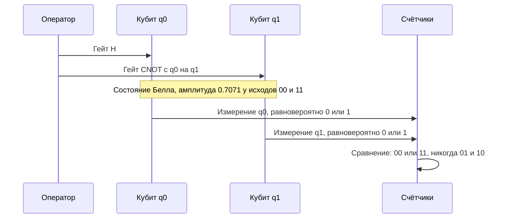

# Запутанность и измерение (Entanglement and Measurement)

## Тензоры vs суперпозиции: два разных «плюса»

Модуль 00 дал тензорное произведение (tensor product) для сборки составных систем. Важно не путать две операции:

- **Тензор** (сборка независимых кубитов): $|0\rangle \otimes |1\rangle = |01\rangle$ — это произведение, а не сумма: кубиты независимы. Сложение — это уже суперпозиция: $\frac{|0\rangle + |1\rangle}{\sqrt{2}} \otimes |0\rangle$.

Для $n$ кубитов пространство — $2^n$-мерное. Суперпозиция живёт **внутри** этого пространства, тензор — **между** подсистемами.

## Продуктовые vs запутанные состояния

Состояние $|\psi\rangle$ двух кубитов называется **продуктовым** (product state), если оно факторизуется:

$$|\psi\rangle = |a\rangle \otimes |b\rangle$$

Проверка на факторизуемость: состояние $\alpha|00\rangle + \beta|01\rangle$ факторизуется как $|0\rangle\otimes(\alpha|0\rangle + \beta|1\rangle)$ — кубиты независимы.

Состояние, которое **не факторизуется**, называется **запутанным** (entangled). Классический пример — состояние Белла (Bell state):

$$|\Phi^+\rangle = \frac{|00\rangle + |11\rangle}{\sqrt2}$$

Предположим, что оно факторизуется: $(a|0\rangle + b|1\rangle)\otimes(c|0\rangle + d|1\rangle) = ac|00\rangle + ad|01\rangle + bc|10\rangle + bd|11\rangle$. Тогда $ad = 0$ и $bc = 0$ означают либо $ac = 0$, либо $bd = 0$ — но у нас оба ненулевые. Противоречие: $|\Phi^+\rangle$ не факторизуется. Запутанность доказана алгеброй, без физики.

Как получить: одна пара H + CNOT (см. [предыдущий урок](02-gates-circuits.md)).

<details class="admonition analogy" markdown="1">
<summary class="admonition-title">Аналогия: пара кубиков, у которых всегда одна грань — но не заранее</summary>

Вообразите пару кубиков, которые при каждом броске показывают одинаковую грань, хотя в момент броска никакой конкретной грани ещё не существует и между кубиками не летит никакого «подсказывающего свистка». Это и есть Белл-состояние. Предел аналогии: настоящие кубики нельзя описать как «заранее назначенную пару граней», которую мы лишь не знаем, — общее описание живёт в амплитудах общего вектора состояния (см. разбор в разделе «Почему это НЕ просто классический рандом» и про неравенства Белла в «Узнать подробнее»).

</details>

## Четыре состояния Белла

| Состояние | Формула | Корреляция измерений |
|---|---|---|
| $\|\Phi^+\rangle$ | $\frac{\|00\rangle+\|11\rangle}{\sqrt2}$ | всегда одинаковые биты |
| $\|\Phi^-\rangle$ | $\frac{\|00\rangle-\|11\rangle}{\sqrt2}$ | одинаковые в Z-базисе, противоположные в X-базисе |
| $\|\Psi^+\rangle$ | $\frac{\|01\rangle+\|10\rangle}{\sqrt2}$ | всегда разные биты |
| $\|\Psi^-\rangle$ | $\frac{\|01\rangle-\|10\rangle}{\sqrt2}$ | всегда разные; синглет |

## Измерения: статистика и корреляции

Для $|\Phi^+\rangle$ каждый кубит **по отдельности** выглядит совершенно случайным: $p(0)=p(1)=1/2$ для первого и для второго. Но совместные исходы идеально коррелированы: `00` с вероятностью 1/2, `11` с вероятностью 1/2, никогда `01`/`10`.

```python
from qiskit import QuantumCircuit
from qiskit_aer import AerSimulator

qc = QuantumCircuit(2, 2)
qc.h(0); qc.cx(0, 1)
qc.measure([0, 1], [0, 1])
counts = AerSimulator().run(qc, shots=5000).result().get_counts()
print(counts)   # {'00': ~2500, '11': ~2500}
```

Важная тонкость: измерение одного кубита пары **проектирует** второй — он автоматически «становится» тем же исходом (для $\Phi^+$). Это выглядит как мгновенное влияние, но передать классическую информацию быстрее света нельзя: исход каждого локального измерения случаен, и только при сравнении результатов по классическому каналу видна корреляция. Кроме того, запутанность расходуется при измерении: одно измерение коллапсирует пару.

<details class="admonition intuition" markdown="1">
<summary class="admonition-title">Интуиция: измерение — «снимок», а не «подглядывание»</summary>

Измерение ведёт себя как съёмка танцора: снимок выбирает одну позу из плавно меняющейся суперпозиции и навсегда превращает её в факт. «До снимка» поз больше, чем одна, но и никакой скрытой позы, которую мы могли бы узнать, тоже нет — это проверено неравенствами Белла. Для пары хватает одного снимка: зафиксировав первый кубит, автоматически фиксируешь и согласованный второй. Поэтому для вычислений измерение — операция «с издержками»: каждый снимок стирает остальную суперпозицию.

</details>



## Небольшое о смеси: частично запутанные состояния

Не всякое «нелокальное» состояние максимально запутано. Состояние $\sqrt{0.9}|00\rangle + \sqrt{0.1}|11\rangle$ — запутанное, но с меньшей силой корреляций. Степень запутанности (entanglement) измеряется, например, конкорренсом (concurrence) или энтропией запутанности (entanglement entropy). Формальный аппарат (матрица плотности) в курсе только намечается: краткое упоминание — в уроке [«Основы квантовой механики» модуля 00](../00-fundamentals/02-quantum-mechanics-basics.md), систематическое изложение — Nielsen & Chuang, §2.4 ([resources/books.md](../../resources/books.md)). Пока достаточно различать «максимально запутан» (Белл) vs «частично запутан» vs «не запутан» (продукт).

## Телепортация (quantum teleportation)

Классический пример практической пользы запутанности: передача неизвестного состояния $|\psi\rangle = \alpha|0\rangle + \beta|1\rangle$ от Алисы Бобу **без физического переноса кубита**, но с обязательными 2 классическими битами и общей заранее разданной Bell-парой.

Схема (3 кубита, 2 классических бита):

```python
from qiskit import QuantumCircuit

qc = QuantumCircuit(3, 2)
qc.h(1); qc.cx(1, 2)          # Алиса и Боб делят Bell-пару (q1-q2)
qc.cx(0, 1); qc.h(0)          # Bell-базис измерение Алисы над q0 (состояние psi)
qc.measure([0, 1], [0, 1])    # 2 классических бита Алисы -> Бобу
qc.cx(1, 2); qc.cz(0, 2)      # коррекция Боба по полученным битам
```

Телепортация **не** нарушает причинность и не копирует состояние (no-cloning theorem): оригинал разрушается измерением, а Бобу нужен классический канал. Запутанность — «ресурс», классические биты — «инструкция».

### Почему это не клонирование (частый вопрос)

Вопрос «раз телепортация передаёт состояние, почему это не копирование?» возникает почти всегда — и ответ в самой конструкции протокола. Чтобы состояние оказалось у Боба, Алиса должна **измерить** свой кубит в Белл-базисе, а измерение необратимо: после него состояние $|\psi\rangle$ у Алисы разрушено, и «оригинала», который можно было бы копировать повторно, больше не существует. Второй момент: Боб получает не сам $|\psi\rangle$, а состояние, отличающееся от $|\psi\rangle$ на **известную поправку** (гейты $X$ и $Z$, выбираемые по двум классическим битам, присланным Алисой). То есть переносится информация о состоянии, но не само состояние-в-виде-объекта, — как раз то, что запрещает теорема о неклонировании.

## Эффект Зенона: измерение «замораживает» эволюцию

Интересный эффект, обратный привычному: если измерять систему достаточно часто, она почти перестаёт меняться. Квантовая механика не описывает «замораживание» как торможение — мешает само существование других состояний: после каждого измерения вектор состояния «подтягивается» к измеренному базисному состоянию, и суммарно (при достаточно малых интервалах) эволюция как будто замирает. Именно этот эффект лежит в основе dynamical decoupling — приёма подавления ошибок в экспериментах с длинными сверхпроводящими кубитами (см. [урок о шуме](../02-programming/04-noise-simulation.md)).

## Квантовая криптография: BB84 за пять минут

Запутанность и измерение — не только философия, но и рабочая криптография. Классическая схема разделения ключа (например, Диффи–Хеллмана) защищена вычислительной сложностью: злоумышленник не знает, как решить задачу. Квантовая схема BB84 (протокол 1984 года) даёт другую гарантию — **безопасность непосредственно из физики**: фотон в одном из четырёх состояний (двух базисов), и «подслушать» его, не спровоцировав ошибку в статистике, невозможно, потому что нельзя измерить, не разрушив (запрет на клонирование работает и здесь).

Схема в четырёх шагах: Алиса шлёт случайные фотоны в случайных базисах; Боб измеряет в случайных базисах и сообщает по открытому каналу, какие измерения «согласовались» (остальные отбрасываются, внося ошибку); Алиса и Боб сверяют часть битов публично, чтобы оценить частоту ошибок канала и убедиться, что перехвата не было; из оставшихся битов, согласовавшихся, извлекается ключ. В квантовой схеме с запутанностью (E91) распределение ключа идёт из корреляций, а безопасность опирается на неравенства Белла.

Практическая оговорка: квантовые ключи — не «взломанный RSA», а отдельный класс решений. Их плюс — доказуемая стойкость; минус — нужна своя инфраструктура (оптический канал, доверенные узлы, защита от атак на приёмники) и они не заменяют аутентификацию. Подробные курсы по этой теме есть у МИАН (см. «Узнать подробнее»).

### Куда это ведёт: квантовые повторители

Длинные оптоволоконные линии нельзя просто «усилить» классическим ретранслятором: усилитель копирует сигнал, а копия неизбежно шумит (и, по закону копирования, не может быть точной). Поэтому сигнал не усиливают, а **пересоздают**: на промежуточных узлах стоят квантовые повторители, которые разбивают линию на короткие участки, «пересоздают» состояние на каждом и склеивают части с помощью перестановки запутанности (entanglement swapping). Телепортация из предыдущего раздела — строительный блок такой схемы: по сути, повторитель реализует телепортацию «на полпути», а замена состояния между двумя узлами — это телепортация, выполненная посредством промежуточного измерения. Отсюда и практический вывод: чем длиннее канал, тем больше промежуточных «точек доверия» — и тем важнее становится аппаратная защита узлов, а не только математика протокола.

## Почему это НЕ просто классический рандом

!!! red-flag "Красный флаг: «кубит = random() с бонусами»"
    Сводить кубит к «генератору случайных битов» — самая частая ошибка на собеседованиях: случайность — лишь один слой того, что происходит при измерении, и не самый интересный. Ниже — четыре свойства, которые классический `random()` не воспроизводит ни за какие деньги.

1. **Интерференция**: амплитуды могут гасить и усиливать друг друга. Классические вероятности неотрицательные — «гасить» не умеют. Почти каждый квантовый алгоритм построен на этом.
2. **Экспоненциальное пространство состояний**: $2^n$ амплитуд при $n$ кубитах; классический рандом описывается $n$ вероятностями.
3. **Корреляции без общего случайного ключа**: состояния Белла коррелированы, хотя пары созданы давно и независимо — локальные скрытые переменные это не объясняют (неравенства Белла, экспериментально проверено).
4. **Неизмеряемость состояния**: нельзя скопировать и полностью прочитать $|\psi\rangle$ (no-cloning); классический бит можно скопировать бесконечно. Это качество — ресурс (квантовая криптография), а не только ограничение.

## 📚 Узнать подробнее

<details markdown="1">
<summary>Видеолекции (с таймкодами)</summary>

- **Михаил Осокин: «Неравенства Белла», Центр Архэ** — блок урока «Почему это НЕ просто классический рандом»: неравенства Белла и локальные скрытые переменные. [проверено] [ссылка](https://youtu.be/UXCcg2R9wls)
- **No-go теоремы квантовой механики — Алексей Рубцов, ПостНаука** — блок урока «Почему это НЕ просто классический рандом»: no-cloning и другие no-go теоремы. [проверено] [ссылка](https://youtu.be/Bh9fBwrTovI)

</details>

<details markdown="1">
<summary>Статьи и блоги</summary>

- **Квантовые вычисления и язык Q# для начинающих, Хабр / Microsoft** — состояния Белла, CNOT, запутанность. [по поиску] [ссылка](https://habr.com/ru/companies/microsoft/articles/351622)
- **Квантовые вычисления: между аналогом и цифрой, Хабр** — запутанность как ресурс квантовых вычислений. [по поиску] [ссылка](https://habr.com/ru/articles/1017210)

</details>

<details markdown="1">
<summary>Русскоязычные ресурсы</summary>

- **МГУ курс «Физические основы квантовых вычислений»** — телепортация, сверхплотное кодирование, квантовый параллелизм. [по поиску] [ссылка](https://quantum.msu.ru/ru/education/additional/physical-base-for-quantum-computing)
- **Холево «Квантовые системы, каналы, информация»** — книга, запутанность, измерения и квантовая информация. [проверено] [ссылка](https://www.mccme.ru/free-books/holevo-quantum.pdf)
- **Центр квантовых технологий МГУ (YouTube)** — лекции и курсы по квантовым вычислениям. [проверено] [ссылка](https://www.youtube.com/@msu_quantum)
- **Китаев, Шень, Вялый «Классические и квантовые вычисления»** — книга, главы о запутанности и состояниях Белла. [проверено] [ссылка](https://www.mccme.ru/free-books/qcomp/qbook.pdf)
- **Д.А. Кронберг. Лекция 1. Квантовая криптография (МФТИ–МИАН, осень 2021)** — блок «Квантовая криптография: BB84 за пять минут»: курс из 14 лекций о распределении квантовых ключей, разборе атак и стойкости протоколов. [ссылка на плейлист](https://youtube.com/playlist?list=PLUbD59ZHv1GTejj3vkVyUbProaQOunU_m)
- **А.С. Трушечкин, Д.А. Кронберг. «Математические основы квантовой криптографии» (МФТИ–МИАН, осень 2020, 16 лекций)** — блок «Квантовая криптография: BB84 за пять минут»: доказательство стойкости BB84 и метод обманных состояний. [ссылка на плейлист](https://youtube.com/playlist?list=PLUbD59ZHv1GRzz6dsQ4fvH1evxqK4qkI0)
- **Д.В. Мусатов. Вычисления на квантовых компьютерах (ФПМИ МГУ, 25.10.2019)** — блок «Квантовая криптография: BB84 за пять минут»: русскоязычная лекция с блоком «криптография» (1:09:30) — от квантовой механики к уязвимости RSA. [ссылка на видео](https://youtu.be/YjeyKgCGJFU)
- **LightCone. Quantum Computing #10. The Quantum Zeno Effect; #12. Перестановка запутанности (2023)** — блоки «Эффект Зенона» и «Перестановка запутанности»: короткие разборы «замораживания» эволюции частым измерением и схлопывания Белл-пар между разными узлами. Ролик #10 проверен отдельно (он же — «Квантовый эффект Зенона»), а нумерацию #12 в плейлисте [проверить]. [ссылка на плейлист](https://youtube.com/playlist?list=PLnbH8YQPwKbn9n1iPdbw0MC55SPyoHa5T)

</details>

## 🎛 Интерактив

Виджет «Два кубита» показывает пару кубитов как две сферы Блоха, а под ними — совместные вероятности четырёх исходов и конкорренс. Он позволяет увидеть главное различие: по отдельности кубиты в состоянии Белла совершенно случайны, но вместе дают только одинаковые биты.

<!--qc-embed: two-qubit.html | Два кубита: суперпозиция, запутанность, корреляции | 640-->

**Интерактив:** [виджет «Два кубита: суперпозиция, запутанность, корреляции»](https://drdimooon.github.io/qc-design-course/curriculum/01-quantum-basics/03-entanglement-measurement/#интерактив) · [файл виджета](../../assets/interactive/two-qubit.html)

**Задание.** Сравните запутанное состояние с парой независимых суперпозиций:

- Нажмите «H на q0», затем «CNOT (q0 -> q1)»: конкорренс станет C = 1.000, вероятности — 50.0% на |00⟩ и |11⟩ и 0.0% на |01⟩ и |10⟩, а виджет пометит состояние как запутанное.
- Посмотрите на строку «чистота редукции» под каждой сферой: у обоих кубитов она равна 0.500, то есть по отдельности каждый кубит полностью смешан (P(0) = P(1) = 50.0%), хотя пара в целом остаётся чистой.
- Нажмите «Измерить 200 раз»: в гистограмме окажутся только два столбика — |00⟩ и |11⟩ (примерно по 100 измерений из 200), у |01⟩ и |10⟩ ровно ноль.
- Нажмите «Сброс |00⟩», затем «Сравнить: H на обоих без CNOT»: конкорренс C = 0.000, по 25.0% на каждый из четырёх исходов, и исходы 01 и 10 вполне возможны — так выглядит пара независимых кубитов.

Как это связано с уроком: конкорренс — измеримая величина, которая отделяет продуктовое состояние от запутанного, а запрет исходов 01 и 10 — прямое следствие того, что состояние Белла не факторизуется. Сравнение в последнем пункте показывает, что «по 50% на каждый кубит» само по себе ещё ничего не говорит о запутанности: корреляцию создаёт именно CNOT.

## ✅ Проверь себя

1. Докажите, что $\frac{|01\rangle + |10\rangle}{\sqrt2}$ не факторизуется.
2. Какова вероятность измерить `10` для состояния $\sqrt{0.9}|00\rangle + \sqrt{0.1}|11\rangle$? Является ли оно максимально запутанным?
3. В схеме телепортации какую роль играют два классических бита? Что произойдёт без них?
4. Объясните, почему состояние Белла не позволяет передать сообщение быстрее света.
5. Реализуйте генерацию пары $\Psi^-$ в Qiskit (H, Z, CNOT, X на нужных кубитах). Проверьте корреляции через симулятор.
6. Почему телепортация не нарушает запрет на клонирование? Назовите два шага протокола, где информация необратимо теряется.
7. Почему в BB84 перехват фотона невозможен «бесшумно»? Какая величина измеряется в канале после согласования базисов?

[тест модуля 01](../../tests/01-quiz.md)

## ➡️ Что дальше

Следующий урок: [Обзор квантовых алгоритмов](04-algorithms-overview.md) — зачем всё это нужно и где квантовое ускорение реально.
