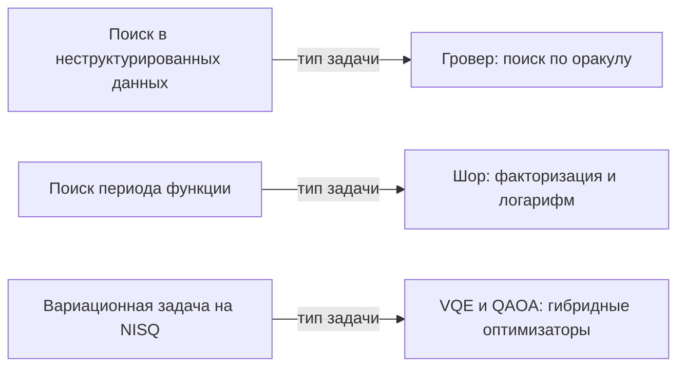

# Обзор квантовых алгоритмов (Quantum Algorithms Overview)

Кубиты, вентили и запутанность — «инструменты». Этот урок — карта того, что ими строят: основные классы квантовых алгоритмов и честный ответ на вопрос «что действительно быстрее».

## Формула успеха квантового алгоритма

Почти каждый полезный квантовый алгоритм устроен одинаково (шаблон «interfere-and-measure»):

1. Загрузить классические данные в суперпозицию (H или amplitude encoding).
2. Унитарная эволюция, использующая структуру задачи (периодичность, свойство оракула, chemistry-гамильтониан).
3. **Интерференция**: неправильные ответы гасятся (destructive interference), правильные усиливаются (constructive).
4. Измерение: прочитать небольшое число бит результата.

Ключевая деталь — пункт 2: ускорение возникает только там, где у задачи есть структура, «видимая» унитарными преобразованиями. На произвольных задачах квантовый компьютер не имеет преимуществ.

## Классы алгоритмов

### Поиск: алгоритм Гровера (Grover's search)

Задача: найти элемент в неструктурированной базе из $N$ записей по «чёрному ящику»-предикату (оракулу). Классически требуется $O(N)$ обращений к оракулу, Гровер — $O(\sqrt{N})$ (квадратичное ускорение, quadratic speedup).

Идея: суперпозиция всех элементов → оракул переворачивает фазу отмеченного → диффузия Адамара усиливает амплитуду отметки → повторить ~$\frac{\pi}{4}\sqrt{N}$ раз.

```python
from qiskit import QuantumCircuit

qc = QuantumCircuit(2)
qc.h([0, 1])                    # суперпозиция всех 4 элементов
qc.cz(0, 1)                     # оракул (один CZ): отмечаем |11> (изменяем фазу)
qc.h([0, 1]); qc.x([0, 1]); qc.cz(0, 1); qc.x([0, 1]); qc.h([0, 1])  # диффузор: H⊗H X⊗X CZ X⊗X H⊗H
# (CZ здесь можно заменить на (I⊗H)·CX·(I⊗H) — см. lab-02, шаг 2)
```

Grover оптимален с точки зрения запросов к оракулу; для задач, где данные структурированы (сортированный массив), классика и так быстрее.

### Оракульные «демонстрашки»: от Дойча до Саймона

Между «просто посчитать» и «сломать RSA» есть лестница алгоритмов, где квантовая часть впервые даёт **сверхклассическое** преимущество. Их стоит знать по порядку — они объясняют, как устроена оракульная модель.

| Алгоритм | Задача | Классически | Квантово |
|---|---|---|---|
| **Дойч** | постоянна ли функция $f(x)$, $x \in \{0,1\}$ | 2 запроса | 1 запрос |
| **Дойч–Джоза** | сбалансирована ли $f$ (то есть $w(f) = 0$ или $2^{n-1}$) | $2^{n-1}+1$ запросов | 1 запрос |
| **Бернштейн–Вазирани** | найти «секретную» строку $s$ в $f(x) = s \cdot x$ | $n+1$ запросов | 1 запрос |
| **Саймон** | найти $s$, для которого $f(x) = f(x \oplus s)$ | ~$2^{n/2}$ запросов | $O(n)$ запросов |

Общая механика у всех четырёх: квантовая схема строит $H^{\otimes n}$, применяет оракул, строит $H^{\otimes n}$ ещё раз и измеряет — а интерференция делает так, что «неправильные» компоненты гасятся. Первые три — учебные (ускорение с 2 запросов до 1), а вот **Саймон уже даёт экспоненциальное разделение** и является прямым предшественником Шора: у функции $f(x) = a^x \bmod N$ тоже есть период, и Саймон показывает, что квантовый компьютер умеет вытаскивать такую периодическую структуру (см. [урок о QFT и Шоре](../03-algorithms/02-qft-shor.md)).

### Факторизация: алгоритм Шора (Shor's algorithm)

Задача: разложить $N = pq$ на множители. Экспоненциальная сложность классики не доказана, но лучший известный алгоритм (решето чисел Гномера — GNFS) субэкспоненциален — именно на этом стоит стойкость RSA. Шор — экспоненциальное ускорение: полиномиальное время.

Три части алгоритма:

1. Сведение факторизации к поиску периода функции $f(x) = a^x \bmod N$.
2. **Квантовое преобразование Фурье (QFT)** для нахождения периода — сердце алгоритма, работает через интерференцию фаз.
3. Классическая постобработка (continued fractions) для извлечения множителей.

Практическая реальность: для криптографически значимых чисел (RSA-2048) нужны миллионы отказоустойчивых кубитов с коррекцией ошибок; текущие устройства далеки от этого.

### Симуляция квантовых систем (quantum simulation)

Первая и «родная» задача (Feynman, 1982): моделирование молекул и материалов. Классическая симуляция электронных систем упирается в экспоненциально растущее пространство состояний; квантовому компьютеру это пространство родно ($n$ кубитов ↔ $2^n$-мерность).

Приложения: катализаторы, батареи, высокотемпературная сверхпроводимость, лекарственные молекулы.

### Вариационные алгоритмы: VQE и QAOA

Компромисс эпохи NISQ (Noisy Intermediate-Scale Quantum — нынешние шумные устройства небольшого масштаба): квантовый компьютер решает «трудную» часть, классический оптимизатор — «лёгкую».

- **VQE (Variational Quantum Eigensolver)**: поиск основного состояния (ground state) молекулы. Анзац (parameterized circuit) $U(\theta)$ готовит пробное $|\psi(\theta)\rangle$, измеряется энергия $E(\theta) = \langle\psi(\theta)|H|\psi(\theta)\rangle$, классический оптимизатор крутит $\theta$ до минимума.
- **QAOA (Quantum Approximate Optimization Algorithm)**: комбинаторная оптимизация (MaxCut, расписания) — анзац из cost- и mixer-слоёв, оптимизация углов.

```python
import numpy as np
from qiskit.circuit.library import efficient_su2
from qiskit.quantum_info import SparsePauliOp, Statevector

hamiltonian = SparsePauliOp.from_list([("ZZ", 1.0), ("XI", 0.5)])
ansatz = efficient_su2(2, reps=1)          # параметризованная схема для VQE

# оценка энергии при фиксированных значениях параметров
values = {p: 0.3 for p in ansatz.parameters}
state = Statevector(ansatz.assign_parameters(values))
print("E =", np.round(state.expectation_value(hamiltonian).real, 4))   # E = 1.0679
```

### Квантовое машинное обучение (QML)

Направление молодое: квантовые ядра (quantum kernels), вариационные классификаторы, квантовые нейросети. Честно: подавляющего преимущества пока не показано; активная исследовательская зона, где главный вопрос — есть ли у данных «квантово-удобная» структура.



## Сводная таблица

| Алгоритм | Задача | Ускорение | Статус |
|---|---|---|---|
| Дойч–Джоза | сбалансированность булевой функции | с $2^{n-1}+1$ запросов до 1 | учебный, демонстрационный |
| Бернштейн–Вазирани | поиск «секретной» строки $s$ в $f(x) = s \cdot x$ | с $n+1$ запросов до 1 | учебный, демонстрационный |
| Саймон | поиск периода двоичной функции | экспоненциальное | учебный, мост к Шору |
| Grover | неструктурированный поиск | квадратичное, $O(\sqrt N)$ | демонстрирован на малых масштабах |
| Shor | факторизация, дискретный логарифм | экспоненциальное | требуются миллионы отказоустойчивых кубитов |
| Симуляция | химия, материалы | вероятно экспоненциальное | активная разработка, NISQ-VQE |
| VQE/QAOA | химия, оптимизация | эвристическое, обсуждается | исследовательский этап |
| QML | ML-задачи | не доказано | ранняя стадия |

## Заблуждения (misconceptions), которые надо снять

1. **«Квантовый компьютер быстрее во всём» (quantum supremacy everywhere).** Нет. Квантовый выигрыш существует для задач со специфической структурой (периодичность, оракульные запросы, гамильтонова динамика). Сложение 16-битных чисел квантовый компьютер не ускорит.
2. **«Он пробует все варианты параллельно»**, и это «бесплатная проверка всех». Суперпозиция всех ответов есть, но измерение даёт только один случайный исход; ценность создаётся интерференцией (см. [запутанность и измерение](03-entanglement-measurement.md)) — и её надо специально спроектировать.
3. **«Вероятностный = квантовый».** Классический Монте-Карло тоже вероятностный; квантовое отличие — амплитуды с фазами, а не просто случайность.
4. **«Shor уже ломает все пароли сегодня».** Требуются миллионы кубитов с исправлением ошибок в таком масштабе; квантово-устойчивая криптография (post-quantum cryptography) уже стандартизирована (NIST, FIPS 203/204/205, 2024) и внедряется.
5. **«Другие задачи вроде сортировки решаются квантово».** Доказаны нижние границы ($\Omega(N)$ для поиска в отсортированном массиве и т.п.).

## Как выбирать задачи для квантового подхода

Хорошие кандидаты: структура + сложность классики + терпимость к шуму + малое число кубитов на решение. Плохие: неструктурированные элементарные операции, задачи, где классика полиномиально легка, и всё, что требует миллиардов точных вычислений на нынешнем железе.

## 📚 Узнать подробнее

<details markdown="1">
<summary>Видеолекции (с таймкодами)</summary>

- **Лекция 13. А.С. Холево. Алгоритмы Саймона и Гровера, МЦМУ МИАН** — блок урока «Классы алгоритмов»: строгий разбор алгоритма Гровера. [проверено] [ссылка](https://youtu.be/CuLVIz-v_Kc)
- **Квантовая информатика. Лекция 7. Алгоритм Гровера Часть 3, КФУ** — блок урока «Классы алгоритмов»: курс КФУ, разбор Гровера. [проверено] [ссылка](https://youtu.be/00X8X-o1VVw)
- **Алгоритм Шора, Quantum Tech** — блок урока «Классы алгоритмов»: разбор алгоритма Шора. [проверено] [ссылка](https://youtu.be/SPWNTxACmjQ)
- **Задачи и алгоритмы квантовых вычислений: Сейсмика, Центр квантовых технологий МГУ** — блок урока «Классы алгоритмов»: обзор задач и алгоритмов. [проверено] [ссылка](https://youtu.be/iuKeR2hpuKk)
- **But what is quantum computing? (Grover's Algorithm), 3Blue1Brown** — блок урока «Классы алгоритмов»: наглядное введение в кубиты и Гровера. [проверено] [ссылка](https://youtu.be/RQWpF2Gb-gU)

</details>

<details markdown="1">
<summary>Статьи и блоги</summary>

- **Квантовые вычисления: между аналогом и цифрой, Хабр** — обзор квантовых компьютеров и их возможностей. [по поиску] [ссылка](https://habr.com/ru/articles/1017210)
- **Квантовые вычисления и язык Q# для начинающих, Хабр / Microsoft** — практическое применение квантовых алгоритмов. [по поиску] [ссылка](https://habr.com/ru/companies/microsoft/articles/351622)

</details>

<details markdown="1">
<summary>Русскоязычные ресурсы</summary>

- **Алексей Фёдоров, Российский квантовый центр. IT-технологии в эпоху квантовых компьютеров** (канал Yandex for Developers) — обзор квантовых вычислений от РКЦ. [проверено] [ссылка](https://youtu.be/B-I_d3BIVac)
- **МГУ курс «Теория квантовых алгоритмов и вычислительной сложности» (А.Ю. Чернявский)** — алгоритмы Шора и Гровера, квантовые блуждания. [по поиску] [ссылка](https://quantum.msu.ru/ru/education/msc-programs/quantum-computing)
- **Китаев, Шень, Вялый «Классические и квантовые вычисления»** — книга, главы о квантовых алгоритмах. [проверено] [ссылка](https://www.mccme.ru/free-books/qcomp/qbook.pdf)
- **МЦМУ МИАН (YouTube)** — открытые лекции по квантовым вычислениям, включая курс Холево. [проверено] [ссылка](https://www.youtube.com/@SteklovMathInstitute)
- **А.С. Трушечкин. Лекция 10. Алгоритм Дойча–Джозы. Алгоритм Бернштейна–Вазирани (МФТИ–МИАН, весна 2021)** — блок «Оракульные "демонстрашки"»: разбор оракульной модели и алгоритмов с 1 запросом вместо $2^{n-1}$; тот же материал в сокращённой версии есть в плейлисте всего курса. [ссылка на видео](https://youtu.be/Pnff711U7XI) · [ссылка на плейлист](https://youtube.com/playlist?list=PLUbD59ZHv1GTNTlI9Gdx2Np3DDd7hta-q)
- **И.В. Чижов. Лекция 03. Задача о сбалансированности булевой функции и алгоритм Дейча (ВМК МГУ, осень 2025)** — блок «Оракульные "демонстрашки"»: доказательство корректности алгоритма Дойча и определение $w(f)$. Ролик подтверждён как «Лекция 3 | ВМК МГУ» курса «Введение в квантовые вычисления и алгоритм Шора», но нумерация лекций в заголовках YouTube не совпадает с номерами на слайдах — тему [проверить]. [ссылка на видео](https://youtu.be/mVF-MABOMz0)
- **LightCone. Квантовые вычисления #7. Парадокс Харди; #8. Квантовая телепортация (2023)** — блок «Классы алгоритмов»: разбор «пирожкового» парадокса Харди как готовой задачи на «найдите неверное допущение» и протокол телепортации. [ссылка на плейлист](https://youtube.com/playlist?list=PLnbH8YQPwKbn9n1iPdbw0MC55SPyoHa5T)

</details>

## 🎛 Интерактив

Виджет «Интерференция и Гровер» — предпросмотр одного из алгоритмов, о котором шла речь выше: четыре элемента базы, один помечен, а на экране видно, как оракул и диффузор вмешиваются в амплитуды. Здесь механизм ускорения — интерференция — показан в самом маленьком масштабе.

<!--qc-embed: grover-amplitude.html | Интерференция и Гровер: рост амплитуды | 640-->

**Интерактив:** [виджет «Интерференция и Гровер: рост амплитуды»](https://drdimooon.github.io/qc-design-course/curriculum/01-quantum-basics/04-algorithms-overview/#интерактив) · [файл виджета](../../assets/interactive/grover-amplitude.html)

**Задание.** Проверьте, как ведёт себя помеченный элемент:

- В группе «Помеченный элемент» нажмите **10**: состояние вернётся к равномерной суперпозиции — по 25.00% на каждый из четырёх элементов, амплитуда 0.500 у всех.
- Нажмите **Шаг** один раз: P(помеченного) = 100.00%, амплитуда помеченного элемента 1.000, у остальных 0.000 — на графике точка попадает в отмеченный оптимум k = 1.
- Нажмите **Шаг** ещё раз: вероятность упадёт обратно до 25.00%, амплитуда помеченного станет 0.500, у остальных −0.500 — снова по 25.00% на каждый элемент, лишняя итерация «перекрутила» амплитуду.
- Нажмите **Авто**: точка на графике будет колебаться между 25% и 100% (25%, 100%, 25%, 25%, 100%, …), и оптимум останется на k = 1.

Как это связано с уроком: это и есть шаблон «interfere-and-measure» в действии — оракул меняет знак амплитуды, диффузор усиливает помеченную амплитуду, и измерение с высокой вероятностью даёт нужный ответ. Сразу видно и ограничение: число итераций надо выбирать точно (оптимум $k \approx \frac{\pi}{4}\sqrt{N}$), иначе результат испортится.

## ✅ Проверь себя

1. Почему суперпозиция «всех ответов» сама по себе не даёт ускорения? Какой механизм превращает её в полезный результат?
2. Какое ускорение даёт Grover и от чего оно зависит? Приведите пример задачи, где Grover бессилен.
3. Опишите три шага алгоритма Шора и роль QFT.
4. Что значит «вариационный» в VQE и какие роли делят квантовый и классический компьютеры?
5. Выберите 3 задачи из списка: (а) отчёт SQL по биллингу, (б) поиск ключа шифрования, (в) моделирование молекулы катализатора, (г) сортировка массива, (д) поиск оптимума в графе MaxCut. Какие — кандидаты на квантовый подход и почему?

[тест модуля 01](../../tests/01-quiz.md)

## ➡️ Что дальше

Модуль завершён. По ROADMAP дальше идут профильные модули: программирование на Qiskit ([модуль 02](../02-programming/README.md)), алгоритмы ([модуль 03](../03-algorithms/README.md)), системы и железо ([модуль 05](../05-hardware/README.md)). Рекомендуемый следующий шаг — внимательно перечитать модуль 01 с запуском всех примеров кода.
