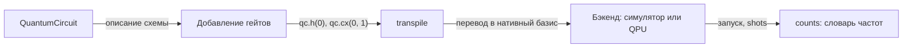

# Гейты, параметры и композиция схем в Qiskit

## Handy-таблица «мысленный вентиль -> вызов»

| Вентиль | Qiskit-вызов | Комментарий |
|---|---|---|
| X (NOT) | `qc.x(q)` | 180° по X |
| Y | `qc.y(q)` | 180° по Y (i-фаза) |
| Z | `qc.z(q)` | 180° по Z (фазовый) |
| H (Hadamard) | `qc.h(q)` | суперпозиция |
| S | `qc.s(q)` | Z на 90° |
| T | `qc.t(q)` | Z на 45° |
| RX | `qc.rx(theta, q)` | вращение по X |
| RY | `qc.ry(theta, q)` | вращение по Y |
| RZ | `qc.rz(phi, q)` | вращение по Z (фазовый) |
| CNOT | `qc.cx(c, t)` | control, target |
| CZ | `qc.cz(c, t)` | диагональный |
| SWAP | `qc.swap(a, b)` | обмен состояниями |
| Toffoli | `qc.ccx(a, b, c)` | 3 кубита |
| RXX/RZZ | `qc.rxx(theta, a, b)` / `qc.rzz(...)` | связывают состояния по X/Z |

## Параметризованные схемы

Для вариационных алгоритмов (VQE, QAOA — [03](../03-algorithms/03-vqe-qaoa.md)) схема зависит от углов:

```python
import numpy as np
from qiskit import QuantumCircuit
from qiskit.circuit import Parameter, ParameterVector

theta = Parameter("theta")
phi   = ParameterVector("phi", 2)

qc = QuantumCircuit(2)
qc.rx(theta, 0)
qc.rzz(phi[0], 0, 1)
qc.ry(phi[1], 1)

bound = qc.assign_parameters({theta: np.pi/2, phi: [0.3, 0.6]})
```

`Parameter` — переменная, `assign_parameters` даёт конкретную схему. Один шаблон анзаца + разные значения — типовой цикл VQE/QAOA.

## Барьеры в конструкции

`barrier()` не выполняет физического действия — он запрещает компилятору переставлять гейты через эту точку. Полезен для: (1) фиксации порядка, (2) разделения «подготовки» и «измерения» в схеме телепортации.

## Композиция схем

```python
bell = QuantumCircuit(2); bell.h(0); bell.cx(0, 1)
qc = QuantumCircuit(4)
qc.compose(bell, qubits=[0, 1], inplace=True)   # встроить в qc на месте
qc2 = QuantumCircuit(4)
qc2 = qc2.compose(bell, qubits=[2, 3])          # без inplace — вернётся НОВАЯ схема
```

`compose` по умолчанию **возвращает новую схему** и не меняет исходную — поэтому результат нужно присвоить (`qc2 = qc2.compose(...)`), иначе вложение просто потеряется. С `inplace=True` схема меняется на месте и ничего не возвращается.

Большой проект собирается как «конструктор»: подготовка->обработка->чтение, каждый блок свой метод.



Как читать схему: стрелки идут слева направо и повторяют тот порядок, в котором вы работаете с Qiskit. Сначала создаётся объект `QuantumCircuit`, в него добавляются гейты (`qc.h(0)`, `qc.cx(0, 1)`, параметры через `assign_parameters`), затем `transpile` переписывает схему в нативный базис и в карту связности устройства, бэкенд исполняет её заданное число `shots`, а на выходе получается словарь `counts` — те же частоты исходов, что в примере `get_counts()` из первого урока модуля.

- Проверь себя: на каком шаге ещё можно свободно выбирать любые кубиты, а на каком связность устройства уже диктует, куда что поставить?
- Проверь себя: на каком шаге схемы решается, чем гейт `cx` станет на устройстве с нативным базисом {`rz`, `sx`, `x`, `ecr`}, и почему симулятор этот шаг может пропустить?
- Проверь себя: почему в словаре `counts` может быть от одного до четырёх ключей при схеме из двух кубитов и что означает отсутствие ключа?

## Многоразрядная алгебра на уровне Qiskit

Урок [2 модуля 01](../01-quantum-basics/02-gates-circuits.md) даёт матрицы. Здесь же важный практический приём: `qc.unitary(matrix, qubits)` — вставить произвольную унитарную матрицу. Qiskit не раскладывает её в базисные гейты сам: в схеме лежит одна инструкция `unitary`, а разложение (`UnitarySynthesis`) выполняет `transpile` под нативный базис устройства. Когда аналог собственной матрицы 2^n×2^n уже есть, это самый короткий эксперимент.

## 📚 Узнать подробнее

Примечание: таймкоды в этом справочнике не проставлены — на момент проверки YouTube блокирует программный доступ к субтитрам, а выдуманные или непроверенные интервалы вставлять нельзя. Ссылки даны без времени.

<details markdown="1">
<summary>Видеолекции</summary>

- **Introduction to Linear Algebra, Prerequisite Mathematics, and Circuit Composition - Part 1 / Part 2, Qiskit Global Summer School 2022 (канал Qiskit)** — блок урока «Композиция схем»: как из маленьких схем собирается большая (тот самый `compose` с параметром `qubits`), плюс гейтовый словарь, который лежит в основе handy-таблицы урока. [Часть 1](https://youtu.be/ZNz7DN1K0Y0), [Часть 2](https://youtu.be/BuKYugTtcXQ)
- **How can I control the unitary part of a circuit? 1 Minute Qiskit (канал Qiskit)** — блок урока «Многоразрядная алгебра на уровне Qiskit»: что происходит с `qc.unitary(matrix, qubits)` и как контролируются произвольные унитарные вставки. [ссылка](https://youtu.be/7PuOMKb8M9c)
</details>

<details markdown="1">
<summary>Статьи и блоги</summary>

- **«Ansatz» (урок курса Quantum chemistry with VQE, IBM Quantum Learning)** — блок урока «Параметризованные схемы»: анзацы как шаблоны из гейтов и `Parameter`/`assign_parameters`, то есть цикл «один шаблон -> много значений», который урок описывает словами, — в виде готового учебного курса. Проверено webfetch (страница открывается). [ссылка](https://quantum.cloud.ibm.com/learning/courses/quantum-chem-with-vqe/ansatz)
</details>

<details markdown="1">
<summary>Книги / документация (глава/раздел)</summary>

- **Qiskit документация** (quantum.cloud.ibm.com), API-страница `qiskit.circuit.QuantumCircuit`: полный список методов-гейтов (`x`, `h`, `rz(theta, q)`, `cx(c, t)`, `ccx`, `rxx`, `rzz`), `barrier`, `compose`, а также готовый пример `assign_parameters` — прямой компаньон handy-таблицы и блоков «Параметризованные схемы» и «Барьеры в конструкции». Проверено через содержимое страницы. [ссылка](https://quantum.cloud.ibm.com/docs/api/qiskit/qiskit.circuit.QuantumCircuit)
- **Qiskit документация** (quantum.cloud.ibm.com), API-страницы `Parameter` и `ParameterVector`: символьные параметры, типовые способы связывания (`assign_parameters` с dict или списком) — расширяют блок «Параметризованные схемы» перед VQE/QAOA. Проверено через содержимое страниц. [Parameter](https://quantum.cloud.ibm.com/docs/api/qiskit/qiskit.circuit.Parameter), [ParameterVector](https://quantum.cloud.ibm.com/docs/api/qiskit/qiskit.circuit.ParameterVector)
</details>

<details markdown="1">
<summary>Русскоязычные ресурсы</summary>

- **«Квантовое программирование. Ч.1: Анализ средств разработки», Рябов Н.В. и др., КиберЛенинка** — научная статья со сравнением Qiskit и Q#: разбор гейтов, суперпозиции, запутанности, телепортации на конкретных листингах — прямое сопровождение handy-таблицы и блока «Композиция схем». Проверено webfetch. [ссылка](https://cyberleninka.ru/article/n/kvantovoe-programmirovanie-ch-1-analiz-sredstv-razrabotki)
- **«Квантовые компьютеры. С точки зрения традиционного программиста-математика. Часть 2», Хабр** — детальный разбор гейтов X, Y, Z, H, S, T, CNOT с матрицами и визуализациями — дополнение к handy-таблице и блоку «Многоразрядная алгебра». Проверено webfetch. [ссылка](https://habr.com/ru/articles/747208/)
- **Онлайн-курс «Программируем квантовые компьютеры на Python с QisKit», Сысоев С.С., СПбГУ** — модуль 2 «QisKit. Гейты. Ввод-вывод»: квантовые гейты, мульти-кубитные гейты, представление результатов — прямое сопровождение блоков «Handy-таблица» и «Композиция схем». Проверено webfetch. [ссылка](https://online.spbu.ru/courses/programmirovanie-kvantovyx-kompyuterov-na-python-s-qiskit/)
- **Семинары РКЦ «Введение в квантовые вычисления» (GitHub)** — ноутбуки по Qiskit: базовые операции, гейты, работа с IBM Q Experience, визуализация результатов — практическое дополнение ко всем блокам урока. Проверено webfetch. [ссылка](https://github.com/RQC-QApp/Seminars)
</details>

## ✅ Проверь себя

1. Чем `qc.ry(theta, 0)` отличается от `qc.rx(theta, 0)` для состояния |0>? Вычислите вручную и проверьте через Statevector.
2. Как в Qiskit «увеличить» данные параметра схемы: `Parameter` или `ParameterVector`? В чём разница при передаче в `assign_parameters`?
3. Барьер дойдёт до финальной схемы после transpile или это только подсказка компилятору? Проверьте `count_ops()` после `transpile` (учится в [03](03-transpilation-hardware.md)).
4. Какова размерность матрицы, которую вернёт `Operator(bell_2qb)`? Теперь представьте 10 кубитов: сколько будет элементов такой матрицы? (проверьте в тесте).

Тест по модулю: [02-quiz.md](../../tests/02-quiz.md).

## ➡️ Что дальше

[03-transpilation-hardware.md](03-transpilation-hardware.md) — как схема превращается в программу для конкретного железа.
