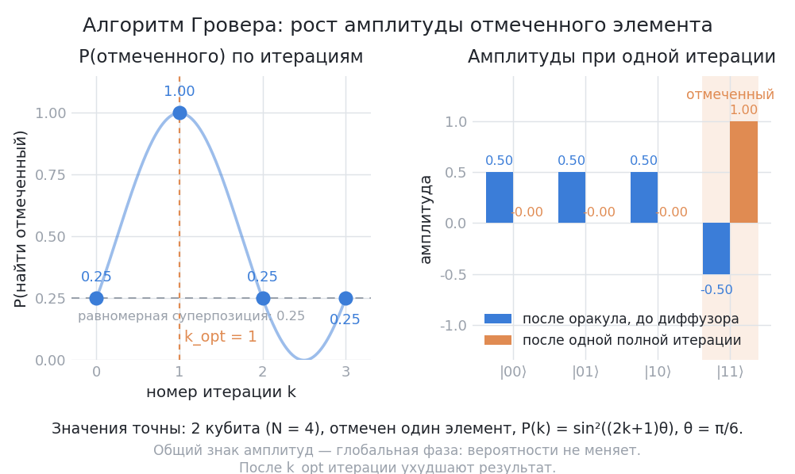
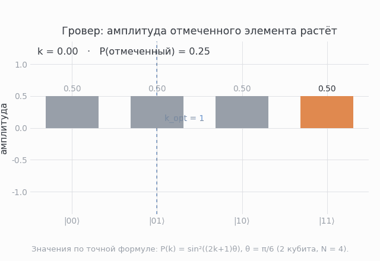

# Алгоритм Гровера: квадратичный поиск

## Постановка

Есть N=2^n вариантов, оракул — «чёрный ящик», который помечает правильный вариант фазой −1 (фазовый оракул). Классически нужно ~N проверок. Квантово — ~√N итераций ($k \approx \frac{\pi}{4}\sqrt{N/M}$, где M — число решений). Это квадратичное, а не экспоненциальное ускорение — частая ошибка при пересказе.

!!! red-flag "Красный флаг: «Гровер ускоряет поиск экспоненциально»"
    Нет: выигрыш строго квадратичный — √N проверок вместо N. Экспоненциальный выигрыш против классики даёт факторизация (Шор, [урок 02](02-qft-shor.md)). В инженерной оценке подмена опасна: $\sqrt{2^{40}}$ — «всего лишь» порядка миллиона итераций, поэтому решатель SAT на Гровере экономит квадрат, а не «всё сразу».

## Анатомия итерации

Одна итерация Гровера = два вращения одного вектора:

1. **Оракул O** — инвертирует амплитуду целевого состояния: $|x\rangle \to (-1)^{f(x)}|x\rangle$.
2. **Диффузор D = H^n X^n (CZ-аналог) X^n H^n** — отражение относительно среднего амплитуд: разносит усиление на целевое состояние.

Геометрически: начальный вектор лежит в 2D-плоскости {target, rest}, а каждая итерация (композиция DO) поворачивает его на угол $\theta = 2\arcsin\sqrt{M/N}$ — это полный угол поворота за итерацию; полуугол между $|s\rangle$ и $|s'\rangle$ равен $\arcsin\sqrt{M/N} = \theta/2$. По мере приближения к target вероятность максимальна при $k_\text{opt} = \lfloor \pi\sqrt{N/M}/4 \rfloor$; пройдя дальше — начнёт «переливаться» обратно (вероятность падает).

Аналогия: два зеркала и толчки в такт

Оракул и диффузор — два «зеркала», между которыми качается вектор состояния: оракул даёт амплитуде цели знак «минус», диффузор отражает все амплитуды относительно их среднего уровня. Одна итерация — один толчок строго в такт: как качели, чья высота раскачки (амплитуда цели) растёт линейно с числом толчков, а вероятность успеха — как квадрат высоты. Проехать дальше $k_\text{opt}$ — и раскачка «переливается» обратно, вероятность падает; поэтому число итераций считают заранее, а не подбирают «на глаз».
Предел аналогии: отражение — картинка одной итерации: оно не объясняет, почему число итераций оптимально и почему под шумом оптимум смещается вниз.

*Подпись: слева — вероятность нахождения отмеченного элемента по числу итераций для двух кубитов (N = 4): 25% при k = 0, максимум 100% при $k_\text{opt} = 1$ и снова 25% при k = 2, то есть лишняя итерация ухудшает результат; справа — амплитуды после оракула (0.50, 0.50, 0.50, −0.50) и после одной полной итерации (1.00 на отмеченном элементе, остальные нулевые). Вывод: вероятность — это квадрат амплитуды, поэтому её рост требует роста самой амплитуды, и останавливаться нужно на $k_\text{opt}$.*

## Реализация на 2-3 кубитах

Смотрите полный код в [lab-02 (шаг 2)](../02-programming/lab-02-first-circuit.md): оракул — один CZ, помечающий $|11\rangle$ фазой −1; диффузор — $H^{\otimes 2}X^{\otimes 2}\,CZ\,X^{\otimes 2}H^{\otimes 2}$ (в коде CZ реализован как $(I\otimes H)\cdot CX\cdot(I\otimes H)$, то есть с H на целевом кубите). Для M=1, N=4: $\theta = 2\arcsin\sqrt{1/4} = 60°$, $k_\text{opt} = 1$ — ровно одна итерация даёт ~100%.

Для 3-SAT-подобных оракулов (truth-table через `DiagonalGate`, альтернативы через clause-uncompute) — проект [02-grover-oracles](../../projects/02-grover-oracles.md): там же анализ, как число итераций k ведёт себя под шумом (спойлер: оптимум сдвигается вниз).

*Анимация: амплитуда отмеченного элемента (оранжевый столбик) растёт от 0.50 при k = 0 (P = 0.25) до 1.00 при k = 1 — пунктирная линия отмечает $k_\text{opt} = 1$ — и снова падает до 0.50 при k = 2, а амплитуды остальных элементов при этом уходят в минус. Вывод: амплитуды осциллируют, поэтому лишняя итерация не усиливает помеченный элемент, а ослабляет его.*

## Оракулы: важная честность

Сам оракул должен «знать» условие — его построение (число гейтов) часто съедает все преимущества √N. Гровер уместен, когда оракул «дешёвый», а пользователь данных — нет (пример: поиск по неиндексированной базе, решение симметричной проблемы).

## Как свести задачу к оракулу

Есть стандартная схема постановки любой такой задачи, и она же — универсальный рецепт, который стоит выучить до остальных алгоритмов. Пусть есть классическая булева функция $f:\{0,1\}^n \to \{0,1\}$ (часто с битом «сравнения», $f(x) = 1$ означает «x — искомый»). Квантовый оракул реализуется одним из двух способов:

- **Обычный (битовый) оракул**: $U_f|x\rangle|y\rangle = |x\rangle|y \oplus f(x)\rangle$ — «вычисли» $f$ в дополнительном (ancilla) регистре и записывает результат в него. В Qiskit это `qiskit.circuit.library.bit_flip_oracle.BitFlipOracleGate`: он переключает ancilla-бит, если $f(x) = 1$, и умеет принимать выражение прямо строкой (`'x0 & x1'`) или в формате DIMACS CNF.
- **Фазовый оракул**: $Z_f(x) = (-1)^{f(x)}$ — ничего не записывает, а только меняет знак амплитуды у «искомых» состояний. Именно он нужен Гроверу: усиливать надо не «содержимое регистра», а вероятность. В Qiskit это `qiskit.circuit.library.PhaseOracleGate` (класс `PhaseOracle` помечен как deprecated с Qiskit 2.2 и будет удалён в 3.0): гейт берёт логическое выражение по отмеченным битам и реализует его как фазовую метку, без ancilla-регистра.

Оракул — чёрный ящик: нам не нужно знать, как он устроен внутри, достаточно доступа «спросить $f(x)$». Именно поэтому в оценках сложности считают не гейты, а **число запросов к оракулу**, а реальную стоимость оракула обсуждают отдельно (см. «Оракулы: важная честность» выше). Этот же приём — «свести задачу к оракулу $f$» — переносится на всё остальное: поиск невыполнимого, задачи выполнимости (КНФ), поиск в неупорядоченной базе.

## Ускорение = √N в терминах ресурсов

- N проб классических → N итераций классического поиска.
- Гровер: (π/4)√N итераций; каждая итерация = 1 оракул + 1 диффузор, $O(n)$ гейтов.
- При N=10^6: ~785 итераций (k_opt = ⌊(π/4)·10³⌋ = 785) vs 10^6 проверок — прекрасный прирост, но не «мгновение».

## 📚 Узнать подробнее

Видеолекции (с таймкодами)

- **Grover's Algorithm | Understanding Quantum Information & Computation | Lesson 08, Джон Уотрус (Qiskit)** [00:03:11-00:12:50] - блок урока «Постановка»: формальная постановка неструктурированного поиска и фазовый оракул $O$ как фазовый запрос. [ссылка](https://youtu.be/hnpjC8WQVrQ)
- **Grover's Algorithm | Lesson 08, Джон Уотрус (Qiskit)** [00:19:20-00:31:54] - блок урока «Анатомия итерации»: действие операции Гровера и геометрическая картина — диффузор $D$ как отражение относительно среднего, поворот вектора на угол $\theta$. [ссылка](https://youtu.be/hnpjC8WQVrQ)
- **Grover's Algorithm | Lesson 08, Джон Уотрус (Qiskit)** [00:31:54-00:37:13] - блок урока «Оракулы: важная честность»: как «настраивается» целевое состояние и что эта настройка реально стоит. [ссылка](https://youtu.be/hnpjC8WQVrQ)
- **Grover's Algorithm | Lesson 08, Джон Уотрус (Qiskit)** [00:44:43-00:51:13] - блок урока «Ускорение = √N в терминах ресурсов»: число запросов до остановки и что меняется при неизвестном числе решений $M$. [ссылка](https://youtu.be/hnpjC8WQVrQ)
- **But what is quantum computing? (Grover's Algorithm), Грант Сандерсон (3Blue1Brown)** [00:18:38-00:29:30] - блок урока «Анатомия итерации»: визуальная сборка итерации из оракула и диффузора на векторе состояния. [ссылка](https://youtu.be/RQWpF2Gb-gU)
- **But what is quantum computing? (Grover's Algorithm), 3Blue1Brown** [00:31:27-00:34:01] - блок урока «Ускорение = √N в терминах ресурсов»: наглядный ответ, почему прирост квадратичный, а не мгновенный. [ссылка](https://youtu.be/RQWpF2Gb-gU)

Русскоязычные ресурсы

- **Лекция 10: Операторы отражения для задачи поиска Гровера, канал QuantuC** — блок урока «Анатомия итерации»: построение операторов отражения (оракул и диффузор) для алгоритма Гровера на русском языке. [проверено по поиску, без таймкодов](https://youtu.be/MqRGor1ZsJo)
- **Лекция 12: Моделирование алгоритма Гровера с помощью Qiskit, канал QuantuC** — блок урока «Реализация на 2-3 кубитах»: практическая реализация алгоритма Гровера в Qiskit с разбором схемы и результатов моделирования. [проверено по поиску, без таймкодов](https://youtu.be/9U8xqmYfjZ8)
- **Лекция 11. В.И. Яшин. Квантовый алгоритм усиления амплитуды и квантовое преобразование Фурье, МИАН (МЦМУ МИАН)** — блок урока «Анатомия итерации»: строгое изложение алгоритма усиления амплитуды (обобщение Гровера) и геометрической картины на русском языке. [проверено по поиску, без таймкодов](https://youtu.be/pyhCt9QWLC8)
- **Лекция 10. V.I. Yashin. Quantum Algorithms Using Oracles, МИАН (МЦМУ МИАН)** — блок урока «Оракулы: важная честность»: обзор квантовых алгоритмов с оракулами, включая постановку задачи поиска и роль оракула. [проверено по поиску, без таймкодов](https://youtu.be/UmvDFaEtAN8)
- **Онлайн курс «Введение в квантовые вычисления», Лекция 7 (МГУ ЦКТ)** — блок урока «Постановка»: алгоритм Гровера, геометрическая иллюстрация, оценка ресурсов и оптимальность. [проверено по поиску](https://quantum.msu.ru/ru/education/online/introduction-to-quantum-computing)
- **А.С. Трушечкин. Лекция 15. Алгоритм Гровера (МФТИ–МИАН, весна 2022, 16.05.2022)** — блок «Анатомия итерации»: строгое изложение поиска в неупорядоченной базе, оператор отражения и геометрия поворота вектора. [ссылка на видео](https://youtu.be/mQhEcdxfn70)
- **И.В. Чижов. Лекция 10. Квантовая постановка задачи (ВМК МГУ, осень 2025)** — блок «Как свести задачу к оракулу»: универсальная схема $U_f|a\rangle|x\rangle = |a \oplus f(x)\rangle|x\rangle$, фазовый оператор $Z_f(x)=(-1)^{f(x)}$ и перечень классических задач, которые сводятся к оракулу (КНФ, поиск в массе). [ссылка на плейлист](https://youtube.com/playlist?list=PLhe7c-LCgl4L8mVa0Zgz5NTm3pvKbnP5j)
- **LightCone. Квантовые вычисления #1-#4 (2023)**: введение, кубит, вычислительный базис, однокубитные гейты — блок «Анатомия итерации»: базовый словарь (вектор состояния, базис, сфера Блоха) перед оракулом и диффузором. [ссылка на плейлист](https://youtube.com/playlist?list=PLnbH8YQPwKbn9n1iPdbw0MC55SPyoHa5T)

Статьи и блоги

- Grover «A fast quantum mechanical algorithm for database search» (STOC 1996) — «Ускорение = √N в терминах ресурсов»: первоисточник оценки порядка $\sqrt{N}$ запросов, из которой выходит $k_{\text{opt}}$. [arXiv](https://arxiv.org/abs/quant-ph/9605043)
- Scott Aaronson «Quantum Computing Promises New Insights, Not Just Supermachines» (Shtetl-Optimized) — «Постановка»: почему Гровер — история про интерференцию амплитуд, а не «перебор всех ответов параллельно». [ссылка](https://scottaaronson.blog/?p=871)
- Abhijith J. и др. «Quantum Algorithm Implementations for Beginners» — «Реализация на 2-3 кубитах»: готовая реализация Гровера в Qiskit и разбор разницы «симулятор vs реальное железо». [arXiv](https://arxiv.org/abs/1804.03719)
- Høyer, Dohotaru «Exact quantum lower bound for Grover's problem» (arXiv:0810.3647; Quantum Inf. Comput. 9(5-6), 533-540, 2009) — «Ускорение = √N в терминах ресурсов»: строгая нижняя граница $\Omega(\sqrt{N})$ запросов, на которую опирается утверждение об оптимальности Гровера. [arXiv](https://arxiv.org/abs/0810.3647)
- Stoudenmire, Waintal «Opening the Black Box Inside Grover's Algorithm» (Phys. Rev. X 14, 041029, 2024; arXiv:2303.11317) — «Ускорение = √N в терминах ресурсов»: контраргумент в живой дискуссии о нижней границе — авторы строят квантово-вдохновлённый алгоритм, решающий задачу Гровера за линейное (а не ~$\sqrt{2^n}$) число вызовов; важно, что речь идёт о смене модели вычислений, а не о том, что «Гровер неверен». [arXiv](https://arxiv.org/abs/2303.11317)
- Сысоев «The Effective Solving of the Tasks from NP by a Quantum Computer» (arXiv:1401.6030) и обсуждение на Quantum Computing Stack Exchange (q/11794) — «Оракулы: важная честность»: попытка обойти доказательство оптимальности Гровера за счёт новой модели вычислений; пример того, как устроена проверка границ в литературе. [arXiv](https://arxiv.org/abs/1401.6030)

Книги (глава/раздел)

- Nielsen, Chuang «Quantum Computation and Quantum Information» — глава 6 «Quantum Search Algorithms»: поиск Гровера, вывод угла $\theta$, число итераций и случай $M > 1$. [Cambridge University Press](https://www.cambridge.org/us/universitypress/subjects/physics/quantum-physics-quantum-information-and-quantum-computation/quantum-computation-and-quantum-information-10th-anniversary-edition)
- Китаев, Шень, Вялый «Классические и квантовые вычисления» — раздел о квантовых вычислениях: строгий ввод на русском языке, поиск Гровера после описания квантового формализма. [свободный PDF, МЦНМО](https://old.mccme.ru/free-books/qcomp/qbook.pdf)
- Mermin «Quantum Computer Science: An Introduction» — глава о квантовом поиске: тот же материал «с точки зрения информатики», без физической подготовки. [Cambridge University Press](https://www.cambridge.org/core/books/quantum-computer-science/66462590D10C8010017CF1D7C45708D7)

## 🎛 Интерактив

Виджет показывает амплитуды четырёх элементов базиса |00⟩, |01⟩, |10⟩, |11⟩ и график вероятности нахождения помеченного элемента по числу выполненных итераций. В этом уроке он нужен, чтобы увидеть главное предупреждение: правильное число итераций важнее самого числа итераций — лишний шаг ухудшает результат.

<iframe class="qc-embed" src="../../assets/interactive/grover-amplitude.html" title="Интерференция и Гровер: рост амплитуды" height="640" loading="lazy"></iframe>

**Задание.**

- Отметьте элемент 10 и нажмите «Шаг»: вероятность помеченного элемента станет 100.00%, его амплитуда — 1.000, а у остальных трёх элементов амплитуды обнулятся (вероятность 0.00% у каждого). Это и есть оптимум для N = 4.
- Нажмите «Шаг» ещё раз: вероятность помеченного элемента упадёт обратно до 25.00% (амплитуда 0.500), а у остальных станет −0.500 — то есть снова по 25.00% на каждый из четырёх элементов.
- Нажмите «Сброс», затем «Применить оракул»: амплитуда помеченного элемента станет −0.500 (столбик уйдёт ниже нулевой линии), но вероятность останется 25.00% — оракул меняет знак, а не длину вектора. Теперь нажмите «Диффузор»: все амплитуды отразятся относительно среднего, помеченный элемент получит 1.000, остальные — нули.
- Объясните, почему лишняя итерация ухудшает результат: амплитуды осциллируют (виджет показывает последовательность 25%, 100%, 25%, 25%, 100%), поэтому оптимум для N = 4 — $k_\text{opt} = 1$, и правило «чем больше итераций, тем лучше» здесь неверно.

Как это связано с уроком: кнопки виджета — это буквально два шага из раздела «Анатомия итерации»: оракул меняет знак амплитуды (то же, что умножение на −1 в формуле $|x\rangle \to (-1)^{f(x)}|x\rangle$), а диффузор отражает вектор относительно среднего — то отражение в плоскости {target, rest}, о котором идёт речь в уроке. График вероятности в виджете совпадает с иллюстрацией выше и подтверждает $k_\text{opt} = 1$ для N = 4, а требование «знать, где остановиться», — это ровно то, о чём предупреждает раздел «Ускорение = √N в терминах ресурсов».

## ✅ Проверь себя

1. Почему одна итерация Гровера увеличивает амплитуду target? Рассчитайте вектор угла.
2. Что произойдёт при k=2·k_opt? (Подсказка: почитайте шаг 2 lab-02 для N=4.)
3. Чему k_opt для N=2^20, M=1?  (Убедитесь, что порядок — ~800.)
4. Почему «оракул стоит» наносит удар в конструктивные ожидания? Сформулируйте в 1 предложении.

Тест по модулю: [03-quiz.md](../../tests/03-quiz.md).

## ➡️ Что дальше

[02-qft-shor.md](02-qft-shor.md) — экспоненциальные арифметические трюки: QFT и Шор.
