# QFT и алгоритм Шора

## Квантовое преобразование Фурье

QFT — унитарный аналог классического DFT: $|x\rangle \to \frac{1}{\sqrt{N}}\sum_k e^{2\pi i xk/N}|k\rangle$. Определяет «частоты» суперпозиции через фазы — при измерении с изменением базиса вы получите информацию о периоде.

<details class="admonition analogy" markdown="1">
<summary class="admonition-title">Аналогия: абсолютный слух</summary>

Человек с абсолютным слухом слышит аккорд и называет ноты, не перебирая клавиши. QFT делает то же с суперпозицией: длинная таблица значений функции превращается в «аккорд» частот, и измерение выдаёт доминанту с высокой вероятностью. В алгоритме Шора «нота» — это период $r$ функции $a^x \bmod N$: QFT сжимает поиск периода из перебора кандидатов в чтение одной доминирующей частоты.
Предел аналогии: слух «слышит» аккорд целиком, а QFT даёт распределение по частотам, из которого период читается лишь с некоторой вероятностью, и точность растёт с числом кубит.

</details>

Qiskit содержит готовую реализацию:

```python
from qiskit.synthesis import synth_qft_full
qft3 = synth_qft_full(3)      # 3-кубитный QFT (H + CP + слой SWAP'ов)
print(qft3.decompose())
```

> Класс `qiskit.circuit.library.QFT` помечен как deprecated с Qiskit 2.1 (удаление в 3.0). В новом коде берите `synth_qft_full` (схема) или `QFTGate` (тот же QFT как гейт).

Структура: H на каждом кубите + контролируемые фазовые вращения (в Qiskit это `cp`, контролируемая фаза). Счёт по операциям: $\Theta(n^2)$ контролируемых вращений (для $n$ = 3, 5, 10, 20 — 3, 10, 45, 190 шт.), но при связности all-to-all многие из них независимы и глубина стандартного QFT линейна: $\Theta(n)$ — `synth_qft_full(n).depth()` даёт 6, 10, 20, 40. Критично ли это для железа — предмет модуля [04](../04-systems-design/01-architecture-models.md): глубину пересчитает компилятор под конкретную топологию.

Две детали, важные для чтения вывода (и выносимые вопросом в [итоговом экзамене](../../tests/final-exam.md)):

- **Порядок битов.** Выход QFT раскладывается в обратном битовом порядке относительно классического DFT (bit-reversal): QFT переставляет биты выходного индекса, поэтому в QFT-схемах, собранных «вручную», нужен слой SWAP'ов, разворачивающий выходные кубиты.
- **Флаг `do_swaps`.** Конвенция задаётся флагом `do_swaps` (по умолчанию True — классический порядок бит); при `do_swaps=False` слой SWAP'ов убирается и выход получается в «перевёрнутом» битовом порядке. Сравните разницу на декомпозиции `qft3.decompose()` выше.

## Как устроен QFT: Адамар и контролируемые повороты

QFT на $n$ кубитах раскладывается в простейший набор гейтов: Адамар на каждом кубите плюс контролируемые фазовые вращения с углами $\pi/2^j$:

$$QFT|x\rangle = \bigotimes_{j=0}^{n-1}\frac{1}{\sqrt2}\Big(|0\rangle + e^{\,2\pi i\, x\, 2^{\,j-n}}|1\rangle\Big)_{q_j}.$$

Здесь $q_j$ — $j$-й кубит (в записи little-endian, как в Qiskit: $q_0$ — младший разряд), $j = 0,\dots,n-1$. Фаза на кубите $q_j$ равна $e^{2\pi i x/2^{\,n-j}}$: она зависит от всего числа $x$, но «видна» ему только через $n-j$ младших битов — ровно так и работают контролируемые вращения, которыми собирают эти углы. Отсюда сразу видны две практические детали:

- **Углы дробные**: показатель $2^{\,j-n}$ (то есть фаза набирается углами $\pi$, $\pi/2$, $\pi/4$, …) — источник классической ошибки при ручной сборке; в Qiskit их берёт готовый `synth_qft_full`.
- **Порядок битов**: разложение корректно для little-endian записи, поэтому «классический» порядок выходных битов получается только после слоя SWAP'ов (см. выше про `do_swaps`).

Не путайте два счётчика: **число гейтов** стандартного QFT — $\Theta(n^2)$ контролируемых вращений (CP), а **глубина** при доступной all-to-all-связности — $\Theta(n)$, потому что вращения на параллельных кубитах независимы и исполняются одновременно (для $n$ = 3, 5, 10, 20 глубина `synth_qft_full` равна 6, 10, 20, 40). Реальный железный счёт зависит ещё и от топологии: наддиагональные пары на лестнице, связывающей соседние кубиты соединяются компилятором через SWAP'ы, и глубина растёт — это работа транспилятора (модуль [04](../04-systems-design/01-architecture-models.md)).

## Оценка фазы (QPE): общий примитив

Шор — не единственный алгоритм, которому нужно «достать фазу». Общий примитив называется **оценкой фазы** (phase estimation, QPE): он находит фазу $\varphi$ собственного вектора унитарного оператора $U$, то есть такое $\varphi$, что $U|\psi\rangle = e^{2\pi i\varphi}|\psi\rangle$.

Схема: подготовить $q$ кубит фазового регистра в состоянии $\frac{1}{\sqrt{2^q}}\sum_{k=0}^{2^q-1}|k\rangle$, применить контролируемую степень $U^{2^k}$ (каждый кубит — «копия» $U$ в своей степени), применить обратный QFT и измерить. Точность оценки — $2^{-q}$. Важно разделять три вида цены: **кубиты** фазового регистра — $q$; **двухкубитные операции самого QFT** — $O(q^2)$; а **контролируемые степени $U$** — отдельно: если $U$ реализуется как чёрный ящик, суммарно нужно $1+2+\dots+2^{q-1}=2^q-1$ применений $U$, и обычно именно эта часть доминирует (сама QFT-оценка фазы вторична по цене). Для Шора это не приговор: степени модульного умножения синтезируются эффективно (умножение на $a^{2^k} \bmod N$ — константное число операций на степень), так что «$2^q-1$ применений» разворачиваются в полиномиальное число элементарных гейтов; для произвольного чёрного ящика $U$ линейная по $2^q$ цена остаётся честным ограничителем точности.

Для Шора всё складывается так: фаза, которую мы ищем, — это фаза собственного вектора оператора «умножение на $a$ по модулю $N$»: $U_a|x\rangle = |a x \bmod N\rangle$. Оценка фазы этого оператора даёт дробь $s/r$ (числитель и знаменатель восстанавливаются классикой цепными дробями; см. ниже). Иными словами, Шор — это модульная арифметика под QPE плюс классическое восстановление периода цепными дробями и проверка порядка.

## Предшественник Шора: алгоритм Саймона

Идея «найти период функции» пришла в квантовые вычисления раньше факторизации. **Алгоритм Саймона** решает задачу: дана функция $f:\{0,1\}^n \to \{0,1\}^n$, для которой известно, что существует «секретная» строка $s \neq 0$, и $f(x) = f(y) \Leftrightarrow y = x$ или $y = x \oplus s$ (то есть значения функции распадаются на пары с общим сдвигом). Подстановку выходного регистра стоит зафиксировать сразу: у функции должно быть $2^{n-1}$ **различных** значений, каждое ровно с двумя прообразами, поэтому однобитовый выход ($f: \{0,1\}^n \to \{0,1\}$) с таким обещанием возможен лишь при $n \le 2$. Классически поиск $s$ требует экспоненциально много запросов (функция может вести себя как «случайная» с точностью до сдвига).

Квантовая схема: один $H^{\otimes n}$, оракул $U_f$, второй $H^{\otimes n}$, измерение — и на выходе строка $y$, для которой $y \cdot s = 0 \pmod 2$. Все такие $y$ образуют линейное пространство $s^\perp$ над $\mathbb{F}_2$ размерности $n-1$: при $s \neq 0$ каждая выходная строка ортогональна ненулевому $s$, поэтому ранг множества в принципе не превышает $n-1$ — и **$n-1$ линейно независимых строк** восстанавливают $s$ решением системы. Ключевой факт: **вероятность получить линейно независимую строку — константа, не зависящая от $n$**, поэтому достаточно $O(n)$ запусков.

Почему это важно для понимания Шора: у функции $f(x) = a^x \bmod N$ тоже есть период, и Саймон показывает, что квантовый компьютер умеет «нащупать» структуру такой функции — просто у Шора периодичность не бинарная, а числовая, и вместо системы уравнений над $\mathbb{F}_2$ нужен QFT.

## Период-нахождение: ядро Шора

Задача: для $N = p·q$, найти мультипликативный порядок $r$ числа $a$ по модулю $N$ (то есть $a^r \equiv 1 \pmod N$). Алгоритм:

1. Выберите случайное $1 < a < N$ (если gcd(a,N)>1 — уже нашли фактор).
2. Квантовое возведение в степень: схема построит «функциональный» регистр: $\frac{1}{\sqrt{2^n}}\sum_x |x\rangle|a^x \bmod N\rangle$.
3. Примените QFT (по сути QPE в notation оператора $U_a$) к первому регистру — измерение даст число $c$ близкое к кратному $\frac{Q}{r}$: $c \approx s\cdot \frac{Q}{r}$, где $Q = 2^m$ размер фазового регистра и $s \in \{0,\dots,r-1\}$ случайно.
4. Классический хвост: из дроби $c/Q$ цепными дробями (continued fractions) восстанавливают несократимую дробь $s/r$ — её знаменатель (при взаимно простых $s$ и $r$, что случается с немалой вероятностью) даёт кандидата в период $r$; затем **проверяют**: $a^r \equiv 1 \pmod N$. Множители дает не «деление $N$ на $r$», а тест: если $r$ чётно и $a^{r/2} \not\equiv -1 \pmod N$, то $\gcd(a^{r/2}\pm 1, N)$ возвращает нетривиальные множители; при неудаче повторяют со новым $a$.

Контрольный пример $N=15$, $a=7$: порядок $r=4$ («деление $15$ на $4$» множителей не даёт); зато $a^{r/2} = 7^2 = 49$, и $\gcd(49-1, 15) = 3$, $\gcd(49+1, 15) = 5$.

Смысл QFT: «достать период из фаз» — то самое, где intermediate-state измерения не спасают классический суперкомпьютер.

```mermaid
flowchart LR
  A["Выбор модуля N = p·q"] -->|"подготовка"| B["Выбор случайного a: больше 1 и меньше N"]
  B -->|"сборка регистров"| C["Квантовое возведение в степень: регистры x и a^x mod N"]
  C -->|«оценка фазы»| D["Выход QFT: число c ≈ s·Q/r"]
  D -->|"с/Q → дробь"| E["Цепные дроби: восстановление s/r → период r"]
  E -->|"проверка a^r ≡ 1"| F["Проверка порядка r"]
  F -->|«r чётно, gcd»| G["gcd(a^(r/2)±1, N): множители p и q"]
```



**Как читать схему.** Схема идёт слева направо и делится на три части: классическая подготовка (выбор модуля N и основания a), квантовая середина (регистры, возведение в степень как QPE для модульного умножения и QFT-измерение) и классический хвост (восстановление периода и извлечение множителей). Стрелка «оценка фазы» — то место, где квантовая часть вскрывает периодическую структуру функции $a^x \bmod N$: период $r$ «прячется» в относительных фазах регистра, поэтому измеренное число близко к $s\cdot Q/r$, но не равно ему. Всё, что правее, — обычная классическая арифметика: дробь $c/Q$ через continued fractions даёт $s/r$, далее проверка порядка ($a^r \equiv 1$) и $\gcd(a^{r/2}\pm 1, N)$ — множители $p$ и $q$; «деление $N$ на $r$» множителей не даёт, см. контрольный пример ($N=15$, $a=7$, $r=4$).

- Проверь себя: какие блоки схемы квантовые, а какие классические — и что именно делает блок «оценка фазы», если не искать в нём готовый ответ?
- Проверь себя: почему результат измерения даёт число, лишь приближённо кратное $r$, и какой классический шаг устраняет эту неточность?
- Проверь себя: что произойдёт уже на первом шаге, если окажется, что НОД(a, N) > 1 — придётся ли запускать квантовую часть заново?

## Почему Шор «рожает» смерть RSA

Факторизация за полиномиальное время (классическая — суб-экспоненциальная) ломает RSA-2048 при достаточном числе корректирующих кубитов. Сегодня масштаб до ~2048 бит нереален, но стандарты постквантовой криптографии (post-quantum cryptography) — уже обязательства (NIST PQC). Понимание трендов от алгоритма к политике важно инженеру.

## Схемы, чтобы не застревать

- Полный Шор требует арифметических схем (add-mod) — это сотни кубитов и тысячи 2q-гейтов. На своих экспериментах **не запускайте полный Шор на железе** — развлекайтесь период-нахождением для маленьких случаев (N=15 — знаменитый демо-пример: a=7, r=4).
- Схему ввода-вывода для периодов ищите в учебниках; проверка малых случаев: 15 = 3×5, a=7.

## 📚 Узнать подробнее

<details markdown="1">
<summary>Видеолекции (с таймкодами)</summary>

- **Phase Estimation and Factoring | Understanding Quantum Information & Computation | Lesson 07, Джон Уотрус (Qiskit)** [00:32:25-00:41:41] - блок урока «Квантовое преобразование Фурье»: определение QFT и её схемы — H на каждом кубите плюс контролируемые фазовые вращения. [ссылка](https://youtu.be/4nT0BTUxhJY)
- **Phase Estimation and Factoring | Lesson 07, Джон Уотрус (Qiskit)** [00:48:29-01:05:37] - блок урока «Период-нахождение: ядро Шора»: задача порядка $r$ и его нахождение через оценку фазы — то самое «достать период из фаз». [ссылка](https://youtu.be/4nT0BTUxhJY)
- **Phase Estimation and Factoring | Lesson 07, Джон Уотрус (Qiskit)** [01:10:55-01:14:48] - блок урока «Период-нахождение: ядро Шора»: факторизация через порядок — классическое продолжение ($r$, затем факторы через gcd). [ссылка](https://youtu.be/4nT0BTUxhJY)
- **Quantum Algorithmic Foundations | Understanding Quantum Information & Computation | Lesson 06, Джон Уотрус (Qiskit)** [00:39:22-00:45:36] - блок урока «Почему Шор "рожает" смерть RSA»: полиномиальная стоимость против классической суб-экспоненциальной — общий язык сравнения ресурсов. [ссылка](https://youtu.be/2wxxvwRGANQ)

</details>

<details markdown="1">
<summary>Русскоязычные ресурсы</summary>

- **Лекция 11. В.И. Яшин. Квантовый алгоритм усиления амплитуды и квантовое преобразование Фурье, МИАН (МЦМУ МИАН)** — блок урока «Квантовое преобразование Фурье»: строгое введение QFT, её схемная структура и роль в квантовых алгоритмах на русском языке. [проверено по поиску, без таймкодов](https://youtu.be/pyhCt9QWLC8)
- **Лекция 12. V.I. Yashin. Quantum Phase Estimation Algorithm and Its Applications, МИАН (МЦМУ МИАН)** — блок урока «Период-нахождение: ядро Шора»: алгоритм оценки фазы как основа для поиска периода и факторизации. [проверено по поиску, без таймкодов](https://youtu.be/9gdctJRtxmE)
- **Лекция 13. V.I. Yashin. Discrete Logarithm and Order Finding Algorithms, МИАН (МЦМУ МИАН)** — блок урока «Период-нахождение: ядро Шора»: алгоритмы для задач теории чисел, включая поиск порядка и дискретный логарифм. [проверено по поиску, без таймкодов](https://youtu.be/8Mdx8hxLmTc)
- **Лекция 13. В.И. Яшин. Квантовые алгоритмы для задач теории чисел, МИАН (МЦМУ МИАН)** — блок урока «Период-нахождение: ядро Шора»: русскоязычная версия лекции по алгоритмам для задач теории чисел (период, факторизация). [проверено по поиску, без таймкодов](https://youtu.be/N8oufURCfCo)
- **Онлайн курс «Введение в квантовые вычисления», Лекции 5-6 (МГУ ЦКТ)** — блок урока «Период-нахождение: ядро Шора»: QFT, оценка фазы, поиск периода и алгоритм Шора с экспериментальными реализациями. [проверено по поиску](https://quantum.msu.ru/ru/education/online/introduction-to-quantum-computing)
- **И.В. Чижов. Лекция 06. Дискретное преобразование Фурье и квантовый оператор ДПФ (ВМК МГУ, осень 2025)** — блок урока «Как устроен QFT: Адамар и контролируемые повороты»: разложение квантового ДПФ на оператор Айдерсайна и фазовые сдвиги $R_z(2\pi/2^j)$ с выводом, плюс домашние задания по сборке схемы. [ссылка на плейлист](https://youtube.com/playlist?list=PLhe7c-LCgl4L8mVa0Zgz5NTm3pvKbnP5j)
- **И.В. Чижов. Лекция 08. Алгоритм оценки фазы (ВМК МГУ, 25.11.2025)** — блок урока «Оценка фазы (QPE): общий примитив»: пошаговая схема оценки фазы, обратное ДПФ на $q$ кубитах и точность $2^{-q}$. [ссылка на видео](https://youtu.be/io1TbPC_1q8)
- **И.В. Чижов. Лекция 09. Задача дискретного логарифмирования в конечной группе (ВМК МГУ, 02.12.2025)** — блок урока «Почему Шор "рожает" смерть RSA»: вторая половина атаки Шора — дискретный логарифм (а значит, и схема Диффи–Хеллмана/ECDH). [ссылка на видео](https://youtu.be/n_9ZUPS7-pM)
- **А.С. Трушечкин. Лекции 11-12. Алгоритм Саймона; алгоритм Шора. Сведение факторизации к нахождению периода (МФТИ–МИАН, весна 2021)** — блоки «Предшественник Шора» и «Период-нахождение»: Саймон как мост к Шору и строгое сведение факторизации к поиску периода. [ссылка на плейлист](https://youtube.com/playlist?list=PLUbD59ZHv1GTNTlI9Gdx2Np3DDd7hta-q)
- **А.С. Трушечкин. Лекции 12-14. Алгоритм Шора (МФТИ–МИАН, весна 2022)** — блок «Период-нахождение»: три лекции о поиске периода, QFT и цепных дробях, включая вероятность $6/\pi^2 \approx 0{,}61$ того, что из измеренной дроби восстановится именно период $r$, а не его делитель (иначе — повторный запуск схемы). [ссылка на плейлист](https://youtube.com/playlist?list=PLUbD59ZHv1GRu_KeMzDdwLB9lpeabl4Mx)
- **LightCone. Квантовые вычисления #9. Квантовое преобразование Фурье (2023)** — блок «Как устроен QFT»: разбор QFT на двух кубитах и приём нахождения матрицы оператора через матричные элементы $A_{ij}=\langle i|A|j\rangle$ — полезно для самопроверки. [ссылка на плейлист](https://youtube.com/playlist?list=PLnbH8YQPwKbn9n1iPdbw0MC55SPyoHa5T)

> Примечание о нумерации: в плейлисте Чижова номера в заголовках YouTube **не совпадают** с номерами лекций на слайдах (например, «Лекция 11» на YouTube — это слайд «Лекция 08. Алгоритм оценки фазы»). В списках выше указаны номера по слайдам — они и соответствуют содержанию; при переходе по ссылке ориентируйтесь на дату и название.

</details>

<details markdown="1">
<summary>Статьи и блоги</summary>

- «Toward a code-breaking quantum computer» (Adam Zewe, MIT News) — «Почему Шор "рожает" смерть RSA»: алгоритм Шора против RSA и свежее улучшение Regev с гибридной модификацией MIT — как меняется кубитный бюджет RSA-2048. [news.mit.edu](https://news.mit.edu/2024/toward-code-breaking-quantum-computer-0823)
- Shor «Polynomial-Time Algorithms for Prime Factorization and Discrete Logarithms on a Quantum Computer» — «Период-нахождение: ядро Шора»: первоисточник — факторизация и дискретный логарифм через период группы. [arXiv](https://arxiv.org/abs/quant-ph/9508027)

</details>

<details markdown="1">
<summary>Книги (глава/раздел)</summary>

- Nielsen, Chuang «Quantum Computation and Quantum Information» — глава 5 «The Quantum Fourier Transform and its Applications»: QFT, оценка фазы и алгоритм Шора целыми шагами, включая continued fractions. [Cambridge University Press](https://www.cambridge.org/us/universitypress/subjects/physics/quantum-physics-quantum-information-and-quantum-computation/quantum-computation-and-quantum-information-10th-anniversary-edition)
- Прескилл (Caltech), конспекты Ph/CS 219 — глава 6 «Quantum Algorithms» (типографский PDF, обновление 2020): QFT, оценка фазы, факторизация и поиск периода. [preskill.caltech.edu](https://preskill.caltech.edu/ph219/chap6_20_6A_2022.pdf)
- Китаев, Шень, Вялый «Классические и квантовые вычисления» — раздел об эффективных квантовых алгоритмах: алгоритм Шора на русском — период $r$, continued fractions, переход $r \to p, q$ через gcd. [свободный PDF, МЦНМО](https://old.mccme.ru/free-books/qcomp/qbook.pdf)

</details>

## ✅ Проверь себя

1. Число контролируемых вращений в QFT — $\Theta(n^2)$, а глубина при all-to-all-связности — $\Theta(n)$: почему вращения параллелятся и что ограничивает их независимость на реальной топологии?
2. Что измеряется после QFT в период-нахождении, почему измеренное число лишь приближённо относится к периоду ($c \approx s\cdot Q/r$) и как из $c/Q$ восстановить $s/r$?
3. Сформулируйте классический хвост Шора: из $c/Q$ через continued fractions к $s/r$, проверка $a^r \equiv 1$, затем $\gcd(a^{r/2}\pm 1, N)$. Почему «деление $N$ на $r$» множителей не даёт (пример $N=15$, $a=7$, $r=4$)?
4. Почему период-нахождение с N=15 на 4-5 кубитах всё ещё интересно теоретически?

Тест по модулю: [03-quiz.md](../../tests/03-quiz.md).

## ➡️ Что дальше

[03-vqe-qaoa.md](03-vqe-qaoa.md) — гибридные вариационные алгоритмы для NISQ-эры.
