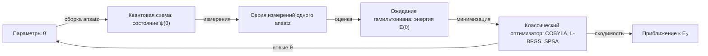

# Вариационные алгоритмы: VQE и QAOA

## Идея гибридного цикла

Вместо глубокого квантового алгоритма — короткий параметризованный анзац, оптимизируемый классическим циклом:

```
поток: парам θ → кв. схема → ожидания ⟨H⟩ → классический оптимизатор → новые θ → ...
```

Это дизайнерское решение NISQ-эры: короткие схемы (меньше ошибок), но новый слой проблем — «бесплодные плато» (barren plateaus) и качество оптимизации.

<details class="admonition analogy" markdown="1">
<summary class="admonition-title">Аналогия: горный хребет в тумане</summary>

Оптимизация энергии $E(\theta)$ — поход по горному хребту в густом тумане: виден только наклон под ногами (градиент по текущему θ), а рельеф за сотню метров не читается. Barren plateau — это участок, где земля почти плоская везде: сколько ни шевели ногами, наклон околонулевой, и классический оптимизатор блуждает по одному месту. Анзац и стратегия параметров — как выбор маршрута: короткие цепочки и физически осмысленные параметризации «раскрывают видимость», вытягивая рельеф вверх.
Предел аналогии: туман стирает рельеф, но не градиент; в VQE «рельеф» — функция энергии по параметрам, и она сама шумная, так что направление спуска оценивается с шумом.

</details>



## VQE: минимум гамильтониана

Свойство: $E_0 = \min_\theta \langle \psi(\theta)|H|\psi(\theta)\rangle$. Берем анзац $\psi(\theta)$ (parameterized circuit) и минимизируем.

```python
from qiskit.circuit.library import efficient_su2
from qiskit.quantum_info import SparsePauliOp
from qiskit.primitives import StatevectorEstimator
from scipy.optimize import minimize
import numpy as np

H      = SparsePauliOp.from_list([("ZI", 1.0), ("IZ", 1.0), ("XX", 1.0), ("YY", 1.0)])
ansatz = efficient_su2(2, reps=1)          # hardware-efficient анзац

estimator = StatevectorEstimator()        # точная (без шума) оценка ⟨H⟩

def energy(theta):
    evs = estimator.run([(ansatz, H, theta)]).result()[0].data.evs
    return float(evs)

rng  = np.random.default_rng(7)
best = minimize(energy, rng.uniform(-np.pi, np.pi, ansatz.num_parameters),
                method="COBYLA", options={"maxiter": 200})
print("E(θ*) =", best.fun)   # верхняя оценка E₀ = min-собственное значение H
```

> Класс `EfficientSU2` помечен как deprecated с Qiskit 2.1 (удаление в 3.0) — в новом коде используйте функцию `efficient_su2` (тот же анзац, новая сигнатура).

Оценка ⟨H⟩ — через V2-примитив: локально `StatevectorEstimator` (точный прогон), на железе — `EstimatorV2` из qiskit-ibm-runtime; оптимизатор — scipy (COBYLA, L-BFGS) или SPSA (робастнее под шум, градиентов не требует — детали в секции «Градиенты» ниже).

H2 как показательный пример: 2-кубитная редукция гамильтониана — готовая лаборатория, проект [03-vqe-h2](../../projects/03-vqe-h2.md) (в т.ч. fallback-гамильтониан из литературы).

## QAOA: решение комбинаторики

Задача MaxCut на графе G: максимизировать число разрезанных рёбер. Гамильтониан-стоимость $C = \sum_{(i,j)\in E}\frac{1-Z_i Z_j}{2}$. Анзац QAOA-p:

$$|\psi_p(\vec\gamma,\vec\beta)\rangle = e^{-i\beta_p D}e^{-i\gamma_p C}\cdots e^{-i\beta_1 D}e^{-i\gamma_1 C}|+\rangle^n$$

Qiskit: `qiskit.circuit.library.qaoa_ansatz(cost_operator=H, reps=p)` (класс `QAOAAnsatz` помечен как deprecated с Qiskit 2.1 — удалён в 3.0). Наивный p=1 даёт неплохие решения; рост p даёт экспоненциальный рост глубины схемы, потому что NISQ даёт «постепенное» улучшение.

Именно QAOA-цепочки — главный «практический» бенчмарк компилятора (как улучшается layout/routing под уровней оптимизации) — см. [lab-04](../04-systems-design/lab-04-platform-comparison.md).

## Энзатц: какие бывают

- **Hardware-efficient** — «дёшев» на конкретном железе (готовит связность устройства).
- **UCCSD** — химический (гарантированно сохраняет симметрию, длиннее).
- **QAOA-специфичный** — структура задачи отражается в гейт-наборе.

Задача подбора анзаца = доля «art» в квантовой практике; реальные ограничения шум выдают скорее уже на этапе оптимизации.

## Эволюция под гамильтонианом: PauliEvolutionGate и Trotter

И VQE, и QAOA требуют поднять $e^{-iHt}$ (cost-слой QAOA $e^{-i\gamma C}$ — частный случай). На реальном железе такого «большого» гейта нет: нативны только 1q-гейты и, у большинства платформ, конкретный 2q-гейт. Троттеризация разбивает экспоненту суммы на последовательность экспонент слагаемых (формула Троттера–Сузуки):

$$e^{-i(A+B)t} \approx \left(e^{-iAt/n}e^{-iBt/n}\right)^n, \qquad \lVert\epsilon\rVert = O(t^2/n).$$

```python
from qiskit import QuantumCircuit
from qiskit.circuit.library import PauliEvolutionGate
from qiskit.synthesis import LieTrotter
from qiskit.quantum_info import SparsePauliOp

op = SparsePauliOp.from_list([("ZZ", 1.0), ("ZI", 0.5), ("IZ", 0.5)])
g  = PauliEvolutionGate(op, time=1.0, synthesis=LieTrotter(reps=3))
qc = QuantumCircuit(2)
qc.append(g, [0, 1])
print(qc.decompose().count_ops())   # {'rz': 6, 'rzz': 3} — ZZ собирается в RZZ, ZI/IZ — в rz
```

Компромисс тот же, что и всюду в NISQ: больше `reps` — меньше ошибка Троттера и больше глубина схемы, то есть больше накопленный шум гейтов. Это дополнительный член бюджета, который наряду с ошибками компиляции учитывается в модуле [04](../04-systems-design/01-architecture-models.md).

### Сколько слагаемых в гамильтониане — и почему это число кусается

Разложение гamiльтониана по операторам Паули — стандартный ход в VQE, но у него есть предсказуемая цена, которую полезно знать заранее. Для $n$ кубит базис Паули содержит $4^n$ строк, поэтому произвольный эрмитов гамильтониан разворачивается максимум на $4^n$ слагаемых, а типичный 1- и 2-локальный гамильтониан (то, что реально встречается в квантовой химии) — порядка $O(n^2 2^n)$. Числа меньшего порядка, вроде $(n+1)\cdot 2^n$, получаются для гамильтонианов со специальной структурой — например, трёхдиагональной, как в разбираемой ниже работе. Главное, что эти строки **не все коммутируют между собой** — поэтому «одним» `PauliEvolutionGate` такую сумму реализовать нельзя: нужна троттеризация, и глубина растёт с числом слагаемых, а ошибка Троттера — с их числом. Практический вывод из реальной работы по алгоритму волнового уравнения (Arseniev, Guskov, Sengupta, Biamonte, Zacharov, «Tridiagonal matrix decomposition for Hamiltonian simulation on a quantum computer», Phys. Rev. A 109, 052629 (2024), arXiv:2310.00121): трёхдиагональная структура разбивается на $O(n)$ коммутирующих подмножеств, и при $n < 15$ схема Троттера–Сузуки оказывается дешевле «оракульной» реализации и требует вдвое меньше кубитов.

Отсюда два практических совета для VQE/QAOA на реальном железе:

- **Считайте число слагаемых до, а не после запуска.** Анзац с малым числом параметров, но гамильтонианом с сотнями строк Паули — это не «лёгкий» VQE: глубина определяется гамильтонианом.
- **Группируйте коммутирующие слагаемые**: в Qiskit это делает `SparsePauliOp.group_commuting()` — он возвращает список групп, и уже по группам (а не по одиночным слагаемым) строится `PauliEvolutionGate`. Параметр `atomic_evolution` у `LieTrotter` к группировке отношения не имеет: он лишь запрещает «дробление» каждого слагаемого на элементарные пауловские части.

## Градиенты: parameter-shift и SPSA

Градиент $\partial\langle H\rangle / \partial\theta_j$ на железе не вычисляют символически; для анзаца, где параметр входит в базисной форме $e^{\pm i\theta_j/2}$ (то есть $U(\theta_j) = e^{-i\theta_j P/2}$ при $P^2 = I$: гейты `rx`, `ry`, `rz`, `p`), работает shift-правило (parameter-shift):

$$\frac{\partial f}{\partial\theta_j} = \frac{f(\theta_j + \pi/2) - f(\theta_j - \pi/2)}{2},$$

то есть два измерения на параметр — точное значение градиента, но дорого при сотнях параметров. Для других форм зависимости величина сдвига другая (так, для $e^{-i\theta_j P}$ при $P^2 = I$ нужен сдвиг $\pi/4$) — поэтому правило всегда сверяют с тем, как параметр входит именно в ваш гейт. Альтернатива — **SPSA**: все параметры сдвигаются одновременно одним «спаренным» рандомизированным возмущением, две оценки на итерацию дают шумную оценку градиента; на зашумлённом железе его сходимость обычно устойчивее классических безградиентных методов. Практика: сначала откалибруйте шаги SPSA на шумной симуляции из [урока о шумовой симуляции](../02-programming/04-noise-simulation.md), затем переносите на железо ([lab-03](../02-programming/lab-03-ibm-quantum-run.md)).

Отдельно про оценку самой энергии $\langle H\rangle$: классическое «посчитать среднее по большому числу выстрелов» упирается в $O(1/\varepsilon^2)$ выборок. **Оценка амплитуды** (quantum amplitude estimation) даёт оценку с точностью $\varepsilon$ всего за $O(1/\varepsilon)$ запросов — но требует когерентной (не сэмплируемой независимо) схемы с усилением амплитуды, то есть сегодня это в основном бумажный результат. На практике связка выглядит так: на реальном железе остаются сэмплирование и SPSA, а оценка амплитуды — предмет экспериментов с NISQ-устройствами и хороший пример того, как «красивая» асимптотика отделяется от инженерной реальности.

## 📚 Узнать подробнее

<details markdown="1">
<summary>Видеолекции (с таймкодами)</summary>

- **Quantum Approximate Optimization Algorithms (Peter Shor, ISCA 2018)** [00:03:18-00:09:11] - блок урока «Идея гибридного цикла»: что такое ближние квантовые алгоритмы и зачем нужен классический оптимизатор в цикле вместо глубоких схем. [ссылка](https://youtu.be/HHIWUi3GmdM)
- **Quantum Approximate Optimization Algorithms (Peter Shor, ISCA 2018)** [00:09:11-00:11:38] - блок урока «QAOA: решение комбинаторики»: постановка MaxCut как исходного примера QAOA. [ссылка](https://youtu.be/HHIWUi3GmdM)
- **Lecture 5.2 - Introduction to the QAOA and Applications (QGSS 2021, Qiskit)** [00:04:44-00:07:32] - блок урока «VQE: минимум гамильтониана»: вариационный метод и вариационные квантовые солверы как целевой класс. [ссылка](https://youtu.be/YpLzSQPrgSc)
- **Lecture 5.2 - Introduction to the QAOA and Applications (QGSS 2021, Qiskit)** [00:18:49-00:26:12] - блок урока «QAOA: решение комбинаторики»: вариационная форма QAOA, cost-слой $e^{-i\gamma C}$ и mixer-слой $e^{-i\beta D}$ с примером. [ссылка](https://youtu.be/YpLzSQPrgSc)
- **Lab 2 - Introduction to Variational Algorithms (QGSS 2021, Qiskit)** [00:02:38-00:11:12] - блок урока «Энзатц: какие бывают»: параметризованные схемы на практике и почему их выбор — отдельная задача. [ссылка](https://youtu.be/bNbdZ4SSjtE)
- **VQE Zero to Hero (Qiskit)** [00:13:19-00:18:59] - блок урока «VQE: минимум гамильтониана»: преобразование операторов и маппинг гамильтониана в Qiskit-операторы вида SparsePauliOp. [ссылка](https://youtu.be/TUFovZsBcW4)

</details>

<details markdown="1">
<summary>Статьи и блоги</summary>

- Cerezo и др. «Variational Quantum Algorithms» (Nature Reviews Physics, 2021) — «Энзатц: какие бывают»: канонический обзор вариационных алгоритмов, включая barren plateaus и стратегии их обхода. [arXiv](https://arxiv.org/abs/2012.09265)
- Schuld и др. «Evaluating analytic gradients on quantum hardware» (2018) — «Градиенты: parameter-shift и SPSA»: обоснование parameter-shift-правила и его цена в измерениях. [arXiv](https://arxiv.org/abs/1811.11184)
- Kandala и др. «Hardware-efficient variational quantum eigensolver for small molecules and quantum magnets» (Nature, 2017) — «Градиенты» и «Энзатц»: первый VQE на реальном железе, где SPSA сравнивали с COBYLA на шумной машине. [open access](https://www.nature.com/articles/nature23879)
- «Simplified quantum software development with Qiskit» (IBM Quantum blog) — «VQE: минимум гамильтониана»: V2-примитивы Estimator/Sampler — тот интерфейс, через который считается $\langle H\rangle$ на практике. [ссылка](https://www.ibm.com/quantum/blog/dev-tools)
- Moondra и др. «Promise of Graph Sparsification and Decomposition for Noise Reduction in QAOA» — «QAOA: решение комбинаторики»: как компиляция через графовую спарсификацию снижает глубину и шум QAOA-схем. [arXiv](https://arxiv.org/abs/2406.14330)
- Montanez-Barrera и др. «Optimizing QAOA circuit transpilation...» — «QAOA: решение комбинаторики»: практический пример того, почему QAOA-схемы — бенчмарк транспилятора (сокращение глубины на 87% и числа 2q-гейтов на 29% относительно Qiskit-транспайлера для 120-кубитного инстанса с 25% связностью). [arXiv](https://arxiv.org/abs/2505.17944)

</details>

<details markdown="1">
<summary>Книги (глава/раздел)</summary>

- Hidary «Quantum Computing: An Applied Approach» (2-е изд.) — главы с каноном вариационных алгоритмов и кодом (VQE/QAOA), параллельно GitHub-репозиторий с примерами. [Springer](https://link.springer.com/book/10.1007/978-3-030-83274-2)
- Ezratty «Understanding Quantum Technologies» (2025) — разделы по квантовым алгоритмам и NISQ-ограничениям: где вариационный подход реально применяется и что говорит об ошибках. [свободный PDF](https://www.oezratty.net/wordpress/2025/understanding-quantum-technologies-2025/)

</details>

<details markdown="1">
<summary>Русскоязычные ресурсы</summary>

- **Лекция 20: Вариационные квантовые алгоритмы, QAOA, канал QuantuC** — блок урока «QAOA: решение комбинаторики»: введение в вариационные квантовые алгоритмы, структура QAOA-анзаца и применение к задачам оптимизации на русском языке. [проверено по поиску, без таймкодов](https://youtu.be/vG2zBowYVu4)
- **Quantum Algorithms / Alexey Fedorov and Evgeny Kiktenko, ПостНаука** — блок урока «Идея гибридного цикла»: обзор квантовых алгоритмов, включая вариационные подходы, от сотрудников Российского квантового центра (РКЦ). [проверено по поиску, без таймкодов](https://youtu.be/kZiU2comN6g)
- **Онлайн курс «Введение в квантовые вычисления», Лекция 12 (МГУ ЦКТ)** — блок урока «VQE: минимум гамильтониана»: квантовые вариационные алгоритмы QAOA и VQE, приложения к задачам квантовой химии, возможности реализации на NISQ-устройствах. [проверено по поиску](https://quantum.msu.ru/ru/education/online/introduction-to-quantum-computing)
- **Задачи и алгоритмы квантовых вычислений: Сейсмика (С. Страупе, М. Сайгин, К. Эпов), Центр квантовых технологий МГУ** — блок урока «Энзатц: какие бывают»: лекция по задачам и алгоритмам квантовых вычислений с участием С.С. Страупе (МГУ ЦКТ). [проверено по поиску, без таймкодов](https://youtu.be/iuKeR2hpuKk)

</details>

## 🎛 Интерактив

Конструктор схем позволяет собрать короткий параметризованный анзац на двух кубитах кликами и сразу увидеть, что он даёт: текст цепи, вектор состояния, вероятности четырёх исходов и гистограмму из 200 измерений. В этом уроке виджет нужен, чтобы показать статистическую природу оценки энергии: один запуск анзаца даёт один исход, а для оценки $\langle H\rangle$ нужна серия измерений.

<!--qc-embed: circuit-playground.html | Конструктор квантовых схем | 640-->

**Интерактив:** [виджет «Конструктор квантовых схем»](https://drdimooon.github.io/qc-design-course/curriculum/03-algorithms/03-vqe-qaoa/#интерактив) · [файл виджета](../../assets/interactive/circuit-playground.html)

**Задание.**

- Соберите схему: выберите цель q0 и нажмите X, затем выберите цель q1 и нажмите H. В строке вероятностей получится |10⟩ 50.0% и |11⟩ 50.0%, а |00⟩ и |01⟩ — по 0.0%; в блоке состояния стоит (|10⟩ + |11⟩)/√2 с амплитудами 0.7071.
- Нажмите «Измерить 200 раз»: гистограмма повторит диаграмму вероятностей — примерно по 100 попаданий на |10⟩ и |11⟩ и ни одного на остальные исходы, всего 200 измерений; счётчик под гистограммой покажет точные числа.
- Нажмите «Удалить последний» и соберите зеркальную схему: X на q1, затем H на q0. Теперь по 50.0% придётся на |01⟩ и |11⟩. Это два разных анзаца, но статистика для них собирается одинаково.
- Объясните, зачем в VQE нужны повторные измерения одного и того же анзаца: один запуск даёт один исход, поэтому из схемы с двумя равновероятными исходами нельзя получить ни $\langle H\rangle$, ни $\langle Z_1Z_2\rangle$; серия измерений превращает распределение в оценку, и уже она попадает в оптимизатор.

Как это связано с уроком: конструктор показывает ровно один оборот цикла со схемы выше — параметры θ задают гейты, собранная схема даёт распределение исходов, а серия измерений превращает это распределение в оценку энергии, по которой оптимизатор выбирает следующие θ. Именно поэтому в VQE «схема» и «статистика» неразделимы: квантовая часть выдаёт не число, а выборку, и разброс гистограммы — это та самая цена, которую платит NISQ за короткую схему.

## ✅ Проверь себя

1. Почему вариационный подход «уложался» в NISQ? Какое свойство схемы он ставит фиксированной?
2. Напишите формулу гамильтониана MaxCut для треугольника K3 и соберите его через SparsePauliOp.
3. Почему SPSA выигрывает у COBYLA на зашумлённых данных? Ответ в терминах градиентов.
4. Что такое barren plateau и как сочетается с выбором ансаца?

Тест по модулю: [03-quiz.md](../../tests/03-quiz.md).

## ➡️ Что дальше

[04-error-correction.md](04-error-correction.md) — как от ошибок уйти структурно, а не «выжить с ними».
