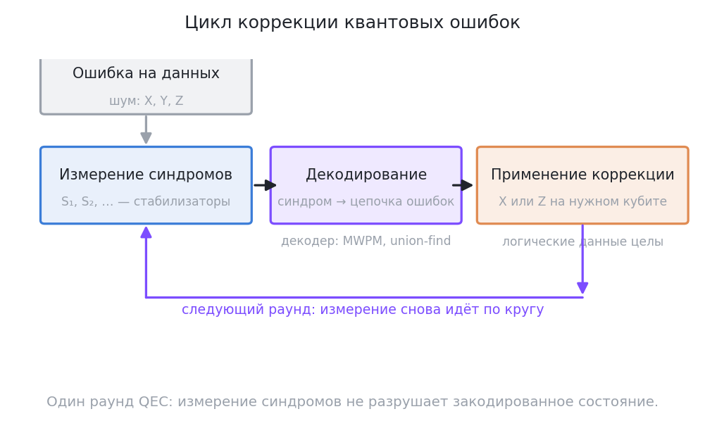
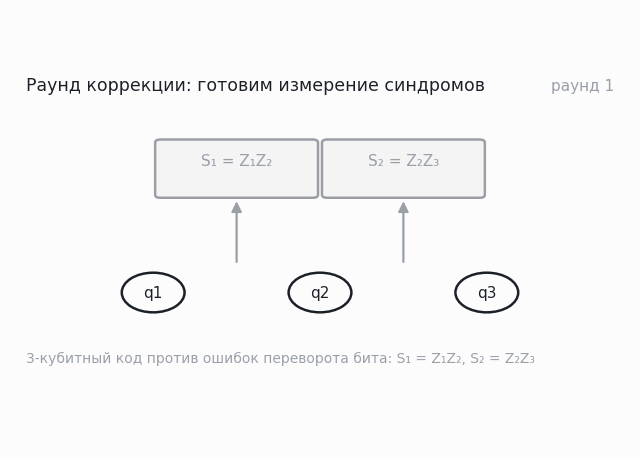
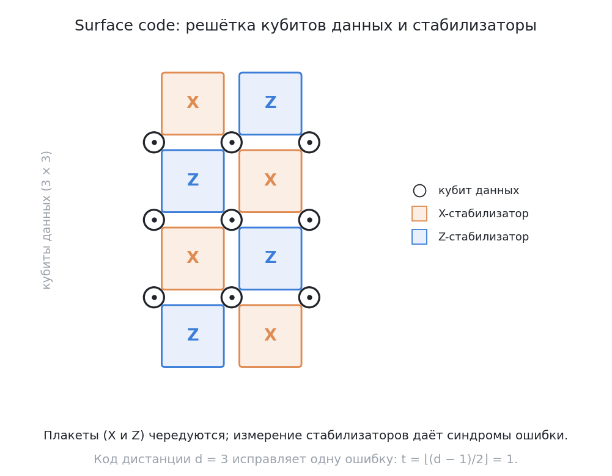

# Исправление квантовых ошибок: от 3-кубитного кода к surface code

## Проблема: no-cloning

Теорема о неклонировании (no-cloning) запрещает копировать произвольное состояние $|\psi\rangle=\alpha|0\rangle+\beta|1\rangle$ — классические «тройные копии бита» прямо не работают. Решение: кодировать состояние в запутанное состояние многих кубитов и измерять не его, а **синдромы** (стабилизаторы) — измерения, не разрушающие логические данные.

!!! red-flag "Красный флаг: «исправить ошибку — значит много раз считать и усреднить»"
    «Голосование повторами» здесь не переносится: чтобы «посчитать трижды», нужны три копии кубита, а копировать произвольное состояние запрещено. QEC работает иначе: код даёт набор проверок (синдромов), которые показывают, *какая* ошибка случилась, не узнавая и не разрушая саму закодированную суперпозицию. Исправление — это реакция на диагноз, а не многократное чтение значения.

## 3-кубитный код (Bit flip)

Кодировка: $|\psi_L\rangle = \alpha|000\rangle + \beta|111\rangle$.

Соглашение — Qiskit (подробно — в [CONVENTIONS.md](../../CONVENTIONS.md)): кет читается как $|q_2 q_1 q_0\rangle$, `q0` — младший бит справа, индекс = $4q_2 + 2q_1 + q_0$. Одно-based имена «кубит 1, 2, 3» читаются **слева направо** по кету: кубит 1 = `q2` (вес 4), кубит 2 = `q1` (вес 2), кубит 3 = `q0` (вес 1). Стабилизаторы — соседние пары:

$$S_1 = Z_2 Z_1 \ (\text{кубиты 1 и 2}), \qquad S_2 = Z_1 Z_0 \ (\text{кубиты 2 и 3}).$$

Измерение пары (S1, S2) локализует X-ошибку:

| Синдром | Кто испорчен | Гейт коррекции |
|---|---|---|
| $(+1,+1)$ | нет | — |
| $(-1,+1)$ | кубит 1 (`q2`) | `qc.x(2)` |
| $(-1,-1)$ | кубит 2 (`q1`) | `qc.x(1)` |
| $(+1,-1)$ | кубит 3 (`q0`) | `qc.x(0)` |

Исправление — обратный X на соответствующем кубите. Проверка в Qiskit: `qc.x(2)` даёт `|100⟩` (индекс 4) и синдром $(-1,+1)$; `qc.x(0)` даёт `|001⟩` (индекс 1) и синдром $(+1,-1)$.

*Подпись: один раунд коррекции: ошибка на данных (шум X, Y, Z) → измерение синдромов S₁, S₂, … (стабилизаторы) → декодирование, то есть перевод синдрома в цепочку ошибок (MWPM, union-find) → применение коррекции X или Z на нужном кубите, после чего раунд повторяется заново. Вывод: исправление ошибок — не разовое действие, а цикл измерений и коррекций, и при этом один раунд измерения синдромов не разрушает закодированное состояние.*

Ошибки фазы (Z) ловятся тем же трюком в базисе Хадамара (пара H вокруг блока поворачивает Z-ошибку в X). Объединение обоих кодов — девятикубитная схема Шора: она исправляет произвольную одиночную ошибку (любую комбинацию X, Y, Z).

## Формализм стабилизаторов (коротко)

Код — это общее собственное подпространство всех его стабилизаторов: $S_i$ коммутируют между собой и «определяют» кодовое пространство. Ошибка, антикоммутирующая со стабилизатором, «светится» в синдроме (собственное значение −1 при измерении). Отсюда растёт вся математика QEC: расстояние кода d и число исправляемых ошибок $t = \lfloor (d-1)/2 \rfloor$.

*Анимация: один раунд коррекции в 3-кубитном коде — X-ошибка на кубите 2 (= `q1`), затем измерение стабилизаторов S₁ = Z₂Z₁ и S₂ = Z₁Z₀, синдром (−1, −1) с указанием на кубит 2 и, наконец, коррекция X на этом кубите, после чего раунд повторяется. Вывод: синдром однозначно указывает на испорченный кубит, поэтому коррекция возвращает исходное состояние, а сами данные при измерении синдромов не разрушаются.*

## Формальный критерий: условия Книлла–Лафламма

Всё выше — примеры кодов; формальный вопрос звучит так: **какой набор ошибок данный код способен исправить?** Ответ дают условия Книлла–Лафламма (Knill–Laflamme): код с проектором $P$ исправляет набор ошибок $\{E_a\}$, если для любой пары $a, b$ из этого набора

$$P E_a^\dagger E_b P = \alpha_{ab}\, P.$$

Смысл условия: оператор $E_a^\dagger E_b$ — это «разность» двух возможных ошибок; равенство означает, что на кодовом пространстве эта разность ведёт себя как обычное число, то есть неотличима от тривиального действия. Практическое следствие, которое стоит запомнить: **условие проверяют на парах, а не поодиночке** — поэтому в коде с исправлением одной X-ошибки нельзя «просто добавить» Y-ошибку, не пересчитав $P E_X^\dagger E_Y P$ (для кода Шора это даёт дополнительные условия на логическую операцию).

Этот критерий — рабочий инструмент, а не формальность: он отличает «код, который ловит X-ошибки» от «кода, который ловит произвольную одиночную ошибку», и объясняет, почему для Y-ошибок нужна дополнительная структура (в 3-кубитном коде — бит и фаза лечатся в разных базисах).

## Surface code: практический стандарт

2D-решётка кубитов с чередованием стабилизаторов X/Z; кубиты данных — вершины решётки, измерения стабилизаторов идут по соседним рёбрам/ячейкам. Каждый раунд измерений собирает синдромы, ошибки данных выстраиваются в цепочки на графе синдромов, декодер (MWPM, union-find) соединяет концы цепочек и строит восстановление. Ключевые факты:

- Пороговая теорема: если физическая ошибка ниже порога (для surface code ~0.5–1% на 2q-гейт), растущий код уменьшает логическую ошибку экспоненциально.
- Большие издержки: ~1000 физических кубитов на 1 логический при современных частотах ошибок; Google Willow (2024) показал переход «логическая ошибка < физическая» с масштабированием кода d (arXiv:2408.13687).
- Числа этого перехода (Google, Nature 2025): при увеличении дистанции кода на 2 логическая ошибка падает в $\Lambda = 2{,}14 \pm 0{,}02$ раза; итоговый код дистанции $d = 7$ на 101 кубите даёт ошибку коррекции $0{,}143\% \pm 0{,}003\%$ за цикл — то есть логическая ошибка уже ниже физической ошибки лучшего кубита.

*Подпись: решётка surface code: кубиты данных (кружки) в узлах решётки, поверх них — чередующиеся плакеты X- и Z-стабилизаторов, измерение которых и даёт синдромы ошибки. Вывод: код с расстоянием d = 3 исправляет одну ошибку ($t = \lfloor (d-1)/2 \rfloor = 1$), и именно увеличение числа плакетов (а значит, расстояния) снижает вероятность логической ошибки.*

## NISQ vs FT: практический раскол

- **NISQ сегодня**: error mitigation (ZNE, PEC) — только математика на пост-обработке результатов, кубиты не увеличивает; в Qiskit Runtime это та самая ручка resilience_level (0…2+).
- **FT завтра**: QEC поверх повторяемого «логического» слоя — каждый логический гейт это много физических операций плюс декодирование в реальном времени.

Компилятор/системного инженера интересует и тот, и другой слой (см. модуль [04](../04-systems-design/01-architecture-models.md): NISQ vs FT-треки архитектуры).

## 📚 Узнать подробнее

Видеолекции (с таймкодами)

- **Correcting Quantum Errors | Understanding Quantum Information & Computation | Lesson 13, Джон Уотрус (Qiskit)** [00:03:28-00:09:10] - блок урока «Проблема: no-cloning»: зачем нужна коррекция ошибок и почему классическое «голосование повторами» нельзя перенести на кубиты напрямую. [ссылка](https://youtu.be/OoQSdcKAIZc)
- **Correcting Quantum Errors | Lesson 13, Джон Уотрус (Qiskit)** [00:18:03-00:26:05] - блок урока «3-кубитный код (Bit flip)»: 9-кубитный код Шора, объединяющий исправление bit-flip и phase-flip. [ссылка](https://youtu.be/OoQSdcKAIZc)
- **Quantum Error Correction | Lesson 15, Джон Уотрус (Qiskit)** [00:30:05-00:40:30] - блок урока «Формализм стабилизаторов (коротко)»: ошибки и синдромы, исправление через измерения операторов, соответствие «антикоммутирует со стабилизатором = светится». [ссылка](https://youtu.be/9TCIOm8gcVQ)
- **Quantum Error Correction | Lesson 15, Джон Уотрус (Qiskit)** [00:22:20-00:30:05] - блок урока «Surface code: практический стандарт»: торический код — прямая основа surface code, откуда растут решётка X/Z-стабилизаторов и пороговая теорема. [ссылка](https://youtu.be/9TCIOm8gcVQ)
- **Курс В. И. Яшина «Вычисления на помехоустойчивых квантовых схемах», Лекция 3 (МИАН)** - блок урока «Формализм стабилизаторов (коротко)»: группа Паули и стабилизаторные состояния — математическая база формализма, на русском. [ссылка](https://youtu.be/ZH_3fnRI3Dk)
- **Курс В. И. Яшина, Лекция 9 (МИАН)** - блок урока «NISQ vs FT: практический раскол»: вычисления на стабилизаторных схемах с магией — Clifford+T и магические состояния как цена перехода к отказоустойчивости. [ссылка](https://youtu.be/SG0FwI0zA8w)

Две русскоязычные позиции — без таймкодов: проверяемые субтитры/транскрипты этих записей недоступны, ссылки даны без времени.

Статьи и блоги

- «Suppressing quantum errors by scaling a surface code logical qubit» (Google Research blog) — «Surface code: практический стандарт»: доступное объяснение surface code, порога и первой демонстрации «больше код = меньше логическая ошибка». [ссылка](https://research.google/blog/suppressing-quantum-errors-by-scaling-a-surface-code-logical-qubit/)
- Google Quantum AI «Quantum error correction below the surface code threshold» (Nature, 2025) — «Surface code: практический стандарт»: числа выше — $\Lambda = 2{,}14$ при увеличении $d$ на 2, код $d=7$ на 101 кубите с 0,143% ошибки за цикл. [arXiv](https://arxiv.org/abs/2408.13687)
- Devitt, Munro, Nemoto «Quantum Error Correction for Beginners» — «Формализм стабилизаторов (коротко)»: вводный обзор «через разобранные примеры», удобный мост между 3-кубитным кодом и stabilizer-формализмом. [arXiv](https://arxiv.org/abs/0905.2794)
- Paetznick и др. (Microsoft Azure Quantum + Quantinuum) «Demonstration of logical qubits and repeated error correction...» — «NISQ vs FT: практический раскол»: логические кубиты с ошибкой в 9,8–800 раз ниже физической — так выглядит слой «FT завтра». [arXiv](https://arxiv.org/abs/2404.02280)

Книги (глава/раздел)

- Nielsen, Chuang «Quantum Computation and Quantum Information» — глава 10 «Quantum Error-Correction»: стабилизаторный формализм, синдромы, код Шора и порог отказоустойчивости. [Cambridge University Press](https://www.cambridge.org/us/universitypress/subjects/physics/quantum-physics-quantum-information-and-quantum-computation/quantum-computation-and-quantum-information-10th-anniversary-edition)
- Прескилл (Caltech), конспекты Ph/CS 219 — глава 7 «Quantum Error Correction» (типографская версия обновлена в марте 2026): от 3-кубитных кодов до отказоустойчивых вычислений. [preskill.caltech.edu](https://preskill.caltech.edu/ph219/chap7_26_6A.pdf)
- Mermin «Quantum Computer Science: An Introduction» — глава о коррекции ошибок: минимальный формализм для программиста, без физического багажа. [Cambridge University Press](https://www.cambridge.org/core/books/quantum-computer-science/66462590D10C8010017CF1D7C45708D7)

Русскоязычные ресурсы

- **Онлайн курс «Введение в квантовые вычисления», лекции 8–10 (МГУ ЦКТ)** — блоки урока «3-кубитный код (Bit flip)» и «Формализм стабилизаторов»: трёхкубитный код, девятикубитный код Шора, классические линейные коды и коды КШС, формализм стабилизаторов и пороговая теорема. Проверено webfetch. [ссылка](https://quantum.msu.ru/ru/education/online/introduction-to-quantum-computing)
- **«Новый квантовый компьютер Quantinuum упрощает коррекцию ошибок» (hightech.plus, Г. Голованов, ноябрь 2025)** — блоки урока «NISQ vs FT: практический раскол» и «Surface code: практический стандарт»: доступный разбор на русском — почему нельзя «копировать кубит», что такое логический кубит, сколько квантовой памяти «съедает» коррекция и чем отличаются подходы платформ. По поиску. [ссылка](https://hightech.plus/2025/11/06/novii-kvantovii-kompyuter-quantinuum-uproshaet-korrekciyu-oshibok)
- **«Анализ эффективности квантовых корректирующих КСС-кодов посредством тождеств Мак-Вильямса» (Forlivesi, Valentini, Chiani; alphaXiv, русскоязычный пересказ 2305.01301)** — блок урока «Surface code: практический стандарт»: строгая оценка логической частоты ошибок поверхностных кодов на деполяризующем канале — математику того, куда упирается «~1000 кубитов на логический». По поиску. [ссылка](https://www.alphaxiv.org/ru/abs/2305.01301)
- **Квантовая коррекция ошибок для начинающих (Devitt, Munro, Nemoto) — русскоязычный перевод/реферат на alphaxiv** — блок урока «Формализм стабилизаторов (коротко)»: доступное изложение стабилизаторного формализма и поверхностных кодов. [проверено по поиску](https://www.alphaxiv.org/ru/abs/0905.2794)
- **Китаев, Шень, Вялый «Классические и квантовые вычисления» — раздел о кодах (toric codes, anyons)** — блок урока «Surface code: практический стандарт»: торические коды и их связь с подходом анионов в квантовых вычислениях. [свободный PDF, МЦНМО](https://old.mccme.ru/free-books/qcomp/qbook.pdf)
- **А.С. Холево. Лекция 12. Условия исправления ошибок Книлла–Лафламма. Симплектические коды (МЦМУ МИАН, 16.12.2025)** — блок «Формальный критерий: условия Книлла–Лафламма»: формальный критерий исправляемости набора ошибок и переход к симплектическим (CSS) кодам. [ссылка на плейлист](https://youtube.com/playlist?list=PLUbD59ZHv1GTg5NcRERKCwTAQgW81Z3Ai)
- **Л.Е. Федичкин. Квантовая коррекция ошибок (МФТИ, «Дистанционные занятия», 13.11.2020)** — блоки «3-кубитный код» и «Формализм стабилизаторов»: русскоязычная лекция-стрим по кодам коррекции; полезна как систематический обзор (учтите: запись 2020 года, без surface code в современном виде). [ссылка на трансляцию](https://www.youtube.com/live/3KDPbs4QAS8)
- **В.И. Яшин. Курс «Вычисления на помехоустойчивых квантовых схемах» (МИАН, 2024, 12 лекций)** — блок «Формализм стабилизаторов (коротко)»: стабилизаторные табло, графовые состояния, кудиты и помехоустойчивые схемы — углублённый курс по теме. [ссылка на плейлист](https://youtube.com/playlist?list=PLUbD59ZHv1GTMVwzmIphi8jGIz9m-EzQf)

## 🎛 Интерактив

Виджет показывает полный цикл коррекции в 3-кубитном коде: три дорожки кубитов с закодированным состоянием $\alpha|000\rangle + \beta|111\rangle$, два блока стабилизаторов S1 = Z₂Z₁ и S2 = Z₁Z₀ с измеренными собственными значениями и полосу «измерение синдромов → декодирование → коррекция». Сверху вниз дорожки идут в порядке `q2`, `q1`, `q0` — так же, как читается кет $|q_2 q_1 q_0\rangle$ (см. [CONVENTIONS.md](../../CONVENTIONS.md)). В этом уроке виджет нужен, чтобы увидеть таблицу «синдром → испорченный кубит» в действии и убедиться, что измерение синдромов не разрушает данные.

<!--qc-embed: qec-cycle.html | Цикл коррекции ошибок: 3-кубитный код | 640-->

**Интерактив:** [виджет «Цикл коррекции ошибок: 3-кубитный код»](https://drdimooon.github.io/qc-design-course/curriculum/03-algorithms/04-error-correction/#интерактив) · [файл виджета](../../assets/interactive/qec-cycle.html)

**Задание.** Кнопки подписаны сразу двумя именами: одно-based именем урока и q-номером Qiskit.

- Нажмите «X-ошибка на кубит 2 (q1)», затем «Измерить синдромы»: синдром окажется (−1, −1) — оба произведения Z₂Z₁ и Z₁Z₀ дают минус, потому что q2 и q1, а также q1 и q0, теперь различаются; декодер укажет «ошибка: кубит 2».
- Нажмите «Исправить»: виджет применит X к `q1`, и в сравнении с исходным появится «СОВПАДАЕТ» (максимальное расхождение 0.000000000) — состояние вернулось к исходному.
- Нажмите «Сброс», внесите X-ошибку на кубит 1 (`q2`) и измерьте синдромы: получится (−1, +1) — S1 = Z₂Z₁ = −1 (q2 и q1 различаются), S2 = Z₁Z₀ = +1 (q1 и q0 совпадают). Так же получите (+1, −1) для X-ошибки на кубите 3 (`q0`), а без ошибки — (+1, +1).
- Объясните, почему две ошибки одновременно код не исправляет: внесите X-ошибки на кубиты 1 и 3 (`q2` и `q0`), измерьте синдромы — получится (−1, −1), то есть ровно тот же синдром, что и у одиночной ошибки на кубите 2 (`q1`), поэтому декодер «вылечит» не тот кубит и в сравнении будет «НЕ СОВПАДАЕТ». Это и есть предел кода с d = 3: он исправляет $\lfloor (d-1)/2 \rfloor = 1$ ошибку.

Как это связано с уроком: синдромы в виджете — это те же собственные значения операторов S1 = Z₂Z₁ и S2 = Z₁Z₀, о которых идёт речь в разделе «3-кубитный код»: X-ошибка антикоммутирует ровно с одним из стабилизаторов, поэтому в паре (S1, S2) минус стоит на одном месте, и эта пара однозначно указывает на испорченный кубит. Формулировка про d = 3 и $t = \lfloor (d-1)/2 \rfloor = 1$ из раздела «Формализм стабилизаторов» здесь превращается в проверяемое ограничение: две ошибки сразу дают синдром одиночной ошибки на «третьем» кубите, и код их не исправляет. А утверждение «измерение синдромов не разрушает данные» виджет подтверждает численно: расхождение вектора состояния до и после измерения равно нулю.

## ✅ Проверь себя

1. Почему нельзя просто «сделать три копии кубита» и голосовать?
2. Для 3-кубитного кода с S1=Z₂Z₁, S2=Z₁Z₀: синдром (−1,−1) означает какую ошибку? В терминах `qc.x(q)` — какой q?
3. Сколько ошибок произвольного вида исправляет код дистанции d=5?
4. Почему surface code требует ~1000 физических кубитов на логический — что именно съедает бюджет?

Тест по модулю: [03-quiz.md](../../tests/03-quiz.md).

## ➡️ Что дальше

Ядро курса: [Модуль 04 — Проектирование систем](../04-systems-design/README.md): как эти «логические кубиты» проектируются на уровне архитектуры и компилятора. Там же — живой пример того, как это работает на настоящем железе: [разбор статьи Google «Willow»](../06-publications/03-google-willow-qec.md) (Stim + PyMatching поверх ваших навыков уроков 02 и lab-03).
