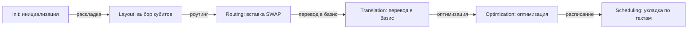

# Как устроен transpiler: DAG, PassManager, группы пассов

Вызов `transpile(qc, backend=...)` прячет внутри себя конвейер из десятков трансформаций схемы. В обычной работе это удобно; когда вы оптимизируете качество компиляции — нужно уметь заглянуть внутрь и конфигурировать конвейер. В этом уроке разберём строение компилятора Qiskit: DAG-представление схемы, PassManager, деление пассов на этапы и то, что делает каждый optimization_level. В финале напишем собственный пасс.

## 30000 футов: что скрывает transpile()

Схема на входе — «алгоритмический» объект: кубиты безымянные, CX между любыми парами, гейты вроде `h` или `rz` в удобном для человека виде. На выходе нужно устройство-специфичное описание: физические кубиты конкретного чипа, только basis gates, с учётом запретов направлений и с раскладкой по времени. Это четыре разные подзадачи:

1. **Layout** — какой логический кубит где живёт (bijection logical → physical).
2. **Routing** — как доставить состояния друг к другу (вставка SWAP).
3. **Translation** — как переписать гейты в доступный basis (rz, sx, x, ecr...).
4. **Scheduling** — до какого момента наносекунд исполнять каждую инструкцию.

Qiskit реализует это как **конвейер пассов**: маленькие трансформации, каждая читает схему (dag) и переписывает её или собирает информацию. Конвейер запускается в составе **StagedPassManager** — «сцены», идущие строго по порядку.

## DAG: форма, в которой живёт компилятор

Готовая последовательность операций бедна: она не говорит, какие шаги независимы. Компилятору нужно DAG (directed acyclic graph) — ориентированный ациклический граф операций:

- **вершины** — операции (гейты, измерения, барьеры);
- **рёбра** — провода: ребро идёт от операции A к операции B, если A пишет кубит, который B читает;
- два узла, не соединённые путём, **независимы** — их можно переставлять, сжимать, отменять.

Основные операции с DAG: `dag.op_nodes()` — список гейт-узлов, `dag.count_ops()` — счётчик по именам, `dag.depth()` — глубина, `dag.remove_op_node(node)` — удаление, `dag.substitute_node_with_dag(node, sub)` — замена узла на под-DAG. Из мира схем в мир DAG и обратно:

```python
from qiskit import QuantumCircuit
from qiskit.converters import circuit_to_dag

qc = QuantumCircuit(3)
qc.h(0)
qc.cx(0, 1)
qc.cx(1, 2)

dag = circuit_to_dag(qc)
print(dag.depth())          # 3
print(dag.count_ops())      # {'h': 1, 'cx': 2}
for node in dag.op_nodes():
    print(node.name, node.qargs)
```

Финальные backend'ы принимают обычные схемы, поэтому на выходе конвейера DAG всегда сворачивается обратно в `QuantumCircuit`.

## StagedPassManager: шесть этапов



Как читать схему: слева направо показаны шесть сцен `StagedPassManager` — от `Init` до `Scheduling`; типичные пассы каждой сцены (список для Qiskit 2.x) перечислены в таблице урока и в тексте ниже. Сцена Init готовит схему (декомпозиция больших выстроек), Layout решает, где стоят логические кубиты, Routing доводит каждое 2q-взаимодействие до ребра графа связности, Translation переписывает гейты в basis gates и соблюдает направление операций, Optimization выкидывает лишние гейты и пересобирает блоки, а Scheduling раскладывает инструкции по времени с добавлением `Delay`.

- Проверь себя: почему `SabreLayout` стоит в сцене layout, хотя внутри себя запускает ещё и routing?
- Проверь себя: какой из пасс Optimization сначала собирает соседние 2q-гейты в блок, а какой затем синтезирует блок заново? (В Qiskit 2.x это делает `TwoQubitPeepholeOptimization`; связка `Collect2qBlocks` → `ConsolidateBlocks` → `UnitarySynthesis` — из 1.x.)
- Проверь себя: перевод гейтов в basis gates отнесён к отдельной сцене translation — почему он идёт после routing, а не до него?

Актуальный (Qiskit 2.x) транспилятор — это `StagedPassManager` со сценами строго порядка:

| Этап | Задача | Типовые пассы (Qiskit 2.x) |
|------|--------|----------------|
| **init** | подготовка: декомпозиция больших выстроек, логические оптимизации до mapping | `HighLevelSynthesis`, `BasisTranslator`, `InverseCancellation`, `ElidePermutations`, `RemoveDiagonalGatesBeforeMeasure`, `ConsolidateBlocks` |
| **layout** | отобразить логические кубиты на физические | `TrivialLayout` (level 0-1), `VF2Layout`, `SabreLayout` |
| **routing** | вставить SWAP, чтобы все 2q-гейты попали на рёбра | `SabreSwap` (+ `BasicSwap`, `LookaheadSwap` — доступны и как отдельные пассы) |
| **translation** | переписать всё в basis gates и соблюдать направление | `BasisTranslator`, `UnitarySynthesis`, `HighLevelSynthesis` |
| **optimization** | выкинуть лишнее, сжать последовательности | `Optimize1qGatesDecomposition`, `TwoQubitPeepholeOptimization`, `CommutativeCancellation` |
| **scheduling** | назначить времена, вставить delays | `ALAPScheduleAnalysis`, `PadDelay`, `TimeUnitConversion` |

Две важные детали архитектуры:

- **VF2 / VF2PostLayout**: `VF2PostLayout` — пост-layout пасс, который по таблице ошибок бэкенда проверяет, нельзя ли пересадить готовую схему на лучшие физические кубиты (работает на уровнях 1-3; отбор раскладок идёт по error-рейтам Target). **Где он стоит:** в Qiskit 2.x на уровнях 1-2 `VF2PostLayout` завершает routing-сцену (до translation и optimization), а на level 3 — стоит в конце optimization-сцены. Проверить можно дампом пассов (см. ниже).
- **SabreLayout** — не «чистый» layout, а комбинированный layout+routing: он внутри себя запускает routing и получает интегрально лучший результат (см. урок 03, arXiv:1809.02573). Важная оговорка: сам по себе `SabreLayout` **не учитывает error-рейты** — он чисто топологический (см. урок 04).

Разгруппировано всё это так: `generate_preset_pass_manager(optimization_level=3, backend=backend)` возвращает `StagedPassManager`, у которого есть атрибуты-сцены (`.init`, `.layout`, `.routing`, `.translation`, `.optimization`, `.scheduling`). В Qiskit 2.x набор сцен — `('init', 'layout', 'routing', 'translation', 'optimization', 'scheduling')`; атрибут `.pre_layout` в API тоже есть, но в preset-менеджере он остаётся `None` (сцена pre-layout не заполняется). Посмотреть фактический конвейер:

```python
from qiskit.transpiler import generate_preset_pass_manager
from qiskit.providers.fake_provider import GenericBackendV2

backend = GenericBackendV2(10, seed=42)
pm = generate_preset_pass_manager(optimization_level=3, backend=backend)

for stage_name in pm.stages:
    stage_pm = getattr(pm, stage_name, None)
    if stage_pm is None:
        continue
    print(f"[{stage_name}]")
    for task in stage_pm.to_flow_controller().tasks:
        print("   ", type(task).__name__)
```

Каждая сцена — тоже `PassManager`; перечисленные через `to_flow_controller().tasks` задачи — это отдельные пассы или контроллеры, объединяющие пассы в циклы (например, повторять оптимизацию, пока глубина уменьшается).

## Что делает каждый optimization_level

Официальный смысл уровней (из документации Qiskit):

- **Уровень 0** — «как написано, но исполняемо»: layout trivial (`TrivialLayout`, i-й логический кубит → i-й физический), вставка SWAP под связность (`SabreSwap`), перевод базиса. Содержательных оптимизаций нет. Полезен для точного воспроизведения задуманной структуры или для тестов.
- **Уровень 1** — лёгкое сжатие: сначала берётся `TrivialLayout`; если без SWAP не обойтись — `SabreLayout` ищет раскладку с минимумом вставок, затем `VF2PostLayout` пробует пересадить схему на лучшие (по ошибкам) физические кубиты. В optimization-этапе: `InverseCancellation` (отмена подряд идущих взаимно-обратных гейтов, например X за X или CZ за CZ) и переписывание цепочек 1q-гейтов (`Optimize1qGatesDecomposition`).
- **Уровень 2** — средняя оптимизация: как уровень 1, но `TrivialLayout` больше не используется (сразу `VF2Layout` → `SabreLayout`), а эвристика layout/routing работает с большей глубиной поиска и числом попыток; в optimization-этапе — `CommutativeCancellation` (отмены через коммутативные границы) и `TwoQubitPeepholeOptimization` (пересборка двухкубитных блоков). В Qiskit 1.x на этом месте стояла связка `Collect2qBlocks` → `ConsolidateBlocks` → `UnitarySynthesis`, а отдельного пасса `CXCancellation` в Qiskit 2.x уже нет.
- **Уровень 3** — тяжёлая оптимизация: как уровень 2, плюс: (а) ресинтез двухкубитных блоков — соседние 2q-гейты собираются в блоки и каждый блок синтезируется заново под минимум 2q-гейтов (`UnitarySynthesis`, разложение KAK; в Qiskit 2.x это делает `TwoQubitPeepholeOptimization` в optimization-сцене плюс `ConsolidateBlocks`/`Split2QUnitaries` в init-сцене, а `Collect2qBlocks` остался от 1.x); (б) пассы, ломающие унитарность схемы: `RemoveDiagonalGatesBeforeMeasure` (в Qiskit 2.x — в init-сцене) и `OptimizeSwapBeforeMeasure` (SWAP, за которым сразу измерение, часто можно убрать; в preset 2.x не входит, остаётся доступным вручную); (в) ещё более агрессивный перебор layout/routing-кандидатов и `VF2PostLayout` в конце optimization-сцены.

Практический смысл: 0 — «исполняемо», 1 — «быстро и коротко», 2 — «хорошо», 3 — «максимальное качество». На схемах с большим числом повторяемых последовательностей выигрыш level 3 значителен; на маленьких схемах преимущество невелико — это и есть предмет lab-04.

## Почему конечного набора гейтов вообще хватает

Наивное возражение: «у процессора нативны только `rz`, `sx`, `x` и один 2q-гейт — как с их помощью выразить произвольную унитарную операцию?» Ответ даёт теория: **любую однокубитную унитарную матрицу можно приближённо представить конечной последовательностью гейтов из фиксированного набора** (например, `rz`, `sx`, `x`), причём длина последовательности растёт лишь полилогарифмически с требуемой точностью $\varepsilon$.

Формально это и есть **теорема Соловея–Китаева**: для любого $\varepsilon$ произвольную однокубитную унитарную операцию можно заменить последовательностью из конечного плотного набора гейтов длины $\mathrm{polylog}(1/\varepsilon)$. Практические следствия для компилятора:

- **Синтез приближённый лишь в дискретном базисе.** Не всякий нативный набор «заведует приближением»: базис с непрерывным параметрическим $R_Z$ (ZSX) позволяет однокубитное разложение делать **точным** (в transpile это `approximation_degree=1.0` — «намеренно не приближать»); приближение возникает, когда углы синтезируются в дискретный конечный FT-базис (например, Clifford+T) или когда синтезатор жертвует точностью ради глубины. Различайте четыре вещи: дискретный конечный базис, непрерывные параметрические семейства, численную точность с плавающей точкой и аппаратную ошибку выполнения гейта;
- **Уровень 3 лучше уровня 1 именно потому, что** пересобирает блоки и синтезирует их заново, а не переставляет готовые гейты;
- **Ошибка синтеза — отдельный источник ошибок** наряду с шумом железа: в дискретном базисе идеальная нативная последовательность реализует приближённую операцию.

Второй элемент той же картины — **двухуровневые операции**: любую унитарную матрицу на $2^n$-мерном пространстве можно собрать из операций, действующих не более чем на паре базисных состояний (с помощью отражений/Householder). Это объясняет, почему компиляция — это в первую очередь задача «разложить большую операцию на локальные», а уже потом — «подобрать локальные под железо».

## Как писать свой пасс

Пасс — это класс, наследующий `AnalysisPass` (только анализ, пишет в property_set) или `TransformationPass` (перестраивает DAG). Пример аналитического пасса: посчитать статистику 2q-операций.

```python
from qiskit.transpiler import PassManager
from qiskit.transpiler.basepasses import AnalysisPass

class TwoQubitProfile(AnalysisPass):
    """Считает число 2q-гейтов и кладёт результат в property_set."""
    def run(self, dag):
        n2q = sum(1 for node in dag.op_nodes() if len(node.qargs) == 2)
        self.property_set["two_qubit_count"] = n2q

pm = PassManager([TwoQubitProfile()])
out = pm.run(qc)
print(pm.property_set["two_qubit_count"])
```

Пример трансформационного пасса: замена H на последовательность rz-sx-rz (демо того, как работает rewrite в basis; на практике это делает `BasisTranslator` через таблицу эквивалентностей).

```python
import numpy as np
from qiskit import QuantumCircuit
from qiskit.transpiler import PassManager
from qiskit.transpiler.basepasses import TransformationPass
from qiskit.converters import circuit_to_dag

class HToRzSx(TransformationPass):
    """Переписывает H как rz(pi/2) sx rz(pi/2) (с точностью до глобальной фазы)."""
    def run(self, dag):
        repl_template = QuantumCircuit(1)
        repl_template.rz(np.pi / 2, 0)
        repl_template.sx(0)
        repl_template.rz(np.pi / 2, 0)
        repl = circuit_to_dag(repl_template)

        for node in list(dag.op_nodes()):
            if node.op.name == "h":
                dag.substitute_node_with_dag(node, repl)
        return dag

out = PassManager([HToRzSx()]).run(qc)
print(out.count_ops())      # {'rz': 2, 'sx': 1}
```

Пример более реального трансформационного пасса: отмена подряд идущих CZ на одной паре кубитов (CZ self-inverse).

```python
from qiskit.transpiler.basepasses import TransformationPass

class KillAdjacentCZ(TransformationPass):
    """Убирает пары подряд CZ на одной паре кубитов."""
    def run(self, dag):
        # узлы сначала собираем, и только потом удаляем: удаление прямо в цикле
        # ломает обход (на 3+ подряд идущих CZ получим "Node not in DAG")
        to_remove = set()
        for run in dag.collect_runs(["cz"]):
            i = 0
            while i + 1 < len(run):
                a, b = run[i], run[i + 1]
                if a in to_remove or b in to_remove:
                    i += 1
                    continue
                q1 = [dag.find_bit(q).index for q in a.qargs]
                q2 = [dag.find_bit(q).index for q in b.qargs]
                if q1 == q2:
                    to_remove.add(a)
                    to_remove.add(b)
                    i += 2
                else:
                    i += 1
        for node in to_remove:
            dag.remove_op_node(node)
        return dag
```

Проверка: 1 → 1 CZ, 2 → 0, 3 → 1, 4 → 0 CZ (то есть нечётное число CZ остаётся, как и должно быть, ведь CZ·CZ = I); CZ на разных парах кубитов не отменяются.

Боевые пассы Qiskit работают по тому же принципу: `CommutativeCancellation` двигает операции через коммутативные границы, `ConsolidateBlocks` (в Qiskit 2.x — стадия `init`) собирает под-DAG размерности 2, а в пресете level 3 пересборку пар делает `TwoQubitPeepholeOptimization`, `Optimize1qGatesDecomposition` переписывает цепочки 1q-гейтов в оптимальную rz-sx форму (до композиции ZSXZ). Правило пасса: **трансформация обязана сохранять вычисление** (различия в глобальной фазе допустимы, в относительной фазе нет).

## Стык с физикой: scheduling и длительности гейтов

Компиляция в реальную систему — это не только «какие гейты», но и «в какое время». Каждая инструкция имеет длительность (время пульса), а кубиты между гейтами простаивают — и это время напрямую умножает вклад декогеренции по T1/T2. Этап scheduling решает раскладку по оси времени:

- `ALAPScheduleAnalysis` / `ASAPScheduleAnalysis` — стратегии «as late / as soon as possible»;
- `PadDelay` — вставка явных `Delay`-инструкций в простои;
- `InstructionDurations` — словарь длительностей инструкций.

```python
from qiskit import transpile

transpiled = transpile(
    qc,                      # схема из предыдущих блоков этого урока
    backend=backend,         # GenericBackendV2 из блока про StagedPassManager
    scheduling_method="alap",   # as late as possible; durations бэкенд сам берёт из Target
)
```

Простои схемы — часть error budget: долгий delay на кубите возле readout-резонатора стоит почти так же дорого, как лишний CX. Именно поэтому на следующем после scheduling шаге добавляют **dynamical decoupling** (DD) — вставку пачек X/Y-импульсов, которые «перемешивают» накопление фазы от шума. Подробно DD и остальное подавление шума — в уроке 04.

Подводя итог: scheduling-этап не оптимизирует время, а только раскладывает операции. Noise-aware операции (выбор лучших кубитов по ошибкам, ценовая модель SWAP по шумовой шкале) лежат на границе этапов layout/routing — тема следующего урока.

## 📚 Узнать подробнее

<details markdown="1">
<summary>Видеолекции (с таймкодами)</summary>

- **Intro to Transpilation — Matthew Treinish, Qiskit (QDC24)** - блок урока «30000 футов: что скрывает transpile()»: обзор цели транспиляции и того, какие пассы Qiskit участвуют в подзадачах layout/routing/translation. [ссылка](https://youtu.be/TmXlUUFMUgI)
- **Transforming Quantum Circuits using Qiskit's Transpiler with Matthew Treinish: Qiskit Summer School** - блок урока «StagedPassManager: шесть этапов»: авторский разбор конвейера пассов от того же лектора — от входной схемы до сцены optimization. [ссылка](https://youtu.be/MvX5OUK-tbE)
- **Qiskit Transpiler Plugin — Day 11 of 12 Days of Qiskit — Qiskit** - блок урока «Как писать свой пасс»: как устроен плагин-интерфейс транспилятора и как писать и подключать собственные пассы. [ссылка](https://youtu.be/k-tf-aFV0BQ)
- **What is the point of a barrier? — Nick Knows, Qiskit** - блок урока «DAG: форма, в которой живёт компилятор»: зачем в DAG нужны барьеры и как они меняют оптимизацию и scheduling. [ссылка](https://youtu.be/CdoCPz6TC9k)
- **UChicagoX: Quantum Computer Systems Design II (Fred Chong и EPiQC, edX)** - блок урока «30000 футов: что скрывает transpile()»: системный курс о том, как схемы маппятся под ограничения железа. [ссылка](https://www.edx.org/learn/quantum-computing/university-of-chicago-quantum-computer-systems-design-ii-principles-of-quantum-architecture)
- **Qiskit Global Summer School 2024: The Path to Utility (плейлист, неделя 1)** - блок урока «Что делает каждый optimization_level»: лекции и лабы по Qiskit SDK и транспиляции из официальной школы. [ссылка](https://www.youtube.com/playlist?list=PLOFEBzvs-Vvr-GzDWlZpAcDpki5jUqYJu)
</details>

<details markdown="1">
<summary>Статьи и блоги</summary>

- **IBM Quantum documentation «Compare transpiler settings»** - секция «Что делает каждый optimization_level»: живой пример сравнения уровней 0 и 3 по числу 2q-гейтов на оракуле Гровера и по результату на реальном железе. [ссылка](https://quantum.cloud.ibm.com/docs/guides/circuit-transpilation-settings)
- **Qiskit (Medium) «How Does The Qiskit Transpiler Work?»** - блок урока «StagedPassManager: шесть этапов»: популярный разбор шагов транспилятора — DAG, layout, routing, synthesis. [ссылка](https://medium.com/qiskit/how-does-the-qiskit-transpiler-work-6710863beaac)
- **IBM Quantum blog «Qiskit leads quantum SDKs in performance, testing shows»** - блок урока «Что делает каждый optimization_level»: бенчмарк Benchpress по транспиляции и введение LightSABRE — куда развивается конвейер. [ссылка](https://www.ibm.com/quantum/blog/qiskit-performance)
</details>

<details markdown="1">
<summary>Книги/документация (глава/раздел, статьи arXiv)</summary>

- **Qiskit Documentation: Transpiler Passes** [документация](https://quantum.cloud.ibm.com/docs/en/api/qiskit/transpiler_passes), разделы Layout, Routing, Optimization: справочник всех пассов из таблицы сцен StagedPassManager.
- **arXiv:2407.00736** (обзор синтеза и оптимизации компиляции, уже есть в resources/papers.md): систематическая рамка для всего урока — от architecture search до маппинга/роутинга.
- **arXiv:2502.14715** (Optimization Driven Quantum Circuit Reduction, уже есть в resources/papers.md): что можно выжать из схем после стандартных optimization_levels.
</details>

<details markdown="1">
<summary>Русскоязычные ресурсы</summary>

- **В.И. Яшин, курс «Вычисления на помехоустойчивых квантовых схемах», Лекция 2 «Вычислительная сложность схем и симуляция» — МИАН** — разбор симуляции квантовых схем и универсальных словарей вентилей: русскоязычная опора для этапов DAG и translation. [ссылка](https://youtu.be/f-yFLRUMRDE) — по поиску
- **В.И. Яшин, Лекция 1 «Базовые элементы квантовых схем» — МИАН** — введение в квантовые схемы как объект компиляции: прямая привязка к блоку «DAG: форма, в которой живёт компилятор». [ссылка](https://youtu.be/487uPVrePgg) — по поиску
- **ЦКТ МГУ, курс «Компьютерное моделирование квантовых операций и алгоритмов» (Ю.И. Богданов)** — рабочий план курса по численному моделированию операций и алгоритмов: русскоязычный источник для понимания трансформаций схемы на пути transpile(). [ссылка](https://quantum.msu.ru/ru/education/msc-programs/quantum-computing) — проверено
- **«Квантовые вычисления» — курс МФТИ-МИАН (mathnet.ru)** — видеолекции по квантовым вычислениям на русском: обзорный русскоязычный контекст для конвейера пассов. [ссылка](https://www.mathnet.ru/php/presentation.phtml?eventID=31&option_lang=rus) — по поиску
- **alphaXiv (рус.), «Quantum Compiler Design for Qubit Mapping and Routing» (2505.16891)** — русскоязычный перевод обзора квантовых компиляторов: прямая привязка к блоку «StagedPassManager: шесть этапов» и optimization_level. [ссылка](https://www.alphaxiv.org/ru/abs/2505.16891) — по поиску
</details>

## ✅ Проверь себя

1. Почему transpiler работает с DAGCircuit, а не с последовательным списком операций QuantumCircuit?
2. Перечислите шесть этапов StagedPassManager по порядку и для каждого — один типовой пасс.
3. Чем optimization_level 2 отличается от 1 с точки зрения layout и какие пассы приходят в optimization-этапе вместо `InverseCancellation`?
4. Что делает VF2PostLayout и в какой сцене он стоит (проверьте дампом preset-менеджера)?
5. Напишите AnalysisPass, который считает число измерений (`measure`). Каким ключом в property_set вы назовёте результат?
6. Почему этап scheduling критичен даже без учёта шума? В чём выгода от знания точной длительности каждой инструкции?

Пройдите [тест модуля 04](../../tests/04-quiz.md).

## ➡️ Что дальше

Следующий урок — о сердцевине layout/routing: [03 — Маппинг и роутинг: задача, NP-трудность, SABRE](03-routing-mapping-sabre.md).
