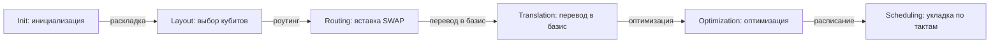

# Как устроен transpiler: DAG, PassManager, группы пассов

Вызов `transpile(qc, backend=...)` прячет внутри себя конвейер из десятков трансформаций схемы. В обычной работе это удобно; когда вы оптимизируете качество компиляции — нужно уметь заглянуть внутрь и конфигурировать конвейер. В этом уроке разберём строение компилятора Qiskit: DAG-представление схемы, PassManager, деление пассов на этапы и то, что делает каждый optimization_level. В финале напишем собственный пасс.

## 30000 футов: что скрывает transpile()

Схема на входе — «алгоритмический» объект: кубиты безымянные, CX между любыми парами, гейты вроде `h` или `rz` в удобном для человека виде. На выходе нужно устройство-специфичное описание: физические кубиты конкретного чипа, только basis gates, с учётом запретов направлений и с раскладкой по времени. Удобно выделить четыре подзадачи:

1. **Layout** — какой логический кубит где живёт (bijection logical → physical).
2. **Routing** — как доставить состояния друг к другу (вставка SWAP).
3. **Translation** — как переписать гейты в доступный basis (rz, sx, x, ecr...).
4. **Scheduling** — до какого момента наносекунд исполнять каждую инструкцию.

**Четыре подзадачи ≠ шесть стадий конвейера.** В Qiskit preset-конвейер (`optimization_level` 0–3) состоит из шести именованных сцен: `init → layout → routing → translation → optimization → scheduling`. Подзадачи выше — это содержание части сцен: `layout`, `routing`, `translation` и `scheduling`; сцена `init` готовит схему до размещения, а `optimization` — постоянная сцена (свой набор пассов на каждом уровне), которая после mapping вычищает лишнее. Так что «четыре» и «шесть» не спорят, а отвечают на разные вопросы: «какие решения принимаются» и «какие сцены исполняются».

Qiskit реализует это как **конвейер пассов**: маленькие трансформации, каждая читает схему (dag) и переписывает её или собирает информацию. Конвейер запускается в составе **StagedPassManager** — «сцены», идущие строго по порядку.

## DAG: форма, в которой живёт компилятор

Готовая последовательность операций бедна: она не говорит, какие шаги независимы. Компилятору нужно DAG (directed acyclic graph) — ориентированный ациклический граф операций:

- **вершины** — операции (гейты, измерения, барьеры);
- **рёбра** — провода: ребро идёт от операции A к операции B, если A пишет кубит, который B читает;
- два узла, не соединённые путём, **независимы** — их можно переставлять, сжимать, отменять.

Основные операции с DAG: `dag.op_nodes()` — список гейт-узлов, `dag.count_ops()` — счётчик по именам, `dag.depth()` — глубина, `dag.remove_op_node(node)` — удаление, `dag.substitute_node_with_dag(node, sub)` — замена узла на под-DAG. Из мира схем в мир DAG и обратно:

```python
from qiskit import QuantumCircuit
from qiskit.converters import circuit_to_dag

qc = QuantumCircuit(3)
qc.h(0)
qc.cx(0, 1)
qc.cx(1, 2)

dag = circuit_to_dag(qc)
print(dag.depth())          # 3
print(dag.count_ops())      # {'h': 1, 'cx': 2}
for node in dag.op_nodes():
    print(node.name, node.qargs)
```

Финальные backend'ы принимают обычные схемы, поэтому на выходе конвейера DAG всегда сворачивается обратно в `QuantumCircuit`.

## StagedPassManager: шесть этапов



Как читать схему: слева направо показаны шесть сцен `StagedPassManager` — от `Init` до `Scheduling`. Принципиальная схема сцен одна и та же во всех версиях Qiskit 2.x, а вот конкретные пассы внутри сцен — вещь версионная: ниже они помечены как «[Qiskit 2.6]», то есть проверены на 2.6 и могут отличаться в других версиях. Надёжнее смотреть собственный дамп (код ниже), чем запоминать список. Сцена Init готовит схему (декомпозиция больших выстроек), Layout решает, где стоят логические кубиты, Routing доводит каждое 2q-взаимодействие до ребра графа связности, Translation переписывает гейты в basis gates и соблюдает направление операций, Optimization выкидывает лишние гейты и пересобирает блоки, а Scheduling раскладывает инструкции по времени с добавлением `Delay`.

- Проверь себя: почему `SabreLayout` стоит в сцене layout, хотя внутри себя запускает ещё и routing?
- Проверь себя: какой пасс Optimization level 3 пересобирает пары соседних 2q-гейтов? (Ответ версионный: проверьте дампом. В Qiskit 2.6 это `TwoQubitPeepholeOptimization`; связка `Collect2qBlocks` → `ConsolidateBlocks` → `UnitarySynthesis` — наследие 1.x и не входит в preset 2.6.)
- Проверь себя: перевод гейтов в basis gates отнесён к отдельной сцене translation — почему он идёт после routing, а не до него?

Актуальный (Qiskit 2.x) транспилятор — это `StagedPassManager` со сценами строго порядка. Каждая сцена — плагинная точка с именем-методом (`init_method`, `layout_method`, …, см. раздел «Плагины транспилятора»); в таблице — реализация `default` пресета на 2.6:

| Этап | Задача | Типовые пассы (реализация `default`, Qiskit 2.6) |
|------|--------|----------------|
| **init** | подготовка: декомпозиция больших выстроек, логические оптимизации до mapping | `UnitarySynthesis`, `HighLevelSynthesis`, `BasisTranslator`, `InverseCancellation`; на уровнях 2–3 ещё `ElidePermutations`, `RemoveDiagonalGatesBeforeMeasure`, `ConsolidateBlocks`, `Split2QUnitaries` |
| **layout** | отобразить логические кубиты на физические | `TrivialLayout` (только level 1, как попытка «идеальной» раскладки), `VF2Layout`, `SabreLayout`, `DenseLayout` (некоторые конфигурации) |
| **routing** | вставить SWAP, чтобы все 2q-гейты попали на рёбра | `SabreSwap` (+ `BasicSwap`, `LookaheadSwap`, `StochasticSwap` — доступны как stage-плагины) |
| **translation** | переписать всё в basis gates и соблюдать направление | `BasisTranslator`, `UnitarySynthesis`, `HighLevelSynthesis` |
| **optimization** | выкинуть лишнее, сжать последовательности | `Optimize1qGatesDecomposition`, `CommutativeCancellation`; на уровнях 2–3 `TwoQubitPeepholeOptimization`; на level 3 ещё `VF2PostLayout` в конце сцены |
| **scheduling** | назначить времена, вставить delays | `ALAPScheduleAnalysis`/`ASAPScheduleAnalysis`, `PadDelay`, `TimeUnitConversion` |

Две важные детали архитектуры:

- **VF2Layout / VF2PostLayout**: `VF2PostLayout` — пост-layout пасс, который по таблице ошибок бэкенда проверяет, нельзя ли пересадить готовую схему на лучшие физические кубиты (отбор раскладок идёт по error-рейтам Target). **Где он стоит (Qiskit 2.6):** на уровне 3 — в конце optimization-сцены, после пересборки; на уровнях 1–2 пресет 2.6 его не запускает (исторически в 1.x он завершал routing-сцену уровней 1–2). Если у вас другая версия — проверьте дампом пассов (см. ниже), а не по памяти.
- **SabreLayout** — не «чистый» layout, а комбинированный layout+routing: он внутри себя запускает routing и получает интегрально лучший результат (см. урок 03, arXiv:1809.02573). Важная оговорка: сам по себе `SabreLayout` **не учитывает error-рейты** — он чисто топологический (см. урок 04).

Разгруппировано всё это так: `generate_preset_pass_manager(optimization_level=3, backend=backend)` возвращает `StagedPassManager`, у которого есть атрибуты-сцены (`.init`, `.layout`, `.routing`, `.translation`, `.optimization`, `.scheduling`). В Qiskit 2.x набор сцен — `('init', 'layout', 'routing', 'translation', 'optimization', 'scheduling')`; атрибут `.pre_layout` в API тоже есть, но в preset-менеджере он остаётся `None` (сцена pre-layout не заполняется). Посмотреть фактический конвейер:

```python
from qiskit.transpiler import generate_preset_pass_manager
from qiskit.providers.fake_provider import GenericBackendV2

backend = GenericBackendV2(10, seed=42)
pm = generate_preset_pass_manager(optimization_level=3, backend=backend)

for stage_name in pm.stages:
    stage_pm = getattr(pm, stage_name, None)
    if stage_pm is None:
        continue
    print(f"[{stage_name}]")
    for task in stage_pm.to_flow_controller().tasks:
        print("   ", type(task).__name__)
```

Каждая сцена — тоже `PassManager`; перечисленные через `to_flow_controller().tasks` задачи — это отдельные пассы или контроллеры, объединяющие пассы в циклы (например, повторять оптимизацию, пока глубина уменьшается).

### Сжатый обзор: MultiStagePassManager и снижение IR

Всё вышеописанное — `StagedPassManager` из `qiskit.transpiler`: его IR всегда `DAGCircuit`, а на входе/выходе неявно конвертируется `QuantumCircuit`. Рядом в `qiskit.passmanager` живёт более общий **`MultiStagePassManager`** (проверено в Qiskit 2.6; в документации passmanager он описан как «staged pass manager supporting multiple IRs»):

- **Сцены задаются именованными аргументами конструктора** (`MultiStagePassManager(**stages)`), а не атрибутами `init/layout/...`, и порядок — это порядок аргументов.
- **Каждая сцена может как сохранять IR, так и понижать его** (lowering): например, стадия принимает ваш собственный IR (скажем, список Pauli-строк), следующая превращает его в `DAGCircuit`, а дальше идёт обычный preset-менеджер. В `StagedPassManager` такое невозможно — там IR фиксирован.
- **Нет автоматического перевода IR между сценами**: ответственность за то, что выход одной сцены совпадает по типу со входом следующей, лежит на вас.
- **Не путать:** `StagedPassManager` — это про «шесть стадий транспиляции DAG», `MultiStagePassManager` — про «произвольную цепочку IR-снижений». Для обычной транспиляции нужен первый.

```python
# qc: executable
from qiskit.passmanager import GenericPass, MultiStagePassManager
from qiskit.transpiler import CouplingMap, Target, generate_preset_pass_manager

target = Target.from_configuration(basis_gates=["rz", "sx", "x", "cx"],
                                   coupling_map=CouplingMap.from_line(3))

class PauliIR:
    def __init__(self, num_qubits):
        self.num_qubits = num_qubits
        self.paulis = []

class DropIdentityStrings(GenericPass):      # своя сцена на своём IR
    def run(self, ir):
        ir.paulis = [p for p in ir.paulis if set(p) != {"I"}]
        return ir

class PauliToDAG(GenericPass):               # снижение IR: PauliIR -> DAGCircuit
    def run(self, ir):
        from qiskit import QuantumCircuit
        qc = QuantumCircuit(ir.num_qubits)
        for p in ir.paulis:
            qc.pauli(p, qc.qubits)
        return qc.to_dag()

pm = MultiStagePassManager(
    clean=DropIdentityStrings(),
    to_dag=PauliToDAG(),
    transpile=generate_preset_pass_manager(target=target),   # сцена с DAG IR
)
ir = PauliIR(3); ir.paulis = ["XYZ", "III", "ZZI"]
out = pm.run(ir)          # -> DAGCircuit, прошедший preset-транспиляцию
print(out.count_ops())      # {'x': 2, 'rz': 2} — preset-сцена уже отработала
assert out.num_qubits() == 3
assert set(out.count_ops()) <= {"rz", "sx", "x", "cx"}
```

Обратите внимание: сцены `MultiStagePassManager` — это `Task`-объекты (пассы-наследники `GenericPass`), а не просто объекты с методом `run`; сцена может быть и готовым `BasePassManager` (как `generate_preset_pass_manager(...)` выше), тогда исполняются только его задачи без конвертаций входа/выхода.

### Плагины транспилятора: официальная точка расширения

Сцены не «зашиты»: каждая — это плагинная точка, которую Qiskit ищет через setuptools entry points. Официальный список групп:

| Сцена | Группа entry point | Зарезервированные имена (2.6) |
|---|---|---|
| init | `qiskit.transpiler.init` | `default` |
| layout | `qiskit.transpiler.layout` | `default`, `trivial`, `dense`, `sabre` |
| routing | `qiskit.transpiler.routing` | `default`, `basic`, `lookahead`, `none`, `sabre` |
| translation | `qiskit.transpiler.translation` | `default`, `translator`, `synthesis` |
| optimization | `qiskit.transpiler.optimization` | `default` |
| scheduling | `qiskit.transpiler.scheduling` | `default`, `alap`, `asap` |

(В установленном окружении `list_stage_plugins("translation")` может показать и добавочные имена от ibm-runtime — это сторонние плагины, а не неотъемлемая часть SDK.)

Плагином сцены становится класс — наследник `PassManagerStagePlugin` с методом `pass_manager(config, optimization_level)`, возвращающим `PassManager`. Скетч (структура из официального гайда «Create a transpiler plugin»; имена — иллюстративные):

```toml
# pyproject.toml пакета-плагина
[project.entry-points."qiskit.transpiler.layout"]
"my_layout" = "my_qiskit_plugin:MyLayoutPlugin"
```

```python
from qiskit.transpiler import PassManager
from qiskit.transpiler.passes import VF2Layout
from qiskit.transpiler.passmanager_config import PassManagerConfig
from qiskit.transpiler.preset_passmanagers import common
from qiskit.transpiler.preset_passmanagers.plugin import PassManagerStagePlugin

class MyLayoutPlugin(PassManagerStagePlugin):
    def pass_manager(self, pass_manager_config: PassManagerConfig,
                     optimization_level: int | None = None) -> PassManager:
        pm = PassManager([
            VF2Layout(coupling_map=pass_manager_config.coupling_map,
                      target=pass_manager_config.target,
                      max_trials=optimization_level * 10 + 1)
        ])
        pm += common.generate_embed_passmanager(pass_manager_config.coupling_map)
        return pm
```

После установки плагин виден как `layout_method="my_layout"` (`transpile(..., layout_method=...)` или `generate_preset_pass_manager(..., layout_method=...)`), а проверить регистрацию можно через `list_stage_plugins("layout")`. Не занимайте имена из колонки «зарезервированные»: они принадлежат встроенным плагинам, и конфликт имени сделает выбор сцены неоднозначным.

Остальные две плагинные точки — не сцены, а **синтезаторы**: `UnitarySynthesisPlugin` (группа `qiskit.unitary_synthesis`, выбор через `unitary_synthesis_method=`) и `HighLevelSynthesisPlugin` (группа `qiskit.synthesis`, ключ вида `clifford.my_plugin`, выбор через `HLSConfig`). Различие важно: стадийный плагин подменяет целую сцену конвейера, синтезатор — только способ разложить одну операцию. Официальные гайды: [Transpiler plugins](https://quantum.cloud.ibm.com/docs/guides/transpiler-plugins) и [Create a transpiler plugin](https://quantum.cloud.ibm.com/docs/guides/create-transpiler-plugin) (проверено webfetch).

## Что делает каждый optimization_level

Держите в голове два уровня детализации. **Неизменный контракт уровня** — это то, о чём можно говорить без привязки к версии:

- **Уровень 0** — «как написано, но исполняемо»: тривиальная раскладка (i-й логический кубит → i-й физический), вставка SWAP под связность, перевод в базис. Содержательных оптимизаций нет; полезен для воспроизведения задуманной структуры и для тестов.
- **Уровень 1** — лёгкое сжатие: пробуем «идеальную» раскладку без вставок, иначе эвристический layout; в optimization — отмена взаимно обратных гейтов и сжатие цепочек 1q-гейтов.
- **Уровень 2** — средняя оптимизация: layout и routing ищутся с бо́льшим перебором; в optimization — отмены через коммутативные границы.
- **Уровень 3** — более дорогой поиск и оптимизация: компилятор тратит больше работы на кандидатов раскладки и преобразования схемы. Конкретные ресинтезаторы и noise-aware пост-раскладка зависят от версии, плагинов и наличия данных в `Target`; это не обещание пересобрать каждую пару гейтов.

Практический смысл: 0 — базовый исполнимый вариант, 1 — небольшой бюджет оптимизации, 2 — больше поиска, 3 — самый большой бюджет. Что окупается именно на вашей нагрузке — предмет lab-04: измеряйте качество вместе с `compile_time`. **Ни минимальная глубина, ни превосходство уровня 3 не гарантируются.**

**Конкретные пассы — версионная деталь [Qiskit 2.6].** Уровень 2 добавляет в optimization `TwoQubitPeepholeOptimization` (и `CommutativeCancellation`, которого нет на уровне 1), а `TrivialLayout` на уровне 2 уже не используется; уровень 3 добавляет `VF2PostLayout` в конец optimization, а `ConsolidateBlocks`/`Split2QUnitaries` выполняются в init-сцене уровней 2–3. `Collect2qBlocks` из старых учебников — это **Qiskit 1.x** (в preset 2.6 не входит), как и `OptimizeSwapBeforeMeasure` (в preset 2.x не входит ни в один уровень, пасс доступен вручную). `CXCancellation` в 2.x отдельным пассом тоже отсутствует. Не запоминайте этот список: распечатайте свой (код ниже) — если номера версий не совпадают, расхождение нормально.

Всё, что дальше в этом уроке про имена пассов, — реализация Qiskit 2.6; смысл сцен сохраняется, а имена проверяйте дампом.

## Почему конечного набора гейтов вообще хватает

Наивное возражение: «у процессора нативны только `rz`, `sx`, `x` и один 2q-гейт — как с их помощью выразить произвольную унитарную операцию?» Ответ даёт теория: **любую однокубитную унитарную матрицу можно приближённо представить конечной последовательностью гейтов из фиксированного набора** (например, `rz`, `sx`, `x`), причём длина последовательности растёт лишь полилогарифмически с требуемой точностью $\varepsilon$.

Формально это и есть **теорема Соловея–Китаева**: для любого $\varepsilon$ произвольную однокубитную унитарную операцию можно заменить последовательностью из конечного плотного набора гейтов длины $\mathrm{polylog}(1/\varepsilon)$. Практические следствия для компилятора:

- **Синтез приближённый лишь в дискретном базисе.** Не всякий нативный набор «заведует приближением»: базис с непрерывным параметрическим $R_Z$ (ZSX) позволяет однокубитное разложение делать **точным** (в transpile это `approximation_degree=1.0` — «намеренно не приближать»); приближение возникает, когда углы синтезируются в дискретный конечный FT-базис (например, Clifford+T) или когда синтезатор жертвует точностью ради глубины. Различайте четыре вещи: дискретный конечный базис, непрерывные параметрические семейства, численную точность с плавающей точкой и аппаратную ошибку выполнения гейта;
- **Ресинтез может уменьшить стоимость схемы**, пересобирая блоки, а не только переставляя готовые гейты; он не является исключительной возможностью уровня 3 и не гарантирует улучшения на каждом входе;
- **Ошибка синтеза — отдельный источник ошибок** наряду с шумом железа: в дискретном базисе идеальная нативная последовательность реализует приближённую операцию.

Второй элемент той же картины — **двухуровневые операции**: любую унитарную матрицу на $2^n$-мерном пространстве можно собрать из операций, действующих не более чем на паре базисных состояний (с помощью отражений/Householder). Это объясняет, почему компиляция — это в первую очередь задача «разложить большую операцию на локальные», а уже потом — «подобрать локальные под железо».

### Пресеты для fault-tolerant конвейеров [Qiskit 2.5+]

Пресет `generate_preset_pass_manager` оптимизирует под NISQ-базис (непрерывные углы, шумные 2q-гейты). Для fault-tolerant вычислений нужен другой конвейер: в нём стоимость меряется не SWAP'ами, а **T-count, T-depth и числом магических состояний**, а «рабочий» базис — Clifford+T (иногда Clifford+T с Pauli-based computation). С Qiskit 2.5 (в 2.6 на локальной установке — проверено) появились два отдельных пресета в `qiskit.transpiler`:

- **`generate_preset_clifford_t_pass_manager(...)`** — конвейер с переходом на Clifford+T: помимо `init/layout/routing/scheduling` в нём появляются отдельные сцены `rz_translation`, `rz_optimization`, `t_translation`, `t_optimization` (8 сцен вместо 6), чтобы можно было оптимизировать непрерывную часть до перевода в T, а затем — уже T-последовательности.
- **`generate_preset_pbc_pass_manager(...)`** — пресет под Pauli-based computation (PBC): работает на уровне последовательностей Паули и их «расходов» (магические состояния), а не на уровне отдельных T-гейтов.

Оба возвращают `StagedPassManager` (проверено: `isinstance` совпадает), но их стадии не совпадают с шестью сценами NISQ-пресета — не смешивайте. Это и есть главный смысл: «шесть стадий» — контракт стандартного (NISQ) пресета, а не универсальный закон транспиляции. Пример:

```python
from qiskit.transpiler import (
    CouplingMap, Target,
    generate_preset_clifford_t_pass_manager,
)

target = Target.from_configuration(basis_gates=["h", "s", "t", "cx"],
                                   coupling_map=CouplingMap.from_line(3))
pm = generate_preset_clifford_t_pass_manager(
    optimization_level=1, target=target, approximation_degree=1.0,
)
print(pm.stages)
# ('init', 'layout', 'routing', 'rz_translation', 'rz_optimization',
#  't_translation', 't_optimization', 'scheduling')
```

У `generate_preset_pbc_pass_manager` сигнатура другая — он не принимает `target` (проверено в 2.6: `target` как аргумент даёт `TypeError`), поскольку PBC-конвейер оперирует не физическим целевым базисом, а Паули-представлением. Поэтому не переносите аргументы от одного пресета к другому «по аналогии»: смотрите сигнатуру своей версии.

## Как писать свой пасс

Пасс — это класс, наследующий `AnalysisPass` (только анализ, пишет в property_set) или `TransformationPass` (перестраивает DAG). Пример аналитического пасса: посчитать статистику 2q-операций.

```python
from qiskit.transpiler import PassManager
from qiskit.transpiler.basepasses import AnalysisPass

class TwoQubitProfile(AnalysisPass):
    """Считает число 2q-гейтов и кладёт результат в property_set."""
    def run(self, dag):
        n2q = sum(1 for node in dag.op_nodes() if len(node.qargs) == 2)
        self.property_set["two_qubit_count"] = n2q

pm = PassManager([TwoQubitProfile()])
out = pm.run(qc)
print(pm.property_set["two_qubit_count"])
```

Пример трансформационного пасса: замена H на последовательность rz-sx-rz (демо того, как работает rewrite в basis; на практике это делает `BasisTranslator` через таблицу эквивалентностей).

```python
import numpy as np
from qiskit import QuantumCircuit
from qiskit.transpiler import PassManager
from qiskit.transpiler.basepasses import TransformationPass
from qiskit.converters import circuit_to_dag

class HToRzSx(TransformationPass):
    """Переписывает H как rz(pi/2) sx rz(pi/2) (с точностью до глобальной фазы)."""
    def run(self, dag):
        repl_template = QuantumCircuit(1)
        repl_template.rz(np.pi / 2, 0)
        repl_template.sx(0)
        repl_template.rz(np.pi / 2, 0)
        repl = circuit_to_dag(repl_template)

        for node in list(dag.op_nodes()):
            if node.op.name == "h":
                dag.substitute_node_with_dag(node, repl)
        return dag

out = PassManager([HToRzSx()]).run(qc)
print(out.count_ops())      # {'rz': 2, 'cx': 2, 'sx': 1} — два cx из исходной схемы
```

Пример более реального трансформационного пасса: отмена подряд идущих CZ на одной паре кубитов (CZ self-inverse).

```python
from qiskit.transpiler.basepasses import TransformationPass

class KillAdjacentCZ(TransformationPass):
    """Убирает пары подряд CZ на одной паре кубитов."""
    def run(self, dag):
        # узлы сначала собираем, и только потом удаляем: удаление прямо в цикле
        # ломает обход (на 3+ подряд идущих CZ получим "Node not in DAG")
        to_remove = set()
        for run in dag.collect_runs(["cz"]):
            i = 0
            while i + 1 < len(run):
                a, b = run[i], run[i + 1]
                if a in to_remove or b in to_remove:
                    i += 1
                    continue
                q1 = [dag.find_bit(q).index for q in a.qargs]
                q2 = [dag.find_bit(q).index for q in b.qargs]
                if q1 == q2:
                    to_remove.add(a)
                    to_remove.add(b)
                    i += 2
                else:
                    i += 1
        for node in to_remove:
            dag.remove_op_node(node)
        return dag
```

Проверка: 1 → 1 CZ, 2 → 0, 3 → 1, 4 → 0 CZ (то есть нечётное число CZ остаётся, как и должно быть, ведь CZ·CZ = I); CZ на разных парах кубитов не отменяются.

Боевые пассы Qiskit работают по тому же принципу: `CommutativeCancellation` использует коммутативность для отмен, `ConsolidateBlocks` собирает блок в унитарную операцию, `TwoQubitPeepholeOptimization` пересобирает локальные 2q-фрагменты, `Optimize1qGatesDecomposition` переписывает цепочки 1q-гейтов в целевой базис. Их размещение по стадиям и уровням смотрите в дампе своей версии, а не выводите из названия класса. Правило для показанных здесь унитарных переписываний: **сохранить оператор с точностью до глобальной фазы**. У преобразований перед измерением может быть более слабый контракт — сохранение статистики измерений; это нужно обосновывать отдельно.

## Стык с физикой: scheduling и длительности гейтов

Компиляция в реальную систему — это не только «какие гейты», но и «в какое время». Каждая инструкция имеет длительность (время пульса), а кубиты между гейтами простаивают — и это время напрямую умножает вклад декогеренции по T1/T2. Этап scheduling решает раскладку по оси времени:

- `ALAPScheduleAnalysis` / `ASAPScheduleAnalysis` — стратегии «as late / as soon as possible»;
- `PadDelay` — вставка явных `Delay`-инструкций в простои;
- `InstructionDurations` — словарь длительностей инструкций.

```python
from qiskit import transpile

transpiled = transpile(
    qc,                      # схема из предыдущих блоков этого урока
    backend=backend,         # GenericBackendV2 из блока про StagedPassManager
    scheduling_method="alap",   # as late as possible; durations бэкенд сам берёт из Target
)
```

Простои схемы — часть error budget: долгий delay на кубите возле readout-резонатора стоит почти так же дорого, как лишний CX. Именно поэтому на следующем после scheduling шаге добавляют **dynamical decoupling** (DD) — вставку пачек X/Y-импульсов, которые «перемешивают» накопление фазы от шума. Подробно DD и остальное подавление шума — в уроке 04.

Подводя итог: scheduling-этап не оптимизирует время, а только раскладывает операции. Noise-aware операции (выбор лучших кубитов по ошибкам, ценовая модель SWAP по шумовой шкале) лежат на границе этапов layout/routing — тема следующего урока.

## Короткий факультатив: динамические схемы и feed-forward

В статической схеме измерения обычно стоят в конце. В **динамической** результат промежуточного измерения определяет следующую операцию в том же запуске — это классическая обратная связь (*feed-forward*). Такой запуск нельзя заменить одним унитарным `Operator` или чистым `Statevector` всей схемы: есть измерение и ветвление.

Минимальный пример: измерить случайный бит, затем условным X вернуть кубит в `|0⟩`. Сохраняем промежуточный исход в `c0`, финальный — в `c1`, чтобы не затереть свидетельство ветвления. Офлайн-прогон на Aer 0.17.2:

```python
# qc: executable
from qiskit import QuantumCircuit, transpile
from qiskit_aer import AerSimulator

qc = QuantumCircuit(1, 2)
qc.h(0)
qc.measure(0, 0)
with qc.if_test((qc.clbits[0], 1)):
    qc.x(0)
qc.measure(0, 1)

sim = AerSimulator()
isa = transpile(qc, sim, seed_transpiler=7)
counts = sim.run(isa, shots=512, seed_simulator=7).result().get_counts()
print(counts)   # c1c0: только '00' и '01'; c1 всегда 0
assert sum(counts.values()) == 512
assert set(counts) == {"00", "01"}
assert all(bits[0] == "0" for bits in counts)
```

Это **не** обещание поддержки любого control flow на любом QPU. Перед облачным запуском отберите `service.backends(dynamic_circuits=True)`, проверьте `backend.target` и текущие ограничения IBM (в частности, поддержка `if_test` не означает поддержку произвольных циклов). В Runtime 0.50 есть `from qiskit_ibm_runtime.circuit import MidCircuitMeasure`: инструкция называется `measure_2` и предпочтительна для промежуточного измерения **только если конкретный бэкенд её поддерживает**. На локальном Aer выше используется обычный `measure`; не заменяйте его вслепую на `measure_2`.

Для компилятора меньшее число слоёв не всегда означает выигрыш: задержка измерения и классического управления может перекрыть экономию 2q-гейтов. Нужно сохранять зависимости квантовых **и классических** данных и учитывать латентность feed-forward. Динамические задания отправляют через `Sampler`; поддержку и ограничения `Estimator` нельзя предполагать по аналогии. QPU-прогон этого примера не проверялся; официальный источник — [Execute dynamic circuits](https://quantum.cloud.ibm.com/docs/en/guides/execute-dynamic-circuits).

**Упражнение (10 минут):** уберите условный X и предскажите ключи counts (`c1c0`), затем проверьте. Объясните, почему вариант без обратной связи даёт `00`/`11`, а исправленный — `00`/`01`.

## 📚 Узнать подробнее

<details markdown="1">
<summary>Видеолекции (с таймкодами)</summary>

- **Intro to Transpilation — Matthew Treinish, Qiskit (QDC24)** - блок урока «30000 футов: что скрывает transpile()»: обзор цели транспиляции и того, какие пассы Qiskit участвуют в подзадачах layout/routing/translation. [ссылка](https://youtu.be/TmXlUUFMUgI)
- **Transforming Quantum Circuits using Qiskit's Transpiler with Matthew Treinish: Qiskit Summer School** - блок урока «StagedPassManager: шесть этапов»: авторский разбор конвейера пассов от того же лектора — от входной схемы до сцены optimization. [ссылка](https://youtu.be/MvX5OUK-tbE)
- **Qiskit Transpiler Plugin — Day 11 of 12 Days of Qiskit — Qiskit** - блок урока «Как писать свой пасс»: как устроен плагин-интерфейс транспилятора и как писать и подключать собственные пассы. [ссылка](https://youtu.be/k-tf-aFV0BQ)
- **What is the point of a barrier? — Nick Knows, Qiskit** - блок урока «DAG: форма, в которой живёт компилятор»: зачем в DAG нужны барьеры и как они меняют оптимизацию и scheduling. [ссылка](https://youtu.be/CdoCPz6TC9k)
- **UChicagoX: Quantum Computer Systems Design II (Fred Chong и EPiQC, edX)** - блок урока «30000 футов: что скрывает transpile()»: системный курс о том, как схемы маппятся под ограничения железа. [ссылка](https://www.edx.org/learn/quantum-computing/university-of-chicago-quantum-computer-systems-design-ii-principles-of-quantum-architecture)
- **Qiskit Global Summer School 2024: The Path to Utility (плейлист, неделя 1)** - блок урока «Что делает каждый optimization_level»: лекции и лабы по Qiskit SDK и транспиляции из официальной школы. [ссылка](https://www.youtube.com/playlist?list=PLOFEBzvs-Vvr-GzDWlZpAcDpki5jUqYJu)
</details>

<details markdown="1">
<summary>Статьи и блоги</summary>

- **IBM Quantum documentation «Compare transpiler settings»** - секция «Что делает каждый optimization_level»: живой пример сравнения уровней 0 и 3 по числу 2q-гейтов на оракуле Гровера и по результату на реальном железе. [ссылка](https://quantum.cloud.ibm.com/docs/guides/circuit-transpilation-settings)
- **Qiskit (Medium) «How Does The Qiskit Transpiler Work?»** - блок урока «StagedPassManager: шесть этапов»: популярный разбор шагов транспилятора — DAG, layout, routing, synthesis. [ссылка](https://medium.com/qiskit/how-does-the-qiskit-transpiler-work-6710863beaac)
- **IBM Quantum blog «Qiskit leads quantum SDKs in performance, testing shows»** - блок урока «Что делает каждый optimization_level»: бенчмарк Benchpress по транспиляции и введение LightSABRE — куда развивается конвейер. [ссылка](https://www.ibm.com/quantum/blog/qiskit-performance)
</details>

<details markdown="1">
<summary>Книги/документация (глава/раздел, статьи arXiv)</summary>

- **Qiskit Documentation: Transpiler Passes** [документация](https://quantum.cloud.ibm.com/docs/en/api/qiskit/transpiler_passes), разделы Layout, Routing, Optimization: справочник всех пассов из таблицы сцен StagedPassManager.
- **Qiskit Documentation: Transpiler stages** [гайд](https://quantum.cloud.ibm.com/docs/guides/transpiler-stages): официальный перечень шести стадий (`init → … → scheduling`) с описанием, что каждая делает и где включается — эталон для раздела «StagedPassManager: шесть этапов» (проверено webfetch).
- **Qiskit Documentation: passmanager** [API](https://quantum.cloud.ibm.com/docs/en/api/qiskit/passmanager): `BasePassManager`, `MultiStagePassManager`, `LoweringPassManager`, flow-контроллеры и callback-интроспекция — опора для врезки «Сжатый обзор: MultiStagePassManager и снижение IR» (проверено webfetch).
- **Qiskit Documentation: Install and use transpiler plugins** [гайд](https://quantum.cloud.ibm.com/docs/guides/transpiler-plugins) и **Create a transpiler plugin** [гайд](https://quantum.cloud.ibm.com/docs/guides/create-transpiler-plugin): три вида плагинов (stage / unitary synthesis / high-level synthesis), таблица групп entry points и рабочий скетч плагина сцены (проверено webfetch).
- **Qiskit Documentation: `generate_preset_clifford_t_pass_manager`** [API](https://quantum.cloud.ibm.com/docs/en/api/qiskit/qiskit.transpiler.generate_preset_clifford_t_pass_manager) и **`generate_preset_pbc_pass_manager`** [API](https://quantum.cloud.ibm.com/docs/en/api/qiskit/qiskit.transpiler.generate_preset_pbc_pass_manager): пресеты для fault-tolerant-конвейеров (Clifford+T и Pauli-based computation); проверены на 2.6 — импортируются из `qiskit.transpiler`.
- **arXiv:2407.00736** (обзор синтеза и оптимизации компиляции, уже есть в resources/papers.md): систематическая рамка для всего урока — от architecture search до маппинга/роутинга.
- **arXiv:2502.14715** (Optimization Driven Quantum Circuit Reduction, уже есть в resources/papers.md): что можно выжать из схем после стандартных optimization_levels.
</details>

<details markdown="1">
<summary>Русскоязычные ресурсы</summary>

- **В.И. Яшин, курс «Вычисления на помехоустойчивых квантовых схемах», Лекция 2 «Вычислительная сложность схем и симуляция» — МИАН** — разбор симуляции квантовых схем и универсальных словарей вентилей: русскоязычная опора для этапов DAG и translation. [ссылка](https://youtu.be/f-yFLRUMRDE) — по поиску
- **В.И. Яшин, Лекция 1 «Базовые элементы квантовых схем» — МИАН** — введение в квантовые схемы как объект компиляции: прямая привязка к блоку «DAG: форма, в которой живёт компилятор». [ссылка](https://youtu.be/487uPVrePgg) — по поиску
- **ЦКТ МГУ, курс «Компьютерное моделирование квантовых операций и алгоритмов» (Ю.И. Богданов)** — рабочий план курса по численному моделированию операций и алгоритмов: русскоязычный источник для понимания трансформаций схемы на пути transpile(). [ссылка](https://quantum.msu.ru/ru/education/msc-programs/quantum-computing) — проверено
- **«Квантовые вычисления» — курс МФТИ-МИАН (mathnet.ru)** — видеолекции по квантовым вычислениям на русском: обзорный русскоязычный контекст для конвейера пассов. [ссылка](https://www.mathnet.ru/php/presentation.phtml?eventID=31&option_lang=rus) — по поиску
- **alphaXiv (рус.), «Quantum Compiler Design for Qubit Mapping and Routing» (2505.16891)** — русскоязычный перевод обзора квантовых компиляторов: прямая привязка к блоку «StagedPassManager: шесть этапов» и optimization_level. [ссылка](https://www.alphaxiv.org/ru/abs/2505.16891) — по поиску
</details>

## ✅ Проверь себя

1. Почему transpiler работает с DAGCircuit, а не с последовательным списком операций QuantumCircuit?
2. Перечислите шесть этапов StagedPassManager по порядку и для каждого — один типовой пасс. Всегда ли «четыре подзадачи» (layout/routing/translation/scheduling) — это то же самое, что «шесть этапов»?
3. Чем optimization_level 2 отличается от 1 с точки зрения layout и глубины поиска? Какие пассы приходят в optimization-этапе вместо `InverseCancellation` (ответ версионный — проверьте дампом)?
4. Что делает VF2PostLayout и в какой сцене он стоит (проверьте дампом preset-менеджера; в 2.6 — только на уровне 3 в конце optimization)?
5. Напишите AnalysisPass, который считает число измерений (`measure`). Каким ключом в property_set вы назовёте результат?
6. Почему этап scheduling критичен даже без учёта шума? В чём выгода от знания точной длительности каждой инструкции?

Пройдите [тест модуля 04](../../tests/04-quiz.md).

## ➡️ Что дальше

Следующий урок — о сердцевине layout/routing: [03 — Размещение и маршрутизация (SABRE): задача, NP-трудность, эвристика](03-routing-mapping-sabre.md).
