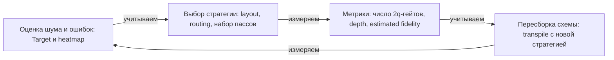

# Noise-aware компиляция: Target, heatmap-подход, error mitigation

**Версионная проверка:** размещение VF2-пассов сверено с локальным Qiskit 2.6.0 / Runtime 0.50.0, `FakeSherbrooke` (2026-10-24). Наличие error-данных и параметры пресета важны не меньше номера уровня.

В уроке 03 мы научились измерять качество компиляции в абстрактных единицах: SWAP, depth, число 2q-гейтов. На реальном устройстве эти единицы весят по-разному: ошибка CX на одной паре кубитов может быть втрое больше, чем на соседней, а readout-ошибка — внезапно хуже в углу чипа. Noise-aware компиляция дискретизирует устройство: layout и routing выбираются по данным о шумах, а не только по топологии. В этом уроке — из чего складывается шум, как читать его в Qiskit, как строить heatmap и компилировать по ней, и где граница между компиляцией и error mitigation.

## Из чего складывается шум устройства

Компоненты шума с точки зрения компилятора:

| Источник | Механизм | Как проявляется |
|----------|----------|-----------------|
| T1 (релаксация) | потеря энергии в среду, спад к нулю | ошибка растёт с длительностью idling и гейтов |
| T2 (dephasing) | потеря фазы | фазовые ошибки, особенно в длинных delays без dynamical decoupling |
| 2q gate error | декогеренция + несовершенные управляющие импульсы (coherent errors) | доминирующий вклад; зависит от пары кубитов |
| Leakage | уход из вычислительного подпространства | «удалённые» ошибки, видны не сразу |
| Readout error | некорректная классификация при измерении | смещает выставленные вероятности, асимметрична 0/1 |
| Crosstalk | взаимное влияние параллельных гейтов | error rate инструкции зависит от соседей |

Важно: readout-ошибка в Target **есть** — она лежит в `target["measure"][(q,)].error` (по одному ключу на каждый измеряемый кубит). А вот у crosstalk-ошибок «стандартного места» в Target-таблице нет: их приходится получать отдельно (из калибровочных данных, через пост-обработку результатов и т.п.), а не из готовых таблиц `target["ecr"]` / `target["cx"]`.

## Как устройство видно из Qiskit: Target и свойства

У современного (BackendV2) бэкенда свойства лежат в `backend.target` — экземпляре `Target`. Ключевые данные: для каждого имени инструкции — словарь пар кубитов, и для каждой пары `InstructionProperties(duration, error)`. Плюс per-qubit свойства t1, t2, frequency в `target.qubit_properties`.

```python
from qiskit.providers.fake_provider import GenericBackendV2

backend = GenericBackendV2(12, seed=42)
target = backend.target

# t1/t2/частота для каждого кубита
for q, qp in enumerate(target.qubit_properties):
    print(q, "t1 =", round(qp.t1 * 1e6, 1), "us, t2 =", round(qp.t2 * 1e6, 1), "us")

# пары (двухкубитные) + их error/duration
# у GenericBackendV2 по умолчанию нативный гейт — cx; у реальных IBM-чипов
# вместо него ecr или cz — смотрите backend.target.operation_names
for pair, props in target["cx"].items():
    print(pair, "error =", props.error, "dur =", props.duration)
```

Классический BackendV1 имел `backend.properties()` с похожими данными (`props.t1(q)`, `props.gate_error("cx", (0, 1))`), но этот интерфейс устарел; ориентируйтесь на Target.

## Heatmap-approach: выбор кубитов по шумам

Простой и эффективный приём — построить heat-карту ошибки 2q-гейтов по чипу и выбрать для layout подграф с наименьшей суммарной ошибкой:

```python
import numpy as np
from qiskit.transpiler import CouplingMap

n = backend.num_qubits
err = np.full((n, n), np.nan)
for pair, props in target["cx"].items():
    err[pair] = props.error

# средний score кубита: сумма ошибок его рёбер
score = np.zeros(n)
deg = np.zeros(n)
for (a, b), props in target["cx"].items():
    score[a] += props.error
    score[b] += props.error
    deg[a] += 1
    deg[b] += 1
avg_edge_err = score / np.maximum(deg, 1)
print("кубиты с худшей связной ошибкой:", np.argsort(avg_edge_err)[-3:])
```

Такой sort — простейший heatmap-подход. Продвинутые варианты (плагины layout, heat-driven routing) используют ту же идею с более сложной целевой функцией.

## Noise-aware layout/routing в Qiskit



Как читать схему: схема показывает замкнутый цикл noise-aware компиляции, в котором решения компилятора и данные об устройстве связаны друг с другом. Сначала по `Target` и heatmap оценивается шум и ошибки, затем выбираются layout, routing и набор пассов (например, `VF2Layout`, `VF2PostLayout`, `SabreLayout`), а результат измеряется числом 2q-гейтов, depth и estimated fidelity. Полученные числа учитываются при пересборке схемы, и цикл повторяется, пока шумовая оценка и метрики не сойдутся.

- Проверь себя: почему `SabreSwap` в базовой версии не учитывает error rate рёбер и как это меняет выбор SWAP?
- Проверь себя: чем отличается оценка fidelity по произведению ошибок инструкций от оценки с поправкой на время (F ≈ exp(−Σ t_i / T_eff))?
- Проверь себя: почему dynamical decoupling требует уже построенного расписания и не может применяться до этапа scheduling?

Три способа «прокачать» шум в компиляцию:

1. **Target внутри preset pass managers:** VF2-пассы могут оценивать раскладки по error-данным `Target`, но это не безусловная гарантия noise-aware результата. В проверенном Qiskit 2.6.0 / FakeSherbrooke при `layout_method=None`, `initial_layout=None` условный `VF2PostLayout` сконфигурирован в routing уровней **1–3**; на level 3 есть **дополнительный** в конце optimization. Явное `layout_method="default"` в той же версии отключает бюджеты этих включений: имя плагина само по себе не описывает всю конфигурацию. Дерево показывает наличие условных задач, а фактическое выполнение проверяется callback на выбранной схеме; [рекурсивная инспекция](02-transpiler-internals.md#stagedpassmanager-шесть-этапов) разобрана в каноническом уроке. **Важная оговорка:** сами `SabreLayout` и `SabreSwap` error-рейты **не используют** в своей топологической эвристике. При одинаковой топологии, параметрах, числе trials и seed изменение только ошибок не задаёт им шумовую целевую функцию. Дополнительный `SabrePreLayout` также не загружает калибровки: его `error_rate` — искусственный штраф для добавленных рёбер, а не аппаратная ошибка. Калибровочный выбор и его результат проверяйте отдельно по VF2-пассам и метрикам.
2. **Custom layout/routing pass с шумовой целевой функцией**: собственный PassManager с пассом, который по heatmap выбирает область чипа (как в уроке 02).
3. **Тепловые веса в routing**: SabreSwap в базовой версии не учитывает error rate рёбер — вставляет SWAP везде одинаково. Продвинутые варианты (например, `SabreLayout` с `routing_pass`, который знает цены рёбер) учитывают шум; это открытая исследовательская задача и одна из целей урока 05.

Практический рецепт noise-aware компиляции:

```python
from qiskit import QuantumCircuit, transpile

qc = QuantumCircuit(4)
qc.h([0, 1, 2, 3])
qc.cx(0, 2)
qc.cx(2, 1)
qc.cx(1, 3)
qc.measure_all()

# Target содержит ошибки; использование VF2 зависит от конфигурации и условий
tq = transpile(qc, backend=backend, optimization_level=3, seed_transpiler=42)
```

Это кандидат для сравнения с другими уровнями, а не обещание лучшей раскладки или наблюдаемой точности. Уровень 3 задаёт больший бюджет оптимизации; измеряйте результат вместе с временем компиляции.

## Оптимизация под fidelity, не под depth

Depth и SWAP — структурные прокси. Физическая длительность, калибровочный error proxy и наблюдаемый успех — разные показатели: см. [лестницу метрик](03-routing-mapping-sabre.md#metrics-ladder). `depth()` не измеряет время декогеренции. Ниже — ограниченная эвристическая модель, а не измеренная fidelity; в частности, код пропускает readout и idle, а для 1q-гейтов использует заглушку:

```python
import math

def estimate_fidelity(circ, target, fallback_1q=1e-3):
    """Эвристический score исполнимости: произведение (1 − error_i) по инструкциям.

    Это не измеренная fidelity и не вероятность правильного ответа, а
    эвристическая согласованность с Target: для каждой 2q-инструкции читаем
    свойства именно фактической пары (name, qargs); направленный гейт с другим
    направлением или нестандартным именем НЕ подменяется обратной операцией —
    вход, которого нет в Target, считается явно некалиброванным.
    """
    f = 1.0
    for inst in circ.data:
        name = inst.operation.name
        qargs = tuple(circ.find_bit(b).index for b in inst.qubits)
        if inst.operation.num_qubits == 2:
            props = target[name].get(qargs)     # читаём по факту: name + направление
            if props is not None:
                f *= (1.0 - (props.error or 0.0))
            else:
                raise KeyError(f"2q-инструкция ({name}, {qargs}) отсутствует в Target — "
                               f"схема не согласована с нативным базисом; подставлять "
                               f"обратное направление нельзя: у направленного гейта "
                               f"ошибка обеих ориентаций может быть разной")
        elif name not in ("barrier", "delay", "measure", "reset", "id"):
            f *= (1.0 - fallback_1q)   # типовая 1q-ошибка заглушки:
                                       # 1q-свойство можно подобрать и по target[name][qargs]
    return f

print("score est.:", estimate_fidelity(tq, backend.target))
```

Замечания к модели: значение выводится как **эвристический score** (оценка исполнимости), а не как измеренные fidelity или вероятность правильного ответа. Список нативных 2q-инструкций различается между бэкендами (`backend.target.operation_names` — `cx`, `ecr`, `cz`), поэтому считайте по фактическому имени гейта схемы. Схема должна выйти из transpile уже в нативном базисе — тогда KeyError указывает либо на несовместимый target, либо на барьерные/вспомогательные операции, попавшие в цикл по ошибке (отфильтруйте их явно). Точность модели — мультипликативная «ошибки независимы»: она не учитывает crosstalk и коррелированные ошибки; обратное направление направленного гейта не подменяется, а неучтённая (калибровочная) 1q-инструкция — единственная честная заглушка.

Практика: сравнивая два набора пассов (например, optimization_level 1 и 3, или два routing-метода), считайте estimated fidelity, а не только depth и число гейтов. Сравнение чисел — основа co-design, к которой мы вернёмся в уроке 05.

## Error mitigation на границе компиляции

На одном чипе есть три семейства борцов с ошибками, и компилятор участвует в одном из них:

1. **Error suppression (компиляторное поле).** Dynamical decoupling — вставка последовательностей X/Y-импульсов в простои кубита, которая «дробит» накопление фазовых ошибок. В Qiskit 2.x это пасс `PadDynamicalDecoupling` (плюс `ContextAwareDynamicalDecoupling` — вариант, учитывающий занятость соседей), который ставится в PassManager после scheduling. Ключевая деталь: DD требует уже построенного расписания (delays), поэтому применяется как дополнительный пасс поверх уже запланированной (scheduled) схемы. В Qiskit 1.x существовал отдельный пасс `DynamicalDecoupling`, но в 2.x он удалён — импортировать его больше нельзя.
2. **Error mitigation (запусковое поле).** Zero-Noise Extrapolation (ZNE): серия экспериментов с намеренно усиленным шумом (pulse stretching либо circuit folding — подстановка $U \to U\cdot U^\dagger\cdot U$, добавляющая гейты и глубину) с последующей экстраполяцией к нулевому шуму. Probabilistic Error Cancellation (PEC): по измеренным шумам строится квазивероятностное представление обратного канала, из которого сэмплируется ансамбль **изменённых** схем; результаты собираются и взвешиваются в один статистический ответ. Итак, mitigation редко является «бесплатной» постобработкой: ZNE и PEC меняют состав исполняемых экспериментов (folding добавляет гейты; PEC исполняет ансамбль схем и взвешивает результаты). Инструменты — runtime-сервисы (qiskit-ibm-runtime `Resilience`-уровни, Mitiq). Варианты без изменения логической структуры существуют (readout mitigation, простые пост-обработки), но ZNE/PEC к ним не относятся.
3. **Error correction (прикладное поле).** Коды требуют дополнительных кубитов и упомянуты как FT-трек в уроке 01 (обзор QEC — в модуле 03).

Для noise-aware компилятора важно разделить три слоя: suppression меняет саму схему (DD-импульсы в delays), mitigation меняет **набор исполняемых экспериментов и постобработку** (ZNE/PEC), correction — архитектуру системы. Тем не менее грамотный scheduling (включая dynamical decoupling) может сильно снизить потребность в mitigation. Так формируется pipeline suppress → mitigate → correct. Для унитарного $U$ сравните $U$ и $U\cdot U^\dagger\cdot U$: идеальный оператор тот же, но исполняемая последовательность длиннее — счёт гейтов и глубина растут.

## Практические рекомендации

1. Для выбора области чипа — используйте `target["cx"]` (или `target["ecr"]` / `target["cz"]` — смотрите `target.operation_names`): считайте среднюю ошибку рёбер, стройте heat-карту, а readout-ошибку берите из `target["measure"][(q,)].error` — и выбирайте кубиты с малой readout-ошибкой.
2. Сравните несколько уровней, включая 3, на одном корпусе и seed'ах: больший бюджет не гарантирует лучшего результата или монотонного времени компиляции. Фиксируйте `seed_transpiler`, версию, параметры и число trials для reproducibility.
3. Сравнивайте стратегии по набору метрик из [лестницы](03-routing-mapping-sabre.md#metrics-ladder), а не только по depth. Error proxy считается по нативной схеме и не заменяет проверку наблюдаемой точности.
4. Учитывайте crosstalk: значение «лучшей» пары кубитов по errors может искажаться, если параллелить её исполнение с соседними слоями; это поле исследования в layout/scheduling-aware компиляции (см. урок 05).

## 📚 Узнать подробнее

<details markdown="1">
<summary>Видеолекции (с таймкодами)</summary>

- **Nick Knows — Dynamical Decoupling — Qiskit** - блок урока «Error suppression (компиляторное поле)»: как DD-последовательности вставляются в простои уже запланированной схемы и что они дают по T2. [ссылка](https://youtu.be/67jRWQuW3Fk)
- **Nick Knows — Measurement Errors — Qiskit** - блок урока «Как устройство видно из Qiskit: Target и свойства»: почему readout-ошибка не приходит из таблиц `target["cx"]` и как её учитывать отдельно. [ссылка](https://youtu.be/9ZSBkH-2zjs)
- **Nick Knows — Pulse Scaling — Qiskit** - блок урока «Error mitigation (запусковое поле)»: механика ZNE через pulse stretching — намеренное усиление шума с последующей экстраполяцией. [ссылка](https://youtu.be/xdRgKC1AMl8)
- **Andrew Eddins | Error Mitigation Landscape | QDC 2025 — Qiskit** - блок урока «Error mitigation на границе компиляции»: современная карта suppress → mitigate → correct и где проходит граница между компиляцией и mitigation. [ссылка](https://youtu.be/ix52wx4_zek)
- **Mitigating Noise in Quantum Hardware — Part 1 | Qiskit Seminar Series 2023** - блок урока «Оптимизация под fidelity, не под depth»: систематика ZNE/PEC и их стоимость в количестве запусков. [ссылка](https://youtu.be/Dv5cqB87nqk)
</details>

<details markdown="1">
<summary>Статьи и блоги</summary>

- **IBM Quantum documentation «Compare transpiler settings»** - секция «Noise-aware layout/routing в Qiskit»: сравнение настроек пресета и использование данных Target; конкретное размещение VF2PostLayout сверяйте с локальной версией и параметрами, а DD — с построенным расписанием. [ссылка](https://quantum.cloud.ibm.com/docs/guides/circuit-transpilation-settings)
- **IBM Quantum blog «Optimize quantum circuits with AI-powered transpiler passes» (David Kremer и др.)** - секция «Тепловые веса в routing»: AIRouting учитывает карту ошибок устройства при вставке SWAP — RL-вариант heat-driven routing, в среднем −42% 2q-гейтов. [ссылка](https://www.ibm.com/quantum/blog/ai-transpiler-passes)
- **IBM Quantum blog «Qiskit leads quantum SDKs in performance, testing shows»** - секция «Heatmap-approach: выбор кубитов по шумам»: почему скорость перебора раскладок важна при оценке по error-рейтам Target. [ссылка](https://www.ibm.com/quantum/blog/qiskit-performance)
</details>

<details markdown="1">
<summary>Книги/документация (глава/раздел, статьи arXiv)</summary>

- **Qiskit Documentation: `Target`** [документация](https://quantum.cloud.ibm.com/docs/api/qiskit/qiskit.transpiler.Target), поля `InstructionProperties(duration, error)` и `qubit_properties`(t1, t2): формальная модель шума, за которой стоит код урока.
- **arXiv:2311.05933** (layer fidelity / EPLG: McKay и др., уже есть в resources/papers.md): протокол, которым IBM измеряет качество цепочек кубитов на 100-кубитных чипах — прямой источник heat-данных о шуме.
</details>

<details markdown="1">
<summary>Русскоязычные ресурсы</summary>

- **В.И. Яшин, курс «Вычисления на помехоустойчивых квантовых схемах» (2024) — МИАН** — целый курс про шум, стабилизаторы и коррекцию ошибок: русскоязычная опора для блока «Из чего складывается шум устройства». [ссылка](https://www.mathnet.ru/rus/conf2384) — по поиску
- **В.И. Яшин, Лекция 9 «Вычисления на стабилизаторных схемах с магией» — МИАН** — как шум и «магия» связаны с ресурсами коррекции: привязка к блоку «Error mitigation на границе компиляции». [ссылка](https://youtu.be/SG0FwI0zA8w) — по поиску
- **Онлайн-курс «Введение в квантовые вычисления», ЦКТ МГУ** — лекции 8–10 про ошибки, дискретизацию ошибок, CSS-коды и пороговую теорему: прямая опора для блока «Из чего складывается шум». [ссылка](https://quantum.msu.ru/ru/education/online/introduction-to-quantum-computing) — проверено
- **ЦКТ МГУ, курс «Квантовая томография и обработка результатов квантовых измерений» (Ю.И. Богданов)** — методы измерений и томографии для оценки шума устройства: русскоязычный источник для heatmap-подхода. [ссылка](https://quantum.msu.ru/ru/education/msc-programs/quantum-computing) — проверено
- **А.Ю. Китаев, А.Х. Шень, М.Н. Вялый. «Классические и квантовые вычисления» (МЦНМО, 1999)** — разделы про шум и коррекцию ошибок: русскоязычный базовый источник для Target-метрик и fidelity. [ссылка](https://old.mccme.ru/free-books) — проверено
</details>

## ✅ Проверь себя

1. Перечислите шесть источников шума (T1, T2, 2q error, leakage, readout, crosstalk). Как каждый из них влияет на решения компилятора?
2. Какие данные лежат в `target["cx"]` (или `target["ecr"]`) и `target.qubit_properties` и как их использовать для heat-карты?
3. Почему «лучшая» пара кубитов по ошибкам может оказаться хуже, если учесть crosstalk?
4. В чём разница между error suppression (dynamical decoupling), error mitigation (ZNE, PEC) и error correction?
5. Что делает VF2PostLayout и где в pipeline он запускается?
6. Как посчитать estimated fidelity по гейтам вручную через Target?

Пройдите [тест модуля 04](../../tests/04-quiz.md).

## ➡️ Что дальше

Следующий урок — стратегии co-design: [05 — Оптимизация архитектуры: QAOA/QCNN-топологии, QAS, circuit reduction](05-architecture-optimization.md).
