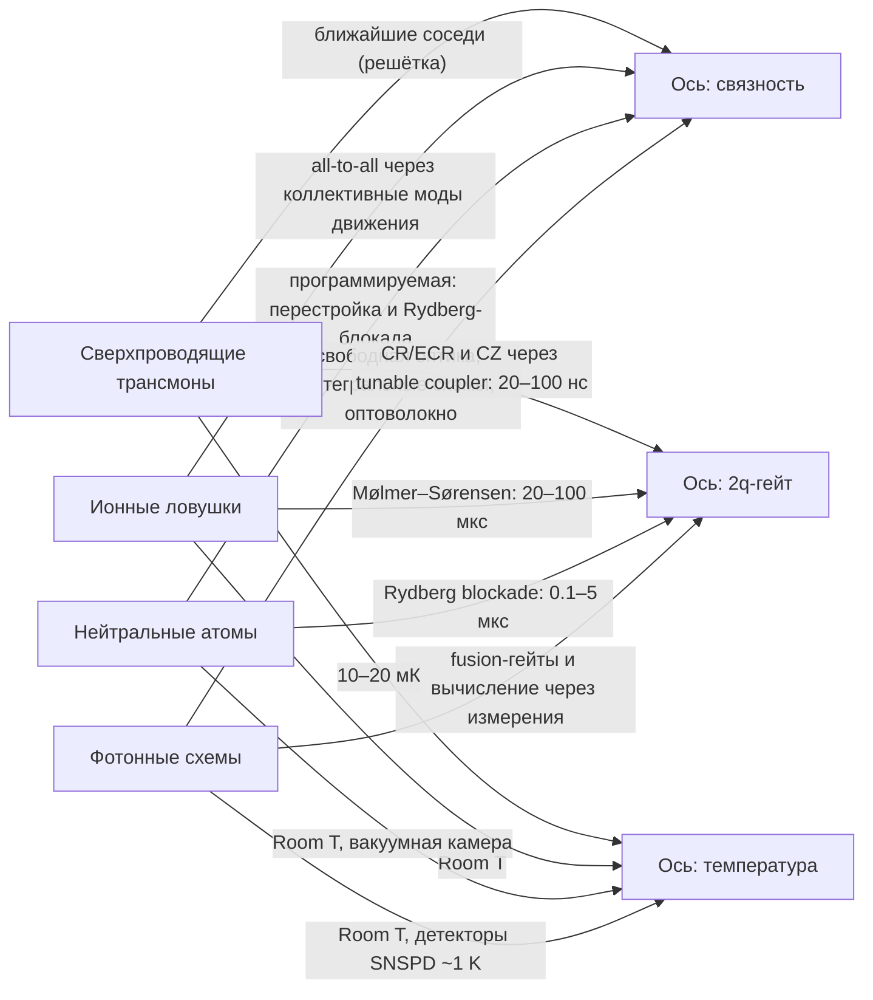

# Обзор платформ кубитов (Qubit Platforms)

## Критерии Ди Винченцо

Чтобы система считалась квантовым компьютером, она должна удовлетворять критериям Ди Винченцо (DiVincenzo criteria, 2000):

1. **Масштабируемая система физических кубитов** с чёткой идентификацией $|0\rangle, |1\rangle$.
2. **Инициализация** в известное состояние $|0\rangle$.
3. **Достаточно долгая когерентность**: времена релаксации и дефазировки ($T_1$, $T_2$) должны превышать время гейта $\tau_{\text{gate}}$ на много порядков — иначе ошибки накапливаются быстрее, чем успевает отработать алгоритм.
4. **Универсальный набор гейтов** (произвольная унитарная операция из одно- и двухкубитных блоков).
5. **Считывание конкретного кубита** с высокой точностью.

Для распределённых машин в литературе часто добавляют шестой критерий — конверсию между стационарными и «летающими» кубитами (networking). Это уже позднейшее расширение: в оригинальной работе Ди Винченцо (2000) критериев пять, а сам networking туда не входит. Будем прогонять каждую платформу через эту призму.

## Ландшафт: две оси напряжённости

```
              точность 2q-гейтов
               ^
  99.9% ─────── |             ионы (Quantinuum H2)
               |
  99.0% ─────── |   сверхпроводники    нейтральные атомы
               |   (IBM, Google, IQM) (QuEra)
               |
  ~99% + annealing D-Wave (не gate-model, 2q-гейтов нет)
               +--------------------------------------->
                 масштаб (число кубитов)
```

Главная ось противоречия: **связность и точность** (ионы — до 99.9% двухкубитных гейтов и полная связность, но медленно) против **масштаба и скорости** (сверхпроводники — сотни кубитов с наносекундными гейтами, но ближайшие соседи). Нейтральные атомы занимают середину: тысячи кубитов и программируемая связность через Rydberg-блокаду.

## Сравнительная таблица

| Платформа | Кубит | 2q-гейт / время | Связность | T1, T2 (типично) | Температура | Плюсы | Минусы |
|---|---|---|---|---|---|---|---|
| Сверхпроводники (transmon) | нелинейный LC-контур, Josephson junction | CR/ECR (IBM Eagle), CZ (IBM Heron, Nighthawk, Google) через tunable coupler; 20–100 нс | ближайшие соседи (решётка) | 100–500 мкс | 10–20 мК | быстро, полупроводниковая фабрикация, лидеры в QEC | разброс параметров junction, mK-криостаты, микроволновый crosstalk |
| Ионы в ловушках | гиперфин-уровни Yb+/Ca+ | Mølmer–Sørensen; 20–100 мкс | all-to-all через коллективные моды движения | минуты (дефазировка) | Room T, сами ионы почти не греются | высочайшие fidelity, идентичные кубиты | медленно, лазерная оптика, QCCD-транспортировка сложна |
| Нейтральные атомы | атомы Rb/Sr в оптических твизерах | Rydberg blockade; 0.1–5 мкс | программируемая: атомы перестраиваются, Rydberg дальнодействие | секунды | Room T (вакуумная камера) | масштаб до тысяч атомов, геометрическая перестройка, кластеры запутанности | потери атомов, mid-circuit readout, digital-гейты — молодая инженерия |
| Фотоника | однофотонные моды | fusion-гейты / measurement-based | свободная оптика + интегральные схемы + оптоволокно | в полёте почти не декогерирует | Room T, детекторы SNSPD ~1 K | связь с сетями и распределённый QC | нет детерминистских источников и памяти, огромный overhead, вычисление через измерения |
| Кремниевые спины | spin электрона в квантовой точке Si | exchange + ESR; нс–мкс | ближайшие соседи | сотни мкс–мс | 0.1–4 K | CMOS-совместимая фабрикация, крошечный footprint | считывание спинов, вариация точек, RF-управление |
| Топологические | Majorana zero modes (полупроводник + сверхпроводник) | измерения | локальные пары | обещают intrinsic protection | mK | защита от локального шума «на уровне физики» | ранняя стадия, малое число кубитов, спорная идентификация сигналов |
| Аннелинг (D-Wave) | сверхпроводящие flux-кубиты | адиабатическая эволюция $H(t) = (1-s)H_{\text{driver}} + sH_{\text{problem}}$ | граф Pegasus (до 15 связей на кубит) | — | ~15 мК | тысячи кубитов с первого дня, задачи оптимизации | не универсальный gate-model, преимущество показано лишь частично |

Куда применяется: сверхпроводники — универсальный gate-model, лидеры fault-tolerant QEC (Google Willow: surface code ниже порога); ионы — точные алгоритмы: VQE, глубокие схемы; нейтральные атомы — квантовые симуляции спиновых моделей и масштабные кластеры; фотоника — сетевые протоколы; кремниевые спины — массовое производство в перспективе; аннелинг — эвристики оптимизации, вне gate-model.

## Как читать таблицу: четыре фильтра

- **Связность**: расстояние в графе связности задаёт число SWAP при [routing](../../curriculum/04-systems-design/03-routing-mapping-sabre.md). All-to-all у ионов обходит проблему, но ценой времени на каждый гейт.
- **Когерентность относительно времени гейта** — важное соотношение $N_{\text{ops}} \sim T_2 / \tau_{\text{gate}}$ (сколько операций «влезает» до декогеренции). Ионы: минуты / 100 мкс → $N \sim 10^6$; сверхпроводники: 300 мкс / 50 нс → $N \sim 10^4$; атомы — между ними.
- **Управляющие сигналы**: микроволны и постоянные токи (сверхпроводники, спины) против лазеров (ионы, атомы). Лазерная система — отдельный инженерный слой: стабилизация фазы, выравнивание пучков, автоподстройка.
- **Температура**: mK-криостаты дороги и ограничивают проводку из криостата; «тёплые» платформы (ионы, атомы, фотоника) выигрывают в температурном бюджете, но платят оптикой/детекторами.

<details class="admonition analogy" markdown="1">
<summary class="admonition-title">Аналогия: стрелка компаса, которая заваливается и «плывёт»</summary>

Два времени, часто встречающиеся в таблицах, — это два способа потерять состояние. $T_1$ — «заваливание»: стрелка медленно сползает к «северу» ($|1\rangle$ релаксирует в $|0\rangle$, энергия утекает в окружение). $T_2$ — «плывущий азимут»: энергия ещё не потеряна, но стрелка уже не знает точную долготу — фаза суперпозиции расплывается. Отношение $T_2/\tau_{\text{gate}}$ из таблицы — «сколько гейтов стрелка ещё качественно покажет»: у ионов счёт на миллионы, у трансмонов — на десятки тысяч; ошибки гейтов съедают этот запас в первую очередь.
Предел аналогии: компас — классическая картинка: в квантовой механике «направление» задаётся вектором, а не физическим предметом, и за раз измеряется только одна проекция.

</details>



**Как читать схему.** Схема устроена как четыре платформы, от каждой из которых идут стрелки к трём осям сравнения: связность, тип и темп двухкубитного гейта, температура. Подпись над стрелкой даёт значение по этой оси для конкретной платформы, поэтому одну ось удобно читать, перескакивая от верхней строки к нижней. Все числа в подписях взяты из сравнительной таблицы урока и являются типичными, а не предельными значениями.

- Проверь себя: какая платформа единственная требует криогеники и что это означает для её инженерного бюджета?
- Проверь себя: у какой платформы связность all-to-all и какой механизм её обеспечивает?
- Проверь себя: почему для фотонной схемы в оси гейтов стоит не время, а тип гейта, и чем она отличается от остальных платформ?

## Ландшафт индустрии (перечисление)

- **Сверхпроводники**: IBM (Heron, Eagle), Google (Willow, Sycamore), IQM (Spark, Radiance), Rigetti; EU-консорциум OpenSuperQ+100.
- **Ионы**: Quantinuum (H1/H2), IonQ (Forte), AQT.
- **Нейтральные атомы**: QuEra (Aquila, 256 атомов), Atom Computing (1100+ атомов), Pasqal.
- **Фотоника**: PsiQuantum, Xanadu.
- **Кремниевые спины**: Intel, Diraq, Quantum Motion.
- **Топологические**: Microsoft (Majorana 1, топопроводники, 2025).
- **Аннелинг**: D-Wave (Advantage).

Сравнение «какая платформа лучше» вне конкретной задачи бессмысленно: грамотный инженер сравнивает метрики, а не бренды — об этом в [уроке 05](05-benchmarking.md).

## Кудиты: носитель с числом уровней больше двух

Большинство платформ используют двухуровневый носитель (кубит), но в ионных ловушках и оптике естественно работать с **кудитами** (qudit, $d > 2$): уровней больше двух, и в одном носителе можно разместить сразу несколько «кубитных» регистров. Практический смысл — не в красоте, а в счёте: обобщённый гейт Тоффоли на $p$ кубитах, размещённых в $p$ кудитах, реализуется **не более чем за $O(p)$ двухчастичных операций** — тогда как на кубитах требуется дерево декомпозиции с $O(p^2)$ 2q-гейтами. Ещё один эффект: кудитная схема может требовать **меньше** двухчастичных взаимодействий, а это и есть главный дефицит на железе (см. блок «Калибровка» в [уроке 04](04-cryogenics-fabrication.md)).

Оговорка: выигрыш зависит от того, какой тип нативного двухчастичного взаимодействия поддерживает платформа (для холодных ионов — Mølmer–Sørensen), и от того, умеет ли компилятор целевой платформы работать с кудитами. Пока это направление экспериментальное, но оно объясняет, почему «кубит — это не обязательно два уровня».

## Квантовый отжиг: другая вычислительная модель

Отдельно от gate-model существует **квантовый отжиг** (annealing): задача формулируется не как последовательность операций над кубитами, а как минимизация энергии в изотермическом квантовом процессе (аналог отжига металла). Всё, что умеет gate-model, отжиг не умеет и наоборот, поэтому его часто обсуждают отдельно от «квантовых компьютеров вообще».

Инженерная проблема отжига: реальные прикладные задачи **на порядки больше** по размерности, чем доступные аннилеры. Рабочий подход — не «купить bigger», а разбить задачу: декомпозиция на подзадачи посильного размера (subQUBO), встраивание в архитектуру Chimera (minor embedding) и локальный поиск (tabu search) на том, что не влезло. Отсюда практическое правило: отжиг — это не «квантовый ускоритель», а способ декомпозиции больших задач на смесь квантовых и классических блоков.

## 📚 Узнать подробнее

<details markdown="1">
<summary>Видеолекции (с таймкодами)</summary>

- **Quantum Computing: Where We Are and Where We're Headed (панель NVIDIA GTC 2025), NVIDIA Developer** [00:12:39-00:18:39] - блок урока «Ландшафт индустрии (перечисление)»: участники панели по очереди объясняют, что стоит за их платформами — нейтральные атомы, сверхпроводники и ловушки ионов. [ссылка](https://youtu.be/9XB-LsfpvCU)
- **Quantum Computing: Where We Are and Where We're Headed (панель NVIDIA GTC 2025), NVIDIA Developer** [00:25:28-00:27:20] - блок урока «Ландшафт: две оси напряжённости»: живой дебат о том, что важнее — масштаб процессора или достижение прикладного выигрыша. [ссылка](https://youtu.be/9XB-LsfpvCU)
- **Learn Quantum: What is Trapped Ion Quantum Computing?, IonQ** [00:03:06-00:07:11] - блок урока «Сравнительная таблица» (строка ионов): как платформа выглядит изнутри — измерение fidelity, время когерентности и почему ценится связность all-to-all. [ссылка](https://youtu.be/f80y85GGyfE)
- **Neutral Atom Quantum Computers — Concept of Operation, QuEra Computing** [00:01:08-00:02:19] - блок урока «Сравнительная таблица» (строка нейтральных атомов): три технических шага — удержание атомов, оптические твизеры, выполнение операций — и обзор главных плюсов (масштаб, программируемая связность, Room T). [ссылка](https://youtu.be/JmnZVhQc-H8)
</details>

<details markdown="1">
<summary>Статьи и блоги</summary>

- Google blog «Meet Willow, our state-of-the-art quantum chip» (Х. Невен) - блок урока «Ландшафт индустрии (перечисление)»: Willow как существующая машина, где число кубитов не главное — важнее падение ошибки с ростом surface code (ниже порога). [ссылка](https://blog.google/technology/research/google-willow-quantum-chip/)
- MIT News «Explained: Quantum engineering» (D. Ackerman) - блок урока «Как читать таблицу: четыре фильтра»: пояснение, почему сравнение платформ упирается в инженерные компромиссы (декогеренция против времени гейта, управляемость, масштабирование). [ссылка](https://news.mit.edu/2020/explained-quantum-engineering-1210)
</details>

<details markdown="1">
<summary>Книги/статьи (глава/раздел, arXiv)</summary>

- DiVincenzo «The Physical Implementation of Quantum Computation» (arXiv:quant-ph/0002077; Fortschr. Phys. 48, 771) - блок урока «Критерии Ди Винченцо»: первоисточник пяти (+двух) критериев. [ссылка](https://arxiv.org/abs/quant-ph/0002077)
- Zhu и др. «Quantum Compiler Design for Qubit Mapping and Routing: A Cross-Architectural Survey…» (arXiv:2505.16891) - блок урока «Сравнительная таблица»: как связность платформы (Superconducting vs trapped-ion vs neutral atom) меняет механику маппинга и routing. [ссылка](https://arxiv.org/abs/2505.16891)
- Rempfer, Obenland «Comparison of Superconducting NISQ Architectures» (arXiv:2409.02063) - блок урока «Как читать таблицу: четыре фильтра»: как топология чипа влияет на результаты QAOA одного и того же кода. [ссылка](https://arxiv.org/abs/2409.02063)
- Kiktenko, Nikolaeva, Fedorov «Qudits for decomposing multiqubit gates and realizing quantum algorithms» (Rev. Mod. Phys. 97, 021003, 2025; arXiv:2311.12003) — блок урока «Кудиты: носитель с числом уровней больше двух»: обзор подходов — разложение многокубитных гейтов по кудитам, упаковка нескольких кубит в один кудит и сокращение числа двухчастичных операций. [ссылка](https://arxiv.org/abs/2311.12003)
- Nikolaeva, Kiktenko, Fedorov «Efficient realization of quantum algorithms with qudits» (EPJ Quantum Technol. 11, 43 (2024; arXiv:2111.04384)) — блок урока «Кудиты: носитель с числом уровней больше двух»: транспиляция qubit-схемы в последовательность одно- и двухкудитных гейтов с учётом числа уровней носителя, пример реализации 6-кубитного алгоритма. [ссылка](https://arxiv.org/abs/2111.04384)
- D-Wave whitepaper «Partitioning Optimization Problems for Hybrid Classical/Quantum Execution» — блок урока «Квантовый отжиг: другая вычислительная модель»: декомпозиция больших задач на subQUBO плюс minor embedding и локальный поиск. [ссылка](https://www.dwavequantum.com/media/jhlpvult/partitioning_qubos_for_quantum_acceleration-2.pdf)
</details>

<details markdown="1">
<summary>Русскоязычные ресурсы</summary>

- **Илья Беседин: Архитектуры квантовых компьютеров. Плюсы, минусы, подводные камни. Часть 1, ODS AI Ru** — блок урока «Ландшафт: две оси напряжённости»: сравнение архитектур квантовых компьютеров (сверхпроводники, ионы, нейтральные атомы) с точки зрения плюсов, минусов и подводных камней каждой платформы. [ссылка](https://youtu.be/VLiQnsVE0oI) — проверено через oembed
- **Павлова Т.В. Квантовый компьютер на основе отдельных атомов примеси в системе Si28: P31, ЦКТ МГУ** — блок урока «Сравнительная таблица» (строка кремниевых спинов): лекция о квантовом компьютере на основе атомов фосфора в кремнии — альтернативной платформе спиновых кубитов. [ссылка](https://youtu.be/NS5UPYuFg9U) — проверено через oembed
- **На пути к квантовому компьютеру на сверхпроводящих электросхемах — Владимир Манучарян, МФТИ** — блок урока «Ландшафт индустрии (перечисление)»: обзор развития сверхпроводниковых квантовых процессоров в России и мире. [ссылка](https://youtu.be/uvjzi8Pboa4) — проверено через oembed
- **Квантовые вычисления, Федичкин Л.Е., Лекция 01, 12.09.20, Дистанционные занятия МФТИ** — блок урока «Критерии Ди Винченцо»: вводная лекция курса МФТИ по квантовым вычислениям с обзором платформ. [ссылка](https://youtu.be/9-li-7EKWeE) — проверено через oembed
- **Добиться превосходства. Как в России создают квантовые компьютеры будущего, Росатом** — блок урока «Ландшафт индустрии (перечисление)»: обзор российских квантовых вычислителей на ионах, сверхпроводниках, нейтральных атомах и фотонах. [ссылка](https://youtu.be/_0kx5YyHuPY) — проверено через oembed
</details>

## ✅ Проверь себя

1. Сформулируйте пять критериев Ди Винченцо и укажите, какой из них аннелинг D-Wave нарушает.
2. Почему ионная связность all-to-all не решает проблему масштабирования полностью?
3. Оцените по порядку величины $N_{\text{ops}} \sim T_2/\tau_{\text{gate}}$ для transmon и для иона — во сколько раз разрыв?
4. Какая платформа работает «теплее» всех и почему это не даёт ей автоматического выигрыша во всём остальном?
5. Что такое Rydberg blockade и почему она даёт дальнодействующую связность в атомных массивах?
6. Почему кудитная реализация алгоритма может требовать меньше двухчастичных операций, чем кубитная? Какой ресурс при этом экономится?
7. Почему для квантового отжига важна не столько покупка аннилера, сколько декомпозиция задачи?

Полезно пройтись по [тесту модуля 05](../../tests/05-quiz.md).

## ➡️ Что дальше

Следующий урок — глубокий разбор самой промышленно развитой платформы: [сверхпроводящие кубиты](02-superconducting-qubits.md); затем — ионы и нейтральные атомы в [уроке 03](03-iontraps-neutral-atoms.md).
