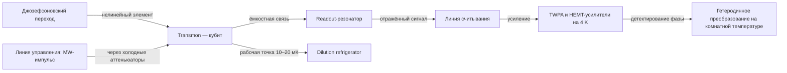

# Сверхпроводящие кубиты: transmon в глубину

## От LC-осциллятора к нелинейности

Идеальная LC-схема с индуктивностью $L$ и ёмкостью $C$ описывается гамильтонианом гармонического осциллятора:

$$H = \frac{Q^2}{2C} + \frac{\Phi^2}{2L}, \qquad \omega_0 = \frac{1}{\sqrt{LC}}.$$

У гармонического осциллятора уровни эквидистантны ($\hbar\omega_0$, $2\hbar\omega_0$, …), поэтому нельзя адресовать переход $|0\rangle\to|1\rangle$, не возбуждая $|1\rangle\to|2\rangle$ — «кубита» из такого объекта не выйдет. Нужен нелинейный элемент, который делает уровни неравномерными. Таким элементом служит **джозефсоновский переход**: два сверхпроводника, разделённые тонкой (~1–2 нм) оксидной прослойкой AlO$_x$, через которую туннелируют куперовские пары. Это совершенный, потерь практически не создающий «нелинейный дроссель» с энергией

$$E_J = \frac{\Phi_0 I_c}{2\pi}, \qquad \Phi_0 = \frac{h}{2e} \approx 2.07\cdot10^{-15}\ \text{Wb}.$$

Шунтирование перехода большой ёмкостью и выбор больших $E_J/E_C$ (30–100) дают **transmon** (transmission monopole-shunted, J. Koch et al., arXiv:cond-mat/0703002, PRA 76, 042319 (2007)).

## Гамильтониан transmon и уровни $|0\rangle,|1\rangle,|2\rangle$

Зарядовая (number-phase) форма:

$$H = 4E_C(\hat n - n_g)^2 - E_J\cos\hat\varphi, \qquad E_C = \frac{e^2}{2C_\Sigma}.$$

В пределе $E_J/E_C \gg 1$ экспоненциально подавляется чувствительность к зарядовому шуму ($n_g$ — наведённый заряд; charge dispersion $\sim \exp(-\sqrt{8E_J/E_C})$), и спектр становится «почти осцилляторным»:

$$\hbar\omega_{01} \approx \sqrt{8E_JE_C} - E_C, \qquad \hbar\omega_{12} \approx \sqrt{8E_JE_C} - 2E_C.$$

Разность частот переходов — **ангармонизм**:

$$\alpha = \omega_{12} - \omega_{01} \approx -E_C/\hbar \quad \text{(циклическая частота)}, \qquad \alpha/2\pi \approx -E_C/h \approx -(200\ldots 300)\ \text{МГц}.$$

В калибровках устройств ангармоничность приводят в герцах: $\alpha/2\pi \approx -(200\ldots 300)$ МГц (у типичных транзамона $E_C/h \approx 200$–300 МГц). Не смешивайте соглашения по ходу расчётов: где гейты записаны через $\omega$ — это рад/с, а таблицы свойств железа (Target, `props`) отдают частоты в ГГц/МГц как $f = \omega/2\pi$.

Именно благодаря ангармонизму микроволновый импульс на частоте $\omega_{01}$ селективен: соседний переход отстоит на ~200 МГц, и импульс шириной 10–50 нс умеет его не задевать (банально при суб-наносекундных импульсах «полосатость» растёт). Типичные параметры: $\omega_{01}/2\pi = 4\ldots7$ ГГц, $E_J/E_C = 30\ldots 100$.

```
 E
 |2 ── 2ℏ(ω01+α/2)      <- |1>-|2> селективность через α ≈ -200 МГц
 |1 ── ℏω01             <- рабочая линия управления (MW-импульс)
 |0 ── 0                <- ground state
```

Практический вывод: transmon — не «идеально двухуровневая» система, а слабо-ангармоническая многоуровневая. Транспилятор и калибровки обязаны это учитывать (leakage на $|2\rangle$ — реальная ошибка).

## Почему нужен милликельвин

Частота ~5 ГГц соответствует квантовой энергии $hf/k_B \approx 240$ мК. Чтобы тепловая заселённость возбуждённых уровней была ничтожна ($P_1 \approx e^{-hf/k_BT} \ll 1$), температура должна быть много меньше 240 мК — отсюда рабочая точка 10–20 мК в **dilution refrigerator** (подробно в [уроке 04](04-cryogenics-fabrication.md)). Вторая причина — подавление шумовой заселённости линий: без холодных аттеньюаторов тёплые микроволновые фотоны из комнаты «накачали» бы кубит.

## Circuit QED: резонаторы и дисперсивное считывание

Каждый transmon связан ёмкостной связью с **readout-резонатором** (копланарный волновод, $\lambda/4$, ~5–7 ГГц) — архитектура **circuit QED** (Blais et al., arXiv:cond-mat/0402216). В режиме дисперсионной связи $|\Delta| = |\omega_r-\omega_q| \gg g$ кубит сдвигает резонатор на величину

$$H_{\text{disp}}/\hbar = \left(\omega_r + \chi\sigma_z\right)a^\dagger a + \frac{1}{2}\left(\omega_q + \chi\right)\sigma_z, \qquad \chi \approx \frac{g^2}{\Delta}.$$

Проще: резонансная частота резонатора зависит от состояния кубита ($\omega_r \pm \chi$). Подаём слабый зондирующий импульс, детектируем фазу отражённого/прошедшего сигнала через цепочку: резонатор → квантово-ограниченные усилители (TWPA) → HEMT-усилители на 4 K → гетеродинное преобразование на комнатной температуре. Измерение квази-QND: вероятность $|0\rangle$ или $|1\rangle$ даёт сдвиг фазы; состояния $|0\rangle$ и $|1\rangle$ разводятся по фазе, если $\chi \gg \kappa$ (время измерения ~0.5–3 мкс). Здесь же живёт readout error, которую вы видели в `backend.target` (запись `measure`).



**Как читать схему.** Слева направо читается физический путь сигнала: джозефсоновский переход даёт трансмону нелинейность, ёмкостная связь приводит к резонатору считывания, а оттуда сигнал уходит по линии считывания через усилители к гетеродинному преобразованию. Отдельная ветвь показывает, что кубит живёт в криостате при 10–20 мК, а управляющий микроволновый импульс приходит извне по отдельной линии управления. Подписи над стрелками называют физическое взаимодействие между блоками, а не просто порядок следования.

- Проверь себя: какой элемент делает уровни трансмона неэквидистантными и почему одного LC-контура для кубита мало?
- Проверь себя: почему состояние кубита читают не напрямую, а через резонатор, и какой величиной состояния различаются?
- Проверь себя: зачем на линиях стоят холодные аттеньюаторы и что случилось бы с кубитом без них?

## Двухкубитные гейты: как строится запутанность

Двухкубитные операции — главное богатство сверхпроводников:

- **Cross-resonance (CR)**: на смежный кубит подаём микроволновый импульс на частоте соседа; через эффект cross-resonance создаётся эффективное взаимодействие $ZX$, из которого собирается CNOT. Работает с фиксированной связью. Эхо-варианты (echoed CR, ECR) подавляют статические систематические ошибки.
- **Tunable coupler + CZ**: между кубитами стоит третий элемент — перестраиваемая джозефсоновская связь (контур с SQUID-петлёй). Подачей потока выводим пару на резонанс, при котором накапливается фаза $\pi$ на состоянии $|11\rangle$ — это родной CZ (так работают Google Willow, IBM Heron и Nighthawk; у IBM Eagle родной 2q-гейт — **ECR**, а не CZ).
- Связность решётки задаёт, **какие пары умеют взаимодействовать напрямую**; это тот граф, на который вы [транспилируете](../../curriculum/02-programming/03-transpilation-hardware.md).

Типичные fidelity: одно-кубитные 99.9–99.99% (1q-ошибка ~10⁻⁴…10⁻³), двухкубитные 99–99.9% (2q-ошибка ~10⁻³…10⁻², то есть 0.1–1 %: в фейковых бэкендах Qiskit медиана ошибки `ecr` — около 0.8 % у Eagle (`FakeSherbrooke`, 127 кубитов) и около 1.0 % у 27-кубитного Falcon (`FakePeekskill`), а лучшие пары дают 0.35–0.4 %; у Heron (`FakeAachen`, 156 кубитов) нативный гейт — `cz` с медианой около 0.15 %) — ошибка двухкубитного гейта на порядок и больше, поэтому в бюджете ошибки доминирует число 2q-гейтов (см. модуль 04). Времена зависят от семейства и типа нативного гейта: ECR на Eagle — 341–882 нс (медиана FakeSherbrooke ≈ 533 нс), CZ на Heron — порядка 68 нс; т.е. «20–100 нс на 2q-гейт» верно для CZ/новых поколений, но не для ECR. Даже у медленного ECR это в сотни раз быстрее ионов (у ионных ловушек 20–100 мкс).

## Материалы: tantalum и TLS-потери

Сверхпроводимость ниобия/алюминия сами по себе почти не теряет энергию; главный «враг» — дефектные аморфные оксиды на границах и поверхностях (**two-level systems**, TLS): каждая пара «поверхность/подложка» — случайная двухуровневая система, высасывающая энергию ($1/T_1 \propto$ восприимчивость TLS). Разворот последних лет — **тантал**: тонкоплёночные transmon на Ta (Princeton/Google) дали стабильный рост T1; на Ta/Al платформах достигают T1 0.3–0.5 мс и выше. Детали — в [04-cryogenics-fabrication.md](04-cryogenics-fabrication.md).

## Почему SQUID и crosstalk мешают масштабу

Tunable couplers и tunable qubits используют **SQUID-петли** (два JJ в контуре): поток $\Phi$ через петлю перестраивает $E_J(\Phi) = E_{J,\max}\cos(\pi\Phi/\Phi_0)$. Это даёт быстрое управление, но и проблемы:

1. Флюкс-crosstalk: подводка потока к одному кубиту слегка «касается» соседей → частота нескольких кубитов сдвигается сразу; калибровка становится дорогой.
2. Флюкс-шум низкочастотный → dephasing; рабочую точку приходится держать в sweet spot ($\partial\omega/\partial\Phi = 0$) ради long-term стабильности.
3. Разброс junction по $E_J$ из литографии требует индивидуальной подстройки — на 100+ кубитах это большая логистика.
4. Проводка: на каждый кубит нужны свои линии управления и считывания; в криостате их число масштабировать труднее, чем число кубитов на чипе (см. [урок 04](04-cryogenics-fabrication.md)).

Магистральный ответ индустрии: fixed-frequency qubits (меньше flux-линий) + tunable couplers, топология heavy-hex (меньше связность → ниже crosstalk, лучше совместимость с QEC), 3D-интеграция и муксинг сигналов.

Google Willow (105 кубитов, родной 2q-гейт — CZ), IBM Heron r2 (156 кубитов, родной 2q-гейт — CZ), IBM Nighthawk (120 кубитов, CZ), IQM Radiance (54) — реальные полевые машины на этой технологии.

## 📚 Узнать подробнее

<details markdown="1">
<summary>Видеолекции (с таймкодами)</summary>

- **QDW Beginner Track: Superconducting qubits 101 — making your first qubit, Quantum Computing Student Association UCLA (Златко Минев)** [00:20:06-00:25:00] - блок урока «Circuit QED: резонаторы и дисперсивное считывание»: введение в framework circuit QED — связка «искусственный атом–резонатор», на которой стоит дисперсивное измерение. [ссылка](https://youtu.be/rUjePWndpiY)
- **QDW Beginner Track: Superconducting qubits 101 — making your first qubit, Quantum Computing Student Association UCLA (Златко Минев)** [00:25:00-00:27:57] - блок урока «Почему нужен милликельвин»: требования к операционному окружению кубита — соответствие той роли mK-криостата, что описана в уроке. [ссылка](https://youtu.be/rUjePWndpiY)
- **QDW Beginner Track: Superconducting qubits 101 — making your first qubit, Quantum Computing Student Association UCLA (Златко Минев)** [01:31:51] - блок урока «Гамильтониан transmon и уровни $|0\rangle,|1\rangle,|2\rangle$»: «проектирование transmon» — как из квантованного осциллятора с джозефсоновским элементом получается рабочая модель кубита. [ссылка](https://youtu.be/rUjePWndpiY)
- **Lecture 20: Superconducting Qubits II (QGSS 2020), Qiskit (IBM Quantum)** [00:00:00-00:04:44] - блок урока «От LC-осциллятора к нелинейности»: формальный анализ нелинейности джозефсоновского элемента в LC-контуре — то, откуда берётся неравномерный спектр. [ссылка](https://youtu.be/jUPAeOoZpEU)
- **Lecture 20: Superconducting Qubits II (QGSS 2020), Qiskit (IBM Quantum)** [00:16:01-00:33:43] - блок урока «Гамильтониан transmon и уровни $|0\rangle,|1\rangle,|2\rangle$»: теория возмущений для transmon — вывод спектра $\hbar\omega_{01} \approx \sqrt{8E_JE_C} - E_C$ и ангармонизма $\alpha \approx -E_C$ — и далее экспериментальные подписи уровней со сведением к двухуровневой системе. [ссылка](https://youtu.be/jUPAeOoZpEU)
</details>

<details markdown="1">
<summary>Статьи и блоги</summary>

- Princeton Engineering «Princeton's new quantum chip built for scale» (A. O'Regan) - блок урока «Материалы: tantalum и TLS-потери»: как тантал вместо алюминия и кремний вместо сапфира подняли $T_1$ transmon к масштабу ~1 мс — продолжение линии tantalum-платформ из урока. [ссылка](https://engineering.princeton.edu/news/2025/11/05/princetons-new-quantum-chip-built-for-scale)
- Google blog «Meet Willow, our state-of-the-art quantum chip» (Х. Невен) - блок урока «Почему SQUID и crosstalk мешают масштабу»: Willow — текущая полевая машина на transmon (105 кубитов), на которой поверхностный код впервые опустился ниже порога. [ссылка](https://blog.google/technology/research/google-willow-quantum-chip/)
</details>

<details markdown="1">
<summary>Книги/статьи (глава/раздел, arXiv)</summary>

- J. Koch и др. «Charge-insensitive qubit design derived from the Cooper pair box» (arXiv:cond-mat/0703002; PRA 76, 042319) - блок урока «Гамильтониан transmon и уровни $|0\rangle,|1\rangle,|2\rangle$»: первоисточник transmon, на который ссылается текст урока. [ссылка](https://arxiv.org/abs/cond-mat/0703002)
- Blais, Grimsmo, Girvin, Wallraff «Circuit Quantum Electrodynamics» (arXiv:2005.12667; Rev. Mod. Phys. 93, 025005) - блок урока «Circuit QED: резонаторы и дисперсивное считывание»: канонический 82-страничный обзор — гамильтониан $H_{\text{disp}}$, связь $\chi = g^2/\Delta$ и устройство readout-цепочки. [ссылка](https://arxiv.org/abs/2005.12667)
</details>

<details markdown="1">
<summary>Русскоязычные ресурсы</summary>

- **А. Устинов. Сверхпроводящие квантовые цепи: физика и схемотехника, ЦКТ МГУ** — блок урока «От LC-осциллятора к нелинейности»: лекция руководителя группы «Сверхпроводящие квантовые цепи» РКЦ о физике и схемотехнике сверхпроводниковых кубитов. [ссылка](https://youtu.be/hqaD6FFtjFI) — проверено через oembed
- **Сверхпроводящие кубиты — Алексей Валентинович Устинов, Cond-mat. Ru** — блок урока «Гамильтониан transmon и уровни $|0\rangle,|1\rangle,|2\rangle$»: доклад о построении квантовых компьютеров на основе сверхпроводников и эффекта Джозефсона. [ссылка](https://youtu.be/fUmpf3BhMnw) — проверено через oembed
- **Квантовый компьютер на сверхпроводниках / Алексей Устинов в Рубке ПостНауки, ПостНаука** — блок урока «Circuit QED: резонаторы и дисперсивное считывание»: популярный разбор сверхпроводниковой платформы от ведущего эксперта РКЦ. [ссылка](https://youtu.be/F7lLlR_RJg4) — проверено через oembed
- **УФН «Управление состояниями в сверхпроводниковых квантовых процессорах» (2022), Вожаков, Бастракова и др.** — блок урока «Почему SQUID и crosstalk мешают масштабу»: обзор управления состояниями в сверхпроводниковых процессорах — связь состояний, измерения и коррекции ошибок. [ссылка](https://ufn.ru/ru/articles/2022/5/a) — по поиску
- **УФН «Джозефсоновские твердотельные кубиты» (2004), Пашкин, Астафьев и др.** — блок урока «От LC-осциллятора к нелинейности»: ранний обзор джозефсоновских кубитов от группы Астафьева (МФТИ/РКЦ). [ссылка](https://ufn.ru/ru/articles/2004/9/e/) — по поиску
</details>

## ✅ Проверь себя

1. Почему гармонический LC-контур не годится как кубит и что делает джозефсоновский переход?
2. Запишите гамильтониан transmon и объясните роль каждого члена; как ангармонизм $\alpha$ связан с $E_C$?
3. Почему нельзя работать с transmon при 4 K — оцените $hf/k_B$ для 5 ГГц?
4. Опишите дисперсивное считывание: что такое $\chi$ и как из фазы сигнала извлекают состояние кубита?
5. Чем полезен tantalum и что такое TLS-потери?

Пройдите [тест модуля 05](../../tests/05-quiz.md).

## ➡️ Что дальше

Далее — «тёплые» платформы с высокими fidelity: [ионы в ловушках и нейтральные атомы](03-iontraps-neutral-atoms.md). Про инфраструктуру вокруг чипа (криостат, литография) — в [04-cryogenics-fabrication.md](04-cryogenics-fabrication.md).
