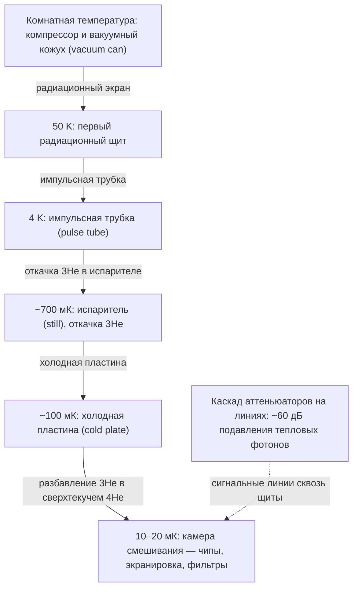

# Криогеника и фабрикация железа

Кубит — половина истории; вторая половина — вся инженерная обвязка: как охладить чип до 10 мК, как подвести к нему тысячи микроволновых линий и как это все изготовить в чистой комнате. Урок — «инкубатор» понимания, откуда в `backend.target.qubit_properties` берутся странные значения вроде `T1 = 213 us` и почему readout и двухкубитные ошибки расходятся от пары к паре.

## Dilution refrigerator: как получить 10 мК

Рабочая лошадка сверхпроводниковых кубитов — **dilution refrigerator** (дилюционный криостат). Принцип: растворение $^{3}$He в $^{4}$He ниже 0.87 K идёт с поглощением энтальпии — охлаждение «испарительного типа», но при фиксированном объёме. Смесь циркулирует по замкнутому контуру: компрессор → импульсная трубка (pulse tube, обеспечивает 4 K) → испаритель (still, ~700 мК, где $^{3}$He откачивается) → cold plate (~100 мК) → камера смешивания (mixing chamber, 10–20 мК), где и происходит собственно разбавление $^{3}$He в сверхтекучем $^{4}$He.

```
 Room T   ─── vacuum can (вакуумный кожух)
 50 K     ─── первый радиационный щит
 4 K      ─── pulse tube (импульсная трубка)
 Still    ─── ~700 мК, здесь откачивается 3He
 Cold plate ── ~100 мК
 Mixing chamber ~10–20 мК: чипы, экранировка, фильтры
```

Типичная криомощность: 0.5–2 мВт на 100 мК — сравните с нВт-тепловыделением самого чипа. Проблема не в охлаждении, а в (a) тепловой нагрузке от сигнальных линий, (b) их шумовой заселённости, (c) вибрациях от пульс-трубки, разрушающих фазовую стабильность микроволновых импульсов.

Сквозь радиационные щиты (50 K / 4 K / 0.1 K) сигнальные линии проходят с каскадом аттеньюаторов: −10 −10 −10 … по температурным ступеням; в итоге до чипа доходит лишь тень исходного сигнала — грамотные цепочки дают ~60 дБ подавления тепловых фотонов в полосе кубита. Отдельно: экранирование магнитного поля (μ-metal, Cryoperm), Eddy-фильтры, криогенные коммутаторы, twisted-pair для flux-управления и cryo-CMOS контроллеры (IBM deep cryo control; Intel Horse Ridge — управление на 4 K).



**Как читать схему.** Схема идёт сверху вниз в порядке охлаждения: комнатная температура и вакуумный кожух, затем ступени радиационного экрана, импульсная трубка, испаритель, холодная пластина и камера смешивания, где стоят чипы, экранировка и фильтры. Подписи над стрелками называют механизм перехода между ступенями: собственно разбавление изотопов гелия происходит в самой нижней точке. Пунктирная стрелка показывает отдельный путь сигнальных линий: они проходят сквозь щиты и теряют часть тепловых фотонов на каскаде аттеньюаторов, поэтому до чипа доходит лишь тень исходного сигнала.

- Проверь себя: на какой ступени происходит разбавление 3He в сверхтекучем 4He и чем этот шаг отличается от откачки 3He в испарителе?
- Проверь себя: зачем на входных линиях стоят каскады аттеньюаторов и какие два эффекта они ограничивают?
- Проверь себя: что размещено в камере смешивания и почему именно там, а не на верхних ступенях?

## Сигнальные линии (wiring) — половина проблемы масштаба

На каждый трансмон: drive-линия (микроволны), flux-линия (DC/bias, если tunable), readout-резонатор → коаксиальная линия → IR-фильтры → TWPA/HEMT-усилитель → детектор. На 127 кубитах IBM Eagle это сотни коаксиальных линий, тысячи контактов и десятки ступеней фильтров; каждая усугубляет тепловую нагрузку.

Решения в разработке: мультиплексирование (одна MW-линия на несколько резонаторов), интегральные фотонные подводки, cryo-CMOS-контроллеры, 3D-интеграция чипов. Всё это пока источник инженерных компромиссов между связностью, тепловой нагрузкой и стоимостью.

## Fab: как изготавливают сверхпроводящий чип

Стандартный поток wafer-фабрикации сверхпроводникового чипа:

1. **Подложка**: высокоомный Si или сапфир; чистая комната класса 10–100.
2. **Электронно-лучевая литография**: рисунок джозефсоновских переходов (Джозефсоновский мост Dolan-типа, разрешение < 10 нм).
3. **Депозиция**: Al/AlO$_x$/Al (туннельный барьер — оксид ~1–2 нм, контролируемая оксидация в чистом кислороде) либо Ta/Nb для плёночной обвязки.
4. **Lift-off**: металл осел только где надо; остатки растворяются вместе с фоторезистом.
5. **Оптическая литография** (stepper, 248/193 нм): CPW-резонаторы, проводки, площадки для bonding.
6. **Сухое травление** (RIE/ICP) + fabrication airbridges (прыгающие перемычки над проводками).

Полный цикл wafer (100–200 мм) в промышленном стандарте. Отдельная нитка — PDK (Process Design Kit) подход консорциума OpenSuperQ+100: формализованный «технологический паспорт» fab, где каждый слой нормирован, а контроль ведётся на тестовых чипах. Так квантовая фабрикация двигается к кремниевой дисциплине повторяемости.

Ключевая инженерная сложность: **каждая операция вносит разброс** — а сверхпроводящие устройства крайне чувствительны: вариация толщины барьера джозефсона на проценты сдвигает $\omega_{01}$ на десятки МГц (frequency collisions на чипе становятся реальной риск-статьёй).

## Почему материалы и поверхности — главный bottleneck

Ключевая связь: потери $1/T_1$ идут не от сверхпроводимости, а от **двухуровневых систем (TLS)** в аморфных оксидах и interfaces:

- подложка/плёнка (Si–Ta) и поверхность/вакуум;
- оксида алюминия внутри junction и на её границах (`junction interfaces`);
- адгезионные слои и границы зёрен плёнки.

Действия последних лет (2019–2025): tantalum для ground plane (аморфный оксид Ta$_2$O$_5$ даёт меньше TLS-потерь, чем NbO$_x$), low-damage deposition, чистое травление, высоковакуумные напыления, улучшение junction-интерфейсов (Princeton/MIT). Результат: когерентность Ta-платформ в индустрии устойчиво уходит за 300–500 мкс T1.

## Где этому учатся

- **Мастер/PhD в физических и инженерных школах**: квантовые группы (QuTech/Delft, ETH, Yale, MIT, KTH, Helsinki), RF-инжиниринг + вакуумная техника.
- **Курсы и тренинги**: RF/microwave circuits, cleanroom training, криогенное оборудование (Bluefors, Oxford Instruments), нанофаб практикумы, wafer-scale programs.
- **Позиции в индустрии**: cryo-инженер (Bluefors, Oxford Instruments), fab-инженер (IBM, IQM, Rigetti, Intel), control electronics (Qblox, Zurich Instruments, Quantum Machines), wafer-тестирование.

Типичный entry-набор: RF-измерения + Linux + Python + опыт работы в чистой комнате — стандартная связка для инженерного найма в отрасли.

## 📚 Узнать подробнее

<details markdown="1">
<summary>Видеолекции (с таймкодами)</summary>

- **How This Machine Keeps Quantum Computers at 0.01 Kelvin, Lukas's Lab** [00:01:25-00:03:38] - блок урока «Dilution refrigerator: как получить 10 мК»: наглядный разбор ступеней криостата и переход к тепло́те растворения (heat of mixing) $^3$He в $^4$He, на которой построен урок. [ссылка](https://youtu.be/Ij19rtPg9hM)
- **A Tour of an IBM Quantum Lab, IBM Research** [00:00:04] - блок урока «Dilution refrigerator: как получить 10 мК»: экскурсия по реальной лаборатории открывается вопросом «насколько холоден квантовый компьютер?» — контекст для mixing chamber и всей обвязки. [ссылка](https://youtu.be/KZf4BSmgdO4)
- **Bluefors: Next Generation of Cryogenics Tailored for Quantum Technologies (Т. Эловаара, Bluefors)** [запись по регистрации] - блок урока «Dilution refrigerator: как получить 10 мК»: дилюционные рефрижераторы XLD и high-density проводка для квантовых процессоров; доступ к записи по регистрации, таймкоды не приводим. [ссылка](https://bluefors.com/webinars/next-generation-of-cryogenics-tailored-for-quantum-technologies/)
</details>

<details markdown="1">
<summary>Статьи и блоги</summary>

- Bluefors stories «How Does a Dilution Refrigerator Work?» - блок урока «Dilution refrigerator: как получить 10 мК»: объяснение цикла охлаждения от производителя — still, heat exchangers, mixing chamber, фазовое разделение изотопов. [ссылка](https://bluefors.com/stories/how-does-a-dilution-refrigerator-work/)
- IBM Quantum blog «How IBM will build the world's first large-scale, fault-tolerant quantum computer» (R. Mandelbaum, J. Gambetta и др.) - блок урока «Сигнальные линии (wiring) — половина проблемы масштаба»: модульные микросхемы и couplers как индустриальный ответ на тепловой бюджет и связность. [ссылка](https://www.ibm.com/quantum/blog/large-scale-ftqc)
</details>

<details markdown="1">
<summary>Книги/статьи (глава/раздел, arXiv)</summary>

- Krantz и др. «A Quantum Engineer's Guide to Superconducting Qubits» (Appl. Phys. Rev. 6, 021318, DOI 10.1063/1.5089550) - блок урока «Fab: как изготавливают сверхпроводящий чип»: инженерный обзор с главы по fab и измерениям — стандартная отправная точка для hardware-трека. [ссылка](https://doi.org/10.1063/1.5089550)
- «Millisecond lifetimes and coherence times in 2D transmon qubits» (Nature 647, 343–348, 2025; DOI 10.1038/s41586-025-09687-4, Princeton; препринт arXiv:2503.14798 «2D transmons with lifetimes and coherence times exceeding 1 millisecond») - блок урока «Почему материалы и поверхности — главный bottleneck»: tantalum-on-high-resistivity-silicon с $T_1$ до 1.68 ± 0.10 мс ($Q = 2.5\times10^7$) — верхняя планка, к которой идут Ta-платформы из урока. [ссылка](https://doi.org/10.1038/s41586-025-09687-4) · [препринт](https://arxiv.org/abs/2503.14798)
</details>

<details markdown="1">
<summary>Русскоязычные ресурсы</summary>

- **Компьютер-предсказатель: зачем нужен квантовый симулятор, Страна-Росатом** — блок урока «Dilution refrigerator: как получить 10 мК»: интервью с Алексеем Устиновым (РКЦ/МИСиС) о сверхпроводниковых квантовых процессорах — почему нужны криогенные системы и как они работают. [ссылка](https://strana-rosatom.ru/2021/07/06/rossijskie-uchenye-razrabatyvajut-kva) — по поиску
- **Квантовые вычисления — Виталий Гребенник, Orel.codes** — блок урока «Fab: как изготавливают сверхпроводящий чип»: обзор квантовых вычислений с акцентом на аппаратную часть и производство чипов. [ссылка](https://youtu.be/nWb_hTHFSno) — проверено через oembed
- **УФН «Управление состояниями в сверхпроводниковых квантовых процессорах» (2022), Вожаков, Бастракова и др.** — блок урока «Почему материалы и поверхности — главный bottleneck»: обзор управления состояниями в сверхпроводниковых процессорах — связь состояний, измерения и коррекции ошибок. [ссылка](https://ufn.ru/ru/articles/2022/5/a) — по поиску
- **УФН «Джозефсоновские твердотельные кубиты» (2004), Пашкин, Астафьев и др.** — блок урока «Fab: как изготавливают сверхпроводящий чип»: ранний обзор джозефсоновских кубитов от группы Астафьева (МФТИ/РКЦ). [ссылка](https://ufn.ru/ru/articles/2004/9/e/) — по поиску
</details>

## ✅ Проверь себя

1. Изобразите по памяти стадии dilution refrigerator и объясните, где именно происходит охлаждение.
2. Зачем нужны каскады аттеньюаторов на входных линиях и какие два эффекта они ограничивают?
3. Какие слои формируют джозефсоновский переход и почему эта стадия литографии особенно щепетильна?
4. Что такое TLS-потери и как они связаны с материалами подложки и поверхностей?
5. В чём практический смысл PDK-подхода для сверхпроводниковой fab?

Пройдите [тест модуля 05](../../tests/05-quiz.md) после консолидации материала.

## ➡️ Что дальше

Завершающий урок модуля — [бенчмаркинг качества железа](05-benchmarking.md): как из (в железе) параметров получить общую оценку и как это читать в дашбордах индустрии.
