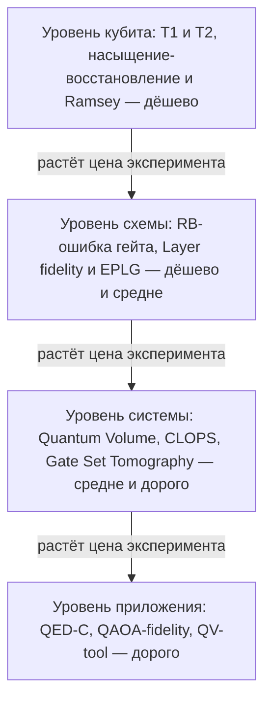

# Как измерить качество квантового компьютера (Benchmarking)

## Не все метрики равны

Число кубитов — плохая метрика: 127 «плохих» кубитов проигрывают 20 «хорошим». Инженерно полезная таблица метрик:

| Уровень | Метрика | Что отвечает | Цена измерения |
|---|---|---|---|
| кубит | $T_1$, $T_2$ | сколько живёт состояние | дёшево (насыщение-восстановление, Ramsey) |
| гейт | RB-ошибка гейта | средняя ошибка 1q/2q | дёшево |
| слой | Layer fidelity / EPLG | деградация на 2q-слое у *всего* процессора | средне |
| процессор | Quantum Volume, EPLG по цепочке | шум + связность + транспиляция | средне |
| скорость | CLOPS | сколько квантовых слоёв-операций в секунду | дорого |
| процесс | Gate Set Tomography | полная матрица процесса | дорого |
| алгоритм | QAOA-fidelity, QV-tool | «посчитает ли он мой код» | дорого |



**Как читать схему.** Схема выстроена как пирамида уровней бенчмаркинга: от уровня отдельного кубита к уровню схемы, затем системы и, наконец, приложения. Подпись над стрелками «растёт цена эксперимента» означает, что каждый следующий уровень ближе к реальной полезной задаче, но требует всё больше машинного времени и усилий, тогда как самый дешёвый уровень — кубитный. Подпись в каждом узле перечисляет метрики этого уровня и их цену измерения по таблице в начале урока; число кубитов в этой пирамиде не участвует, потому что это плохая метрика.

- Проверь себя: почему число кубитов нельзя поставить на место кубитного уровня в пирамиде?
- Проверь себя: на каком уровне появляется Gate Set Tomography и почему для рутинного мониторинга её не используют?
- Проверь себя: какой уровень отвечает на вопрос «сможет ли машина посчитать мой код» и что он требует по времени?

## Randomized benchmarking (RB)

Идея: не собирая детального «профиля шума», оцениваем усреднённую ошибку гейта. Берём случайные последовательности Клиффорд-гейтов длины $m$, затем инвертируем их произведение (дополнительный Клиффорд), чтобы итоговая унитарность была $I$. Идеальная машина вернула бы $|0\ldots0\rangle$ с вероятностью 1; в реальности вероятность возврата экспоненциально падает:

$$P(m) = A\,\alpha^m + B, \qquad \varepsilon_{\text{gate}} = \frac{1-\alpha}{2}\ \text{(1q)},\quad \varepsilon_{2q} = \frac{3\alpha - 1}{4}.$$

Формы RB и их смысл: обычный (standard) RB даёт среднюю ошибку, но не чувствует гейт-специфичные дефекты; **Interleaved RB** (вставка целевого гейта после каждого Клиффорда) выделяет ошибку конкретного гейта; **Layer RB** — RB на «слое» 2q-гейтов — работает на всём процессоре сразу. При масштабировании IBM дополняет это парой **layer fidelity** (LF) и **EPLG** (error per layered gate):

$$\mathrm{LF}(d) = \exp(-d\cdot \text{EPLG}), \qquad \text{EPLG} = -\frac{\ln\mathrm{LF}}{d},$$

где $d$ — число слоёв цепочки. Это средняя 2q-ошибка на каждую пару в слое, объединённая по цепочке процессора (см. IBM-презентации 2023+). Порядок величин на современных 100+ кубитных процессорах: EPLG ~10⁻³ (на лучших парах ниже).

## Quantum Volume (QV)

Маркер IBM (Cross et al., arXiv:1811.12926): «квадратные» (width = depth) схемы из случайных унитарных блоков. Heavy output — результат с амплитудой выше медианы. QV = $2^n$, где $n$ — максимальная ширина, при которой по протоколу (100 схем на размер, статистическая уверенность ≥ 97%) средняя вероятность тяжёлого исхода $\ge 2/3$. QV ловит: readout error, 1q/2q ошибки, связность, сложность транспиляции. Qiskit даёт готовый генератор: функция `qiskit.circuit.library.quantum_volume(...)` (класс `QuantumVolume` помечен deprecated с Qiskit 2.2 и будет удалён в 3.0). Ограничение: QV — метрика «одной картинки»; она не отражает специфику конкретного алгоритма (VQE/QAOA).

## CLOPS и «скорость»

**CLOPS** (Circuit Layer Operations Per Second, IBM, 2021): сколько слоёв параметризованных схем процессор прогоняет за секунду при реальном runtime (батчи, очередь, время repeat-delay). Концептуально: CLOPS растёт с уменьшением времени гейтов и времени считывания; влияет на скорость VQE/QAOA, где нужны сотни–тысячи итераций по параметрам.

$$\text{CLOPS} = \frac{\text{слоёв\_в\_запуске} \times \text{выстрелов}}{\text{время\_полной\_итерации\_параметров}}.$$

Практический маркер: CLOPS ~ десятки тысяч слоёв/с на Heron/Eagle — это то, что ограничивает скорость вариационных алгоритмов.

## Gate Set Tomography: дорогая «полная карта»

GST (пакет pyGSTi, Sandia) — восстановление матриц процесса для выбранного набора гейтов (считывание, 1q-гейты, CNOT): дорогой, но точный метод; он отделяет SPAM-ошибки от ошибок гейтов и даёт gauge-invariant картину шума. На практике применяют к небольшим системам и при разработке процессоров; для рутинного мониторинга слишком тяжело — там правят RB/QV.

## Algorithmic benchmarks: QED-C, QAOA-fidelity

QED-C (Quantum Economic Development Consortium) публикует open-source набор алгоритмических бенчмарков (QAOA, VQE, QFT, Grover и др.) с единым протоколом: запуск на симуляторе и на реальном устройстве, вычисление fidelity против «идеального» распределения для фиксированных размеров задачи. Так ловится не средняя ошибка, а «сможет ли машина посчитать мой код». Похожие сервисы: IQM Benchmarks (облачная платформа IQM с рядом алгоритмических метрик) и Quantum Inspire (QuTech) с бэкенд-инструментами. Прикладное применение: прогон QAOA на MaxCut с оценкой approximation ratio против симулятора — честный «algorithmic» индикатор состояния железа.

## Практический чек-лист перед запуском на железе

```
 1. зафиксировать целевую задачу и её теоретический ответ (на симуляторе)
 2. выбрать бэкенд: проверить связность (coupling_map/target) под мою схему
 3. смотреть 2q-ошибки на нужных рёбрах и readout-ошибки
    (target[name_2q][(a,b)].error, target["measure"][(q,)].error)
  4. оценить бюджет ошибок: depth × ошибка_слоя (плюс вклад простоя: Σ idle / T₁, T₂)
 5. транспилировать (optimization_level=3), сверить depth и число 2q-гейтов
 6. сравнить варианты layout/routing (trivial vs sabre, разные seed)
 7. прогнать smoke-тест (Bell, RB-цепочка) перед полным объёмом
 8. запустить основной job с учётом session/queue бюджета
```

Пример чтения бэкенда в Qiskit (Qiskit ≥ 1.0):

```python
from qiskit_ibm_runtime.fake_provider import FakeSherbrooke
backend = FakeSherbrooke()
target = backend.target
# родной 2q-гейт и его ошибка на паре (10, 11): у Eagle это "ecr",
# у Heron, Nighthawk и Google — "cz"
name_2q = next(n for n in target.operation_names if n in ("ecr", "cz", "cx"))
err_2q   = target[name_2q][(10, 11)].error
# ошибка считывания
err_read = target["measure"][(12,)].error
# времена когерентности и частота
props    = target.qubit_properties[5]   # .t1, .t2, .frequency
# граф связности
print(backend.coupling_map)
```

Замечание: ориентируйтесь на BackendV2 `backend.target` (BackendV1 с его `backend.properties()` устарел): readout-ошибка живёт в `target["measure"][(q,)].error`, 2q-ошибка — в записи родного гейта процессора (`"ecr"` у IBM Eagle, `"cz"` у IBM Heron и Nighthawk, а также у Google), времена когерентности — в `target.qubit_properties[q]`; имя родного 2q-гейта всегда берите из `target.operation_names`, а не из конкретного документа.

## 📚 Узнать подробнее

<details markdown="1">
<summary>Видеолекции (с таймкодами)</summary>

- **Benchmarking near-term quantum computers, IBM Research** [00:01:53-00:10:25] - блок урока «Не все метрики равны»: «пирамида бенчмарков» — от ошибок гейтов к процессорным метрикам — и живой протокол измерения Quantum Volume с результатами. [ссылка](https://youtu.be/DD-JCi0lcLo)
- **Benchmarking near-term quantum computers*, IBM Research** [00:07:42-00:08:41] - блок урока «Quantum Volume (QV)»: точечный фрагмент про определение QV и критерии успеха теста (порог 2/3), о котором говорит формула урока. [ссылка](https://youtu.be/DD-JCi0lcLo)
- **Not All Benchmarks Are Created Equal, Simons Institute for the Theory of Computing** [00:41:38-00:56:56] - блок урока «Randomized benchmarking (RB)»: direct randomized benchmarking, зачем в протоколе клиффорд-гейты, и выход на объёмные (volumetric) метрики уровня «Layer fidelity / EPLG». [ссылка](https://youtu.be/XskSHchkn2g)
</details>

<details markdown="1">
<summary>Статьи и блоги</summary>

- Google blog «Meet Willow, our state-of-the-art quantum chip» (Х. Невен) - блок урока «Не все метрики равны»: как выбирается бенчмарк верхнего уровня — у Willow это random circuit sampling «ниже порога» вместо числа кубитов. [ссылка](https://blog.google/technology/research/google-willow-quantum-chip/)
- IBM Quantum Learning «Running quantum circuits» (курс Quantum Computing in Practice) - блок урока «CLOPS и «скорость»»: актуальный справочник метрик процессора — EPLG, CLOPS и три «первичные» характеристики (scale, quality, speed); лежит рядом с чек-листом урока. [ссылка](https://quantum.cloud.ibm.com/learning/en/courses/quantum-computing-in-practice/running-quantum-circuits)
</details>

<details markdown="1">
<summary>Книги/статьи (глава/раздел, arXiv)</summary>

- Cross, Bishop, Sheldon, Nation, Gambetta «Validating quantum computers using randomized model circuits» (arXiv:1811.12926; Phys. Rev. A 100, 032328) - блок урока «Quantum Volume (QV)»: первоисточник метрики и протокола — heavy outputs, 100 схем, статистическая уверенность. [ссылка](https://arxiv.org/abs/1811.12926)
- McKay и др. «Benchmarking Quantum Processor Performance at Scale» (arXiv:2311.05933) - блок урока «Randomized benchmarking (RB)»: протокол layer fidelity на цепочке 80–100 кубитов и метрика EPLG, которую урок выписал формулой $\mathrm{LF}(d) = \exp(-d\cdot\text{EPLG})$. [ссылка](https://arxiv.org/abs/2311.05933)
</details>

<details markdown="1">
<summary>Русскоязычные ресурсы</summary>

- **Бенчмаркинг квантовых компьютеров: Исследовательский систематический обзор литературы, alphaXiv** — блок урока «Не все метрики равны»: систематический обзор бенчмарков квантовых компьютеров — таксономия, метрики, стандартизация. [ссылка](https://www.alphaxiv.org/ru/abs/2509.03078) — по поиску
- **Обзор и подборка метрик и бенчмарков для квантовых компьютеров: определения, методологии и программное обеспечение, alphaXiv** — блок урока «Не все метрики равны»: комплексная система оценки качества квантовых компьютеров по уровням — от кубитов до приложений. [ссылка](https://www.alphaxiv.org/ru/abs/2502.06717) — по поиску
- **Бенчмаркинг квантовых компьютеров: от кубитов к производительности, Colobridge** — блок урока «Практический чек-лист перед запуском на железе»: практический обзор бенчмаркинга квантовых компьютеров — метрики, стандартизация, приложения. [ссылка](https://blog.colobridge.net/2025/05/benchmarking-quantum-systems/) — по поиску
- **Масштабный бенчмаркинг производительности квантовых процессоров, alphaXiv** — блок урока «Randomized benchmarking (RB)»: обзор статьи McKay и др. о масштабном бенчмаркинге процессоров — layer fidelity и EPLG. [ссылка](https://www.alphaxiv.org/ru/abs/2311.05933) — по поиску
</details>

## ✅ Проверь себя

1. Объясните формулу QV: почему именно «квадратные» схемы и что означает порог 2/3?
2. Что такое EPLG и почему он считается полезнее отдельного 2q-гейта в отчёте?
3. Что входит в CLOPS-оценку и почему эта метрика ограничивает вариационные алгоритмы?
4. Почему RB на «произвольных random-схемах» даёт лишь среднюю оценку, а не точный профиль вашей задачи?
5. Опишите бэкенд-доступ в Qiskit: где взять readout error, T1/T2 и coupling map.

Пройдите [тест модуля 05](../../tests/05-quiz.md).

## ➡️ Что дальше

Модуль «Железо» окончен. Вернитесь к [README модуля](README.md) и переходите к проекту [01-transpiler-benchmark](../../projects/01-transpiler-benchmark.md): метрики урока применяются к реальному транспилятору под две топологии.
