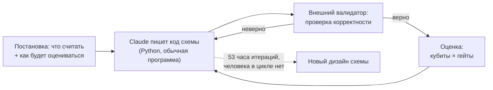

# Разбор: Claude проектирует квантовые цепи эффективнее готовых

Источники этого разбора — два документа, вышедших 16 октября 2026 года: [пост Anthropic](https://www.anthropic.com/research/designing-efficient-quantum-circuits) и [статья на arXiv](https://arxiv.org/abs/2610.22367) «Discovering state-of-the-art quantum circuits with large language models». Работу вела **Анди Гу (Andi Gu)** в рамках STEM Fellows Program Anthropic, при менторстве **Алека Кемени (Alek Kemeny)** — квантового физика Anthropic; соавторами выступили **Сюзанна Елин (Harvard)** и **Михаил Лукин (Harvard + QuEra Computing)**.

Читайте это как разбор статьи из [урока 01](01-how-to-read-paper.md): тип статьи, главное утверждение, модель затрат, где искать доказательство.

## О чём статья и в чём её утверждение

**Тип статьи:** системная инженерия + методология автоматического дизайна. Это не «новый алгоритм, доказанное превосходство» и не «эксперимент на железе». Это — **конструкция с таблицей ресурсов**: авторы берут восемь вычислительных примитивов и показывают, что найденные для них схемы дешевле лучших опубликованных.

**Главное утверждение** (одно предложение с числами): если дать LLM текстовое описание того, что должна считать квантовая схема, и внешнюю программу, которая проверяет правильность и ставит оценку, то в семи задачах из восьми будут найдены схемы, которые одновременно экономят и кубиты, и гейты, а в восьмой (сложение точек на эллиптической кривой) будет найдена **новая обратимая архитектура** модулярной инверсии, недостижимая для классического divsteps.

По самой статье: в семи из восьми задач найденные схемы «significantly reduce both Toffoli and qubit counts relative to the state of the art», в восьмой — «a new reversible architecture for prime-field modular inversion», которая «makes divsteps viable and substantially improves the Toffoli-qubit trade-off».

**Мотивация, из которой выросли числа.** Авторы начинают с FeMoco — кластера Fe–Mo в активном центре фермента нитрогеназы, который бактерии используют для превращения азота воздуха в аммиак. Оценка 2017 года (Reiher et al., [arXiv:1605.03590](https://arxiv.org/abs/1605.03590)) требовала **около 50 триллионов гейтов Toffoli** для расчёта энергии основного состояния молекулы. Серия алгоритмических улучшений — Berry (2019), von Burg (2021), Lee (2021), Rocca (2024) и, наконец, Low et al. (2025) через spectrum amplification ([arXiv:2502.15882](https://arxiv.org/abs/2502.15882), PRX 15, 041016) — сжала оценку до **около 340 миллионов Toffoli**: примерно в **150 000 раз** дешевле, то есть «несколько часов» на будущей машине с ~3 миллионами физических кубитов. Обе оценки — для одной и той же 54-орбитальной модели FeMoco, как они сведены в таблице 1 у Low et al.

И ключевой вывод поста, ради которого всё затевалось:

> «These reductions largely came from redesigning the circuits that carry out the computation, rather than from making better hardware.»

То есть выигрыш дало **перепроектирование схем**, а не улучшение железа. Это ровно тот сдвиг, который обсуждает весь [модуль 04](../04-systems-design/README.md): пока аппаратная часть упирается в физику, самая дешёвая оптимизация — та, что в компиляторе и в математике.

## Схема метода: closed loop с внешним валидатором

Задача формулировалась **одним абзацем**: правило вычисления + описание того, как валидатор будет проверять каждую предложенную схему на корректность и оценивать её по числу кубитов и числу гейтов. Отдельно в постановке было сказано: исследовать несколько подходов **параллельно**.



Почему этот цикл работает **именно** для квантовых схем — три причины, которые авторы перечисляют прямо:

1. **Квантовый алгоритм — это код.** Цепь описывается программой, значит её можно писать, запускать и править как обычный код. Это не «рисунок схемы», который нужно верстать в редакторе.
2. **Корректность проверяется классически и дёшево.** Для выбранного класса задач каждый вход даёт один определённый выход, который обычный компьютер может проверить. Значит, внешняя программа может отсеивать неверные предложения автоматически.
3. **Оценка проста и объективна.** «Число кубитов × число гейтов» — скучная, но однозначная величина; оптимизировать её не нужно, её нужно просто сообщать модели на каждом шаге.

Заметьте, что здесь нет ни «промпта-магии», ни «доверьтесь модели». Есть **измеримая целевая функция** и **внешняя проверка**. Это ровно тот же каркас, что и в инженерной оптимизации: спецификация + оценка + цикл.

За 53 часа работы с минимальным участием человека (только исходная постановка и изредка подсказки «подумай шире») на задаче сложения точек на эллиптической кривой был получен принципиально новый подход.

## Ограничения квантовой цепи, о которых статья напоминает

Это, пожалуй, самая полезная часть поста для инженера: авторы явно перечисляют два ограничения, которые обычный программист не держит в голове.

**Ограничение 1: в квантовой цепи нет ветвления.** Обычная программа может проверить значение и выполнить одну из двух веток. Квантовый компьютер работает на суперпозиции входов сразу: часть входов пошла бы по первой ветке, часть — по второй, поэтому схема обязана содержать операции **для обеих** при каждом запуске. Это значит, что «если вход special-case, сделай иначе» на языке цепей невозможно: придётся всегда делать оба варианта.

**Ограничение 2: ничего нельзя стереть.** Каждый шаг квантовой цепи обратим. Промежуточный «черновик», который обычная программа просто затирает, в квантовой схеме нельзя удалить. Оставить его тоже нельзя — он испортит результат. Единственный способ избавиться от информации — **uncompute**: прогнать вычисление, её породившее, в обратном порядке, заплатив дополнительными гейтами.

Отсюда — центральный компромисс, который обсуждает вся статья: **время против памяти**. Один полюс — uncompute промежуточный результат сразу после использования: кубиты освобождаются, но если он понадобится снова, его придётся пересчитать (гейты растут, время растёт). Другой полюс — хранить всё до последнего: повторов нет, но кубитов может понадобиться заметно больше.

Связь с курсом: обратимость и «считать в обратную сторону» — это то, чем занимается [урок про QFT и Шора](../03-algorithms/02-qft-shor.md) (обратное преобразование Фурье) и [problem-set-03](../03-algorithms/problem-set-03.md); ограничения по числу кубитов и связности — это [модуль 04](../04-systems-design/01-architecture-models.md) и [урок про routing](../04-systems-design/03-routing-mapping-sabre.md). Обратите внимание на асимметрию: в классической программе вы выбираете, что хранить, свободно; в квантовой схеме этот выбор — часть стоимости.

## Два результата по шагам

### Модулярная инверсия через divsteps

**Задача.** Сложение точек на эллиптической кривой — ядро квантовых алгоритмов дискретного логарифма: дана начальная точка и результат её n-кратного сложения, найти n. Такие задачи «легко считать, крайне трудно обратить» — и потому они давно стали стандартным бенчмарком квантовых цепей.

**Где всё дорого.** Почти вся стоимость сложения точек — в одном шаге: **модулярная инверсия**. Это «деление по модулю»: для целого $a$ найти $x$, такое что $ax \equiv 1 \pmod p$.

**Почему классический лучший метод не подходит.** На обычных компьютерах модулярную инверсию считают методом **divsteps** (это метод из блокчейн-криптографии, в классической литературе — [Bernstein–Yang, TCHES 2019](https://tches.iacr.org/index.php/TCHES/article/view/8298)). Он начинает с пары чисел и много раундов упрощает её: в каждом раунге условно **меняет местами, складывает, вычитает или делит на два**. Проблема не в алгоритме, а в обратимости.

Запоминать, **какая именно из четырёх операций была выбрана** в каждом раунде (это и есть *branch information*), классической программе не нужно: этот «черновик» выбрасывается нафиг. Квантовой схеме — нужно: чтобы вычисление можно было прогнать назад. Наивная квантовая версия divsteps вынуждена **накапливать длинную историю ветвлений**, а под неё нужно огромное число дополнительных кубитов. Именно это и делало divsteps «непрактичным» для квантовой схемы.

**Идея Claude.** А что если историю хранить **не нужно**? Можно **выводить** (декодировать) её прямо из текущей пары чисел: сами числа хранят журнал. Тогда цепь можно крутить назад без единого дополнительного кубита.

**Как это шло.** Первые кандидаты на правило декодирования — простые эвристики — **работали на малых тестах и отваливались на полном размере задачи** (256-битные числа). После этого модель перешла к теоретическому пути: доказала ряд утверждений о процессе итерации, включая несколько новых алгебраических тождеств; из этих тождеств вывела точную формулу правила декодирования; проверила её сначала крупномасштабными численными симуляциями, а затем формализовала утверждение в **Lean**. Итог — первая обратимая реализация divsteps **без хранения branch history**.

**Семейство конструкций.** Декодирование экономит кубиты, но стоит времени. Поэтому Claude варьировал порог, начиная с которого цепь уже **хранит** ветвление вместо того, чтобы его декодировать, и получил семейство решений между двумя полюсами. По сравнению с наименьшей по кубитам из прежних конструкций один из вариантов требует **на 12 % больше кубитов, но в 17 раз меньше гейтов**. База сравнения — работы [Schrottenloher (2026)](https://arxiv.org/abs/2606.02235) и [Luo et al. (2026)](https://arxiv.org/abs/2607.13816) (причём в arXiv-версии Luo et al. это уже третья редакция, v3, с другим пространственным бюджетом, чем v1 — проверяйте версию!).

Обратите внимание на формулировку: это **не «стало лучше по всем показателям»**, а «появилась точка на Pareto-фронте, которой раньше не было». Именно так корректно читать результат.

### Декодер Рида-Соломона: где выиграно 12×

**Задача.** **DQI** (Decoded Quantum Interferometry, [arXiv:2408.08292](https://arxiv.org/abs/2408.08292), Jordan, Shutty, Wootters, Zalcman, Schmidhuber, King, Isakov, Khattar, Babbush; журнальная версия — Nature 646, 831–836, 2025) — квантовый алгоритм оптимизации с потенциально **суперполиномиальным** ускорением. Авторы показали его на задаче **OPI** (Optimal Polynomial Intersection): в каждой позиции сетки $x$ находится несколько допустимых значений $y$, и нужно найти простую кривую (полином низкой степени), проходящую через допустимую клетку в как можно большем числе позиций.

**Где всё дорого.** DQI готовит квантовое состояние, в котором хорошие решения читаются чаще плохих. Для этого используется **корректирующий декодер**, который по компактной сводке восстанавливает короткий список «ошибок». Это и есть самый дорогой шаг алгоритма. Декодер работает со **синдромом** — компактной сводкой ошибок; задача декодера — вывести из синдрома, где и какие ошибки произошли.

**Почему прежняя лучшая схема плохо легла на квантовую цепь.** До сих пор лучшая квантовая схема для этого шага опиралась на **расширенный алгоритм Евклида** ([Khattar et al., 2025, arXiv:2510.10967](https://arxiv.org/abs/2510.10967) — команда Google Quantum AI). А это последовательность делений и обменов, **число и порядок шагов зависят от конкретного входа**. А квантовой схеме приходится обрабатывать все входы **одной фиксированной последовательностью гейтов**. Отсюда — вынужденное растягивание вычисления на много больше раундов, чем нужно любому отдельному входу, и выполнение всех операций в каждом раунде, даже когда они не нужны.

**Новая структурная идея.** Claude перестроил цепь вокруг **алгоритма Берлекампа–Мэсси**: он читает синдромы по одному и постепенно вырабатывает простейшее правило, предсказывающее каждое число по предыдущим. Когда правило найдено, оно раскрывает ошибки. В отличие от расширенного алгоритма Евклида, Берлекамп–Мэсси выполняет **одинаковый шаг в каждом раунде и всегда делает одинаковое число раундов** — а это ровно то, что требуется от квантовой схемы с одной фиксированной последовательностью гейтов.

**Вторая половина задачи — обратимость.** В каждом раунде цепь вычисляет временные величины, нужные лишь на мгновение. Удалить их нельзя (обратимость), а хранить — слишком дорого. Claude применил **тот же приём, что и с divsteps**: большую часть этой информации можно восстановить из текущего состояния схемы. Но несколько «особых» значений восстановить нельзя — их приходится сохранять.

**Как измеряли, сколько именно.** Резервировать память на худший случай (особое значение возникает в 35 разных раундах) — дорого: это **665 кубитов**. Claude написал быстрый симулятор, прогнал **403 000 000 сэмп-декодирований** и измерил частоту исключений. Почти всегда хватает **одного** сохранённого значения — **19 кубитов**. Примерно **один запуск из 10 000** требует больше и завершается ошибкой, что укладывается в допустимую ошибку задачи.

**Итог.** Итоговые улучшения **сократили число гейтов в декодере в 12 раз** относительно прежней конструкции Google. Авторы подчёркивают: выигрыш дали изменения сразу на трёх уровнях — (1) другой метод (расширенный алгоритм Евклида → Берлекамп–Мэсси), (2) другая архитектура схемы (восстановление временных значений вместо хранения), (3) другой бюджет ресурсов (точное измерение того, сколько памяти и вычислений реально нужно). Ни одно изменение по отдельности не было достаточным.

**Масштаб, ради которого всё затевалось.** Оценки исследователей Google Quantum AI: одна конкретная задача OPI — **около трёх месяцев на суперкомпьютере Frontier** против **примерно часа на будущей квантовой машине** с DQI. И **большая часть этого часа — именно декодирование Рида-Соломона**. Вот почему 12× в декодере — не техническая мелочь, а изменение бюджета всего приложения.

## Что воспроизводит курс

| Приём из статьи | Готовый инструмент в курсе |
|------------------|---------------------------|
| Спецификация вычисления как «чёрный ящик» с одним проверяемым выходом на вход | Оракул и разметка решений: [Гровер](../03-algorithms/01-grover.md) — задание «придумай функцию, которую ищет алгоритм» устроено ровно так же |
| Обратимость, uncompute, «черновик нельзя стереть» | [QFT и Шор](../03-algorithms/02-qft-shor.md) (обратное преобразование Фурье) и [problem-set-03](../03-algorithms/problem-set-03.md) |
| Подсчёт числа гейтов, 2q-гейтов, глубины как функции от реализации | [Транспилятор: внутренности](../04-systems-design/02-transpiler-internals.md) и [проект-бенчмарк транспилятора](../../projects/01-transpiler-benchmark.md) |
| Компромисс «кубиты ↔ время» под ограничения связности | [Модели архитектур](../04-systems-design/01-architecture-models.md), [роутинг и SABRE](../04-systems-design/03-routing-mapping-sabre.md) |
| Декодер: синдром → цепочка ошибок | [Исправление квантовых ошибок](../03-algorithms/04-error-correction.md) — 3-кубитный код даёт синдром, поверхностный код даёт его в масштабе |
| T-count, Toffoli-count, перевод оценок в физические единицы | [Бенчмаркинг](../05-hardware/05-benchmarking.md) |

Обратите внимание на строчку про T-count и Toffoli. Это и есть «мост» между статьёй и вашей работой: авторы считают в Toffoli (это язык оценок «когда справится суперкомпьютер»), вы в курке считаете в 2q-гейтах и времени (это язык реального железа). Свести их — отдельная задача, и именно она делает разбор статьи полезным, а не просто интересным.

## Практика: свой closed loop на задачах курса

Мини-проект на 30–40 минут. Смысл — повторить **конструкцию** метода из статьи на маленькой задаче, где вы всё понимаете.

**Шаг 1. Написать валидатор.** Внешняя программа, которая проверяет корректность схемы и ставит оценку — ровно как в статье, только оценка попроще: число кубитов × число гейтов.

```python
from qiskit import QuantumCircuit, transpile
from qiskit.quantum_info import Operator
from qiskit.transpiler import CouplingMap

TWO_QUBIT_GATES = {"cx", "cz", "ecr", "swap", "cp", "rzz"}


def evaluate(candidate: QuantumCircuit, target: QuantumCircuit) -> dict:
    """Внешний валидатор: проверка корректности + оценка стоимости схемы."""
    if candidate.num_qubits != target.num_qubits:
        return {"correct": False, "reason": "не та ширина"}
    # from_circuit корректно учитывает layout после транспиляции
    if not Operator.from_circuit(candidate).equiv(Operator.from_circuit(target)):
        return {"correct": False, "reason": "не тот оператор"}
    ops = candidate.count_ops()
    total = sum(ops.values())
    return {
        "correct": True,
        "qubits": candidate.num_qubits,
        "gates": total,
        "two_qubit_gates": sum(c for n, c in ops.items() if n in TWO_QUBIT_GATES),
        "depth": candidate.depth(),
        "score": candidate.num_qubits * total,   # оценка из статьи
    }
```

**Шаг 2. Задать спецификацию.** Возьмите обратимую функцию, результат которой нужно «расплести» обратно: приготовить состояние Белла $\lvert\Phi^+\rangle = (\lvert 00\rangle + \lvert 11\rangle)/\sqrt 2$ и вернуть систему в исходное состояние $\lvert 00\rangle$. Целевой оператор — тождественный.

```python
identity = QuantumCircuit(2)          # целевой оператор: ничего не меняем


def bell_then_uncompute() -> QuantumCircuit:
    """Вычислить |Phi+> и расплести обратно."""
    qc = QuantumCircuit(2)
    qc.h(0)
    qc.cx(0, 1)      # подготовка
    qc.cx(0, 1)
    qc.h(0)          # uncompute
    return qc


def only_bell() -> QuantumCircuit:
    """Та же работа, но без uncompute: спецификация не выполнена."""
    qc = QuantumCircuit(2)
    qc.h(0)
    qc.cx(0, 1)
    return qc


for name, build in [("вычислить и расплести", bell_then_uncompute),
                    ("только вычислить", only_bell)]:
    print(name, "->", evaluate(build(), identity))
```

Ожидаемый вывод: `вычислить и расплести` корректен и стоит 4 гейта; `только вычислить` отклонён валидатором как «не тот оператор». Вы увидели то же, что видят авторы статьи: **расплести — не бесплатно**, это ещё два гейта, и за это платит вся схема.

**Шаг 3. Прогнать цикл.** Сделайте 3–5 «предложений» и оцените каждое:

1. приготовить $\lvert\Phi^+\rangle$ напрямую (2 гейта, score 4);
2. та же схема с лишней парой `h`/`cx` вхолостую: функция та же, оценка хуже — идеальный пример «правильно, но дороже»;
3. та же схема, разложенная на базис `{rz, sx, x, cx}` без привязки к топологии: посчитайте 2q-гейты и глубину;
4. та же схема, транспилированная под линейную топологию: сравните 2q-гейты и глубину. **Обратите внимание на подводный камень**: после транспиляции раскладка может переставить логические кубиты, и `Operator(circuit)` сравнивает операторы в *физическом* порядке кубитов, т.е. выдаёт «не тот оператор». Правильный способ — `Operator.from_circuit(...)`, который учитывает layout. Это ровно тот класс ошибок, о котором [урок 01](01-how-to-read-paper.md) рассказывает в ловушке №1. Рабочий пример (важно: линия из **двух** кубитов — при трёх транспилятор добавит ancilla, и валидатор отклонит схему по другой причине; и схема должна быть нетривиальной, иначе транспилятор сократит её в ноль):

   ```python
   qc = QuantumCircuit(2)
   qc.h(0)
   qc.cx(1, 0)                      # направление «наоборот» — routing переставит кубиты
   tq = transpile(qc, coupling_map=CouplingMap.from_line(2),
                  basis_gates=["rz", "sx", "x", "cx"], optimization_level=3, seed_transpiler=7)

   print(Operator(tq).equiv(Operator(qc)))                    # False — «не тот оператор»
   print(Operator.from_circuit(tq).equiv(Operator.from_circuit(qc)))  # True — с учётом layout
   print(tq.layout.initial_layout)                            # Layout({1: q0, 0: q1}) — перестановка
   ```

   Вывод: `Operator` без `from_circuit` не учитывает раскладку и «ломает» сравнение; `Operator.from_circuit` — учитывает.
5. вариант, где вы «экономите» кубиты, расплетая раньше: оцените, что выигрыш в кубитах стоит в гейтах — и сравните с компромиссом «+12 % кубитов, но −17× гейтов», который получился в статье.

**Шаг 4. Записать вывод.** Три строчки в заметках: какая метрика оказалась главной; где валидатор ловил ошибки; в какой момент вы поняли, что «просто улучшить готовую схему» не работает так, как в статье.

**Шаг 5 (по желанию).** Закоммитьте цикл с настоящей LLM-ассистентной: сформулируйте спецификацию из шага 2 **одним абзацем** (как в статье), дайте модель-ассистенту доступ к вашему валидатору и посмотрите, что получится. Ожидание стоит затрат: по [посту Anthropic](https://www.anthropic.com/research/designing-efficient-quantum-circuits), модель в таких задачах склонна быть **консервативной** — перепроверять уже проверенное и предпочитать известные методы; помогает требование нескольких **качественно разных** подходов и иногда подсказка «подумай шире». Это наблюдение из статьи стоит перенести в собственную практику: **если просить модель улучшить решение, всегда запрашивайте несколько разных гипотез, а не одну «лучшую версию»**.

## 📚 Узнать подробнее

<details markdown="1">
<summary>Видеолекции (с таймкодами)</summary>

Видеоразбора самой статьи нет: она вышла 16 октября 2026 года, и свежие публикации ещё не успевают попасть в готовые лекционные курсы. Ниже — проверенные лекции, которые дают ровно ту часть, которой в статье нет: ограничения обратимых вычислений и устройство декодера.

- **Лекция 3. Обратимые вычисления (В. И. Яшин, МИАН)** — блок урока «Ограничения квантовой цепи»: почему нельзя «стереть» промежуточный результат и что такое uncompute с точки зрения построения схемы. [ссылка](https://youtu.be/iovXetaetNg)
- **Лекция 2. Вычислительная сложность схем и симуляция (В. И. Яшин, МИАН)** — блок урока «Модулярная инверсия через divsteps»: сложность обратимых арифметических подпрограмм и почему «итеративный метод с ветвлением» плохо переносится в цепь. [ссылка](https://youtu.be/f-yFLRUMRDE)
- **Quantum Error Correction | Understanding Quantum Information & Computation | Lesson 15, Джон Уотрус (Qiskit)** [00:22:20-00:30:05] — блок урока «Декодер Рида-Соломона: где выиграно 12×»: что такое синдром и как из него получают цепочку ошибок — ровно та операция, которую в статье делает декодер. [ссылка](https://youtu.be/9TCIOm8gcVQ)
- **Nick Knows — Routing | Qiskit** — блок урока «Что воспроизводит курс»: сколько стоит купить кубиты — в гейтах и в SWAP'ах. [ссылка](https://youtu.be/jHx7oZfI7jw)

</details>

<details markdown="1">
<summary>Статьи и блоги</summary>

- **Пост Anthropic «Designing more efficient quantum circuits with Claude» (16 октября 2026)** — исходный текст разбора: формулировки, ограничения, числа, признания авторов. [ссылка](https://www.anthropic.com/research/designing-efficient-quantum-circuits)
- **arXiv:2610.22367** — Gu, Kemeny, Yelin, Lukin, «Discovering state-of-the-art quantum circuits with large language models»: полная статья (46 страниц, 10 рисунков, 6 таблиц), включая таблицу ресурсов по всем восьми примитивам. [arXiv](https://arxiv.org/abs/2610.22367)
- **Bernstein, Yang, «Fast constant-time gcd computation and modular inversion» (TCHES 2019, 2019(3), 340–398)** — классическая работа, на которой стоит divsteps: «обычный» метод, который в квантовую цепь не переносился. [TCHES](https://tches.iacr.org/index.php/TCHES/article/view/8298)
- **arXiv:2606.02235** — Schrottenloher, «Optimized Point Addition Circuits for Elliptic Curve Discrete Logarithms»: база сравнения «лучших ранее опубликованных» для точечного сложения. [arXiv](https://arxiv.org/abs/2606.02235)
- **arXiv:2607.13816** — Luo et al., «Quantum Algorithm for Elliptic Curve Discrete Logarithms with Space-Efficient Point Addition»: вторая база сравнения; обратите внимание на версию v3 и на то, что в пространственной сложности был пересчёт. [arXiv](https://arxiv.org/abs/2607.13816)
- **arXiv:2408.08292** — Jordan et al., «Optimization by Decoded Quantum Interferometry» (Nature 646, 831–836, 2025): исходный алгоритм DQI и задача OPI. [arXiv](https://arxiv.org/abs/2408.08292)
- **arXiv:2510.10967** — Khattar et al., «Verifiable Quantum Advantage via Optimized DQI Circuits»: та схема декодера на расширенном алгоритме Евклида, которую Claude перестроил. [arXiv](https://arxiv.org/abs/2510.10967)
- **arXiv:2502.15882** — Low et al., «Fast quantum simulation of electronic structure by spectrum amplification» (PRX 15, 041016, 2025): та самая работа 2025 года, из таблицы 1 которой взят современный бюджет FeMoco. [arXiv](https://arxiv.org/abs/2502.15882)
- **arXiv:1605.03590** — Reiher et al., «Elucidating reaction mechanisms on quantum computers» (PNAS 114, 7555–7560, 2017): исходная оценка ~50 триллионов Toffoli. [arXiv](https://arxiv.org/abs/1605.03590)

</details>

<details markdown="1">
<summary>Книги (глава/раздел)</summary>

- **Nielsen, Chuang «Quantum Computation and Quantum Information»** — глава 3 (разделы о стоимости обратимых вычислений: почему Toffoli — стандартная единица ресурса) и глава 11 (коррекция ошибок). Страница издателя закрыта для автоматических запросов, поэтому прямой ссылки нет — см. доступные альтернативы ниже.
- **Yanofsky, Mannucci «Quantum Computing for Computer Scientists»** — главы об алгоритмах и о коррекции ошибок: «стоимость» схемы и роль декодера с точки зрения программиста. [Cambridge Core](https://www.cambridge.org/core/books/quantum-computing-for-computer-scientists/8AEA723BEE5CC9F5C03FDD4BA850C711)
- **Thomas Wong «Introduction to Classical and Quantum Computing»** — бесплатный PDF; разделы про сложность, оценки ресурсов и декодирование: удобно сверять, как из «Toffoli-count» получается T-count и физическое время. [PDF](https://www.thomaswong.net/introduction-to-classical-and-quantum-computing-1e4p.pdf)
- **Прескилл (Caltech), Ph/CS 219** — глава 7 «Quantum Error Correction»: база для понимания, что такое синдром и что делает декодер. [preskill.caltech.edu](https://preskill.caltech.edu/ph219/chap7_26_6A.pdf)
- **Китаев, Шень, Вялый «Классические и квантовые вычисления»** — раздел об обратимых вычислениях и о кодах: русскоязычная рамка для обоих ограничений из поста. [свободный PDF, МЦНМО](https://old.mccme.ru/free-books/qcomp/qbook.pdf)

</details>

<details markdown="1">
<summary>Русскоязычные ресурсы</summary>

- **alphaXiv (рус.), «Открытие квантовых схем мирового уровня с помощью больших языковых моделей»** — русскоязычный пересказ самой статьи с выводами: удобно, чтобы сначала прочитать сжатую версию, а потом оригинал. Проверено webfetch. [ссылка](https://www.alphaxiv.org/ru/abs/2610.22367)
- **alphaXiv (рус.), «Оптимизация с помощью декодированной квантовой интерферометрии»** — русскоязычный пересказ статьи о DQI: контекст для блока про декодер Рида-Соломона. Проверено webfetch. [ссылка](https://www.alphaxiv.org/ru/abs/2408.08292)
- **alphaXiv (рус.), «Оптимизированные схемы сложения точек для дискретных логарифмов на эллиптических кривых»** — русскоязычный пересказ базы сравнения Schrottenloher 2026. Проверено webfetch. [ссылка](https://www.alphaxiv.org/ru/abs/2606.02235)
- **«53 часа на задачу, над которой учёные бились годами. Claude Mythos сократил расходы на взлом криптографии в 17 раз» (securitylab.ru, 19 октября 2026)** — русскоязычный новостной пересказ с ключевыми числами (53 часа, 403 млн проверок, 19 кубитов, 1 ошибка из 10 000). Ссылка проверена по поисковой выдаче: сайт закрывает автоматические запросы (401). [ссылка](https://www.securitylab.ru/news/578909.php)
- **«Claude от Anthropic проектирует квантовые схемы, требующие до 17 раз меньше гейтов» (Gate News, октябрь 2026)** — ещё один русскоязычный пересказ с акцентом на ресурсные числа. Ссылка проверена по поисковой выдаче: сайт закрывает автоматические запросы (403). [ссылка](https://www.gate.com/ru/news/detail/anthropics-claude-designs-quantum-circuits-requiring-up-to-17x-fewer-gates-25008844)

</details>

## ✅ Проверь себя

1. Назовите три причины, по которым задача «спроектировать квантовую схему» так хорошо ложится на цикл с LLM, и объясните, почему для других задач тот же цикл не сработает так же.
2. Почему необратимость divsteps (в классическом смысле — зависимость от входа) делает метод непригодным для квантовой схемы, хотя сам по себе алгоритм вычислительно дешёвый?
3. В чём суть приёма Claude «декодировать branch information из пары чисел» и почему он не сводится к «просто сохранить ещё пару регистров»?
4. Почему при переходе с расширенного алгоритма Евклида на Берлекампа–Мэсси выигрыш в числе гейтов составил 12×, а не, скажем, 2×? Какой из трёх уровней изменения здесь сработал?
5. Авторы пишут: «результат по эллиптической кривой — не притирка готовой схемы, а новая методология». Проверьте это утверждение по таблице ресурсов: какой признак в ней это показывает?
6. Пост признаёт, что модель была «консервативной» и предпочитала известные методы. Какие две меры они приняли и почему без них результат по divsteps, скорее всего, не появился бы?

**Ответы** — в отдельном файле: [answers/02-anthropic-efficient-circuits.md](answers/02-anthropic-efficient-circuits.md). Сначала ответьте сами, потом открывайте ключи: в них важна логика рассуждения, а не «правильное слово».

## ➡️ Что дальше

Второй разбор — про статью другого типа: не конструкция схемы, а **измерение на реальном железе**. [Разбор: Google Willow — порог поверхностного кода](03-google-willow-qec.md).
